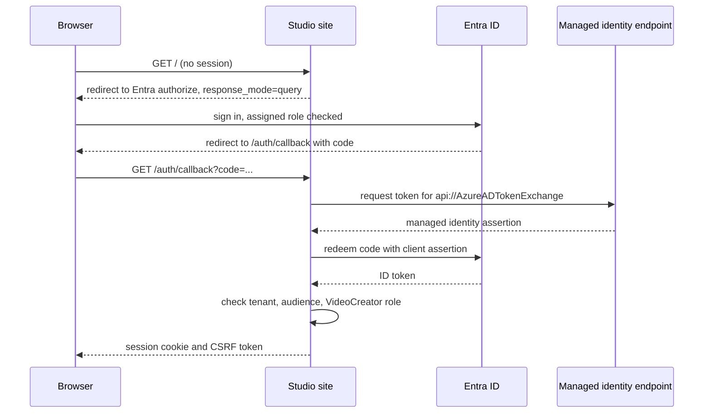

import WhoWhatWhy from '@site/src/components/WhoWhatWhy';

<WhoWhatWhy
  who="Security and identity owners, and the engineers who review role assignments before approving a deployment"
  what="Which identity does what, the exact roles Terraform grants, what the manual Entra bootstrap creates, and how a login flows."
  why="So you can approve the permissions with full knowledge of them, and recognise a 403 as an identity problem or a network problem."
/>

## Identities

The studio runs as user-assigned managed identities, plus the human operators. No secret is stored in Terraform, in app settings or in the image.

| Identity | Name | Used by |
| --- | --- | --- |
| Workspace identity | `id-<stem>-workspace` | The Azure ML workspace, to read the datastore, the vault and the registry. One per region. |
| Compute identity | `id-<stem>-gpu` | The GPU job. Its client ID is `AzureMl__ComputeIdentityClientId`. One per region. |
| Site identity | `id-<stem>-portal` | The shared web app, only when `portal` is set. Its client ID is `AZURE_CLIENT_ID`. It runs the hosted lifecycle. |
| Operator | `operator_principal_id` | A human running the independent recovery. This is an Entra object ID. |
| Publisher | `publisher_principal_id` | The build and promotion identity. Optional. Null grants no release-publication access. |

Mixing these up is the most common cause of `403` errors. The site identity submits jobs, reads storage and runs Start and Stop. The compute identity is the one the job runs as, so it is the one that writes video.

## Roles Terraform assigns

Regional role assignments are created in `infra\modules\region\foundation.tf`. The site's assignments are in `infra\portal.tf` and `infra\operations-rbac.tf`. Each assignment name is a deterministic UUID, so reruns do not duplicate it. This table is a summary. `docs\operations\ownership-and-permissions.md` has the exact action families and evidence, and the grants have not been validated in a real tenant.

| Principal | Role | Scope |
| --- | --- | --- |
| Workspace identity | Storage Blob Data Contributor | Storage account |
| Workspace identity | Key Vault Secrets Officer | Key Vault |
| Workspace identity | AcrPull | Container registry |
| Compute identity | Storage Blob Data Contributor | The `wan-studio` container |
| Compute identity | Storage Blob Data Reader | The `wan-release` container |
| Compute identity | AcrPull | Container registry |
| Operator | Storage Blob Data Contributor | The `wan-studio` and `wan-release` containers |
| Operator | AcrPush | Container registry |
| Operator | AzureML Data Scientist | Azure ML workspace |
| Operator | A custom lifecycle and recovery role | The workspace, compute identity, subnets and resource group |
| Publisher | Storage Blob Data Contributor | The `wan-release` container |
| Publisher | AcrPush | Container registry |
| Publisher | Custom roles for environment and model registration, and for one storage metadata read | Workspace, storage account |
| Site identity | Storage Blob Data Contributor | The `wan-studio` container, and `wan-control` for the host |
| Site identity | Storage Blob Data Reader | The `wan-release` container, for release verification |
| Site identity | A custom job-submitter role, one per workspace | Azure ML workspace |
| Site identity | AcrPull | Container registry |
| Site identity | Custom lifecycle permissions: compute and job management, subnet read and join, SKU and usage reads | Each workspace, compute identity, subnet and, with managed egress, the owned egress resources |
| Site identity | Cognitive Services OpenAI User | Your Foundry resource, only when `agent.resource_id` is set |
| Site identity | Key Vault Secrets User | Your Key Vault, only when `key_vault_id` is set |

The operator gets service-scoped access and no subscription Owner role. The identity that applies the foundation needs rights to create these assignments. Contributor alone does not include `Microsoft.Authorization/roleAssignments/write`, so pair it with User Access Administrator or Role Based Access Control Administrator at the scope Terraform deploys into. Confirm the exact role with your subscription owner before the first foundation apply.

No client secret is created, so no one needs a Key Vault role for sign-in.

A new role assignment is not instant. If the site returns `403` right after a foundation apply or a server deployment, wait a few minutes, then restart the site because it caches tokens.

## Release assets live where the site cannot write them

Storage is split in three. The promoted code and model snapshots go to the `wan-release` container, reached through the `wan_release` datastore. Licence records go there as well. Run data stays in `wan-studio`: uploaded reference images under `studio/web-inputs/` and generated video under `video-library/`. Operational state lives in `wan-control`, which is not an Azure ML datastore.

The site identity holds Blob Data Contributor on the `wan-studio` container and Reader on `wan-release`. It cannot write releases. None of the grants is account-scoped. A compromised site can therefore write inputs and read videos, and it still cannot rewrite the code a GPU node is about to execute. The compute identity gets Storage Blob Data Reader on `wan-release`, so the job reads its own code and weights and cannot overwrite them. No GPU role reaches `wan-control`.

The workspace role is custom too. The submitter role is defined per workspace, scoped to that workspace, and assignable only there. It lets the site read, submit and cancel jobs, read computes, datastores, environments and models, and use experiments and workspace metadata. Writes to datastores, environments, models, v2 data assets and code assets sit in `not_actions`. So the site cannot repoint `wan_release` at storage it controls, and it cannot register an environment or model of its own. AzureML Data Scientist allowed all of that. Only the publisher and the operator can register those assets.

One group of actions does carry write rights: the legacy dataset API.

```hcl title="infra\portal.tf"
"Microsoft.MachineLearningServices/workspaces/datasets/read",
"Microsoft.MachineLearningServices/workspaces/datasets/registered/read",
"Microsoft.MachineLearningServices/workspaces/datasets/registered/write",
"Microsoft.MachineLearningServices/workspaces/datasets/unregistered/read",
"Microsoft.MachineLearningServices/workspaces/datasets/unregistered/write",
```

The site can therefore register and update v1 dataset entries in the workspace. It still cannot write the blobs behind them on `wan-release`, and the newer `workspaces/data/write` path stays denied, so this does not reopen the release-tampering route. Treat the dataset list in the workspace as something the site can change, and review it the same way you review its jobs.

Every way of reading a secret is excluded as well. Two of the `actions` are wildcards, `experiments/*` and `metadata/*`, and a wildcard quietly picks up whatever the resource provider adds under it. That is why `metadata/listsecrets/action` is listed explicitly alongside `workspaces/listKeys/action` and `datastores/listSecrets/action`: without it, the metadata grant would hand the site the workspace connection secrets. This excerpt of the `not_actions` list in `infra\portal.tf` shows the entries that matter most for that:

```hcl title="infra\portal.tf"
not_actions = [
  "Microsoft.MachineLearningServices/workspaces/datastores/write",
  "Microsoft.MachineLearningServices/workspaces/environments/versions/write",
  "Microsoft.MachineLearningServices/workspaces/models/versions/write",
  "Microsoft.MachineLearningServices/workspaces/codes/write",
  "Microsoft.MachineLearningServices/workspaces/listKeys/action",
  "Microsoft.MachineLearningServices/workspaces/datastores/listSecrets/action",
  "Microsoft.MachineLearningServices/workspaces/metadata/listsecrets/action",
]
```

The release container is created by Terraform and guarded with `prevent_destroy`. The build and promotion pipelines do not create it, because container-scoped data roles cannot create containers, so a missing container means the foundation has not been applied. The health page reports an error when `AzureMl__ReleaseContainer` equals `AzureMl__Container`, or the two datastore names match.

## Hardening that the Terraform sets

| Resource | Setting |
| --- | --- |
| Storage | Shared-key access off, public blob access off, public network access disabled, TLS 1.2, Entra-only data access |
| Key Vault | RBAC authorization, purge protection, 90-day soft delete, public network access disabled |
| Registry | Premium, admin user off, anonymous pull off, public network access disabled |
| Azure ML workspace | Public network access disabled, identity-based datastore authentication |
| Compute, created by hosted Start | No node public IP, remote login disabled. The recovery script and the host check the cluster shape. |
| Web app | HTTPS only, TLS 1.2, FTP and WebDeploy basic authentication disabled, public access disabled |

## Hardening inside the application

The site adds its own layer, which no Terraform variable turns off:

| Control | What it does |
| --- | --- |
| Security headers | `X-Content-Type-Options: nosniff`, `Referrer-Policy: no-referrer`, `X-Frame-Options: DENY` and a Content-Security-Policy on every response, including 401s. Scripts are `'self'` only; `media-src` names your storage account's blob host when `Storage__Backend` is `azure`. |
| Session cookie | `__Host-wan_session` on an https origin: `Secure`, `Path=/`, no `Domain`, `HttpOnly`, `SameSite=Lax`. |
| Anonymous surface | Only the sign-in paths, `/healthz`, `/health`, `/alive`, `/`, `/videos` and the built UI's own files are reachable without a session. A new route is protected by default. |
| Rate limits | `POST /api/submit` and `POST /api/agent` use the normalized Entra `oid`, so display-name changes do not reset quotas or merge creators. None mode shares one local bucket. Rejections return 429 with a JSON error. |
| Request bodies | 32 MB by default, 324 MB for a submit, 512 MB for a vision video upload. |
| Trainer containers | Run with no network, all capabilities dropped, no privilege escalation and a pid ceiling. Linux requires a non-root API and uses its effective UID/GID with a private output mount. Cancellation attempts bounded removal by name; daemon failure can leave a container running. |

The ceilings and limits are in [deployment configuration](../configuration.mdx). The reasoning behind the sign-in rules is in the developer [auth page](/developers/domains/auth).

## Entra app registration

The sign-in objects are not in Terraform, and nothing in a pipeline or the web host creates them. An identity owner does the one-time bootstrap by hand, following `docs\operations\entra-bootstrap.md`. The repository never holds tenant-administrator rights. Everything is single-tenant.

| Object | Value |
| --- | --- |
| Application | `WAN Safety Studio`, `AzureADMyOrg`, tagged `wan-safety-studio` and `deployment:<deployment_name>` |
| App roles | `VideoCreator` (creates videos) and `StudioAdmin` (Start, Stop, release selection and settings), both member type User |
| API permissions | Microsoft Graph delegated `openid` and `profile`, nothing else |
| Redirect URI | `https://<site hostname>/auth/callback`. Add `http://localhost:<port>/auth/callback` only for a developer machine that signs in. |
| Enterprise application | Assignment required |
| Groups | A creators group assigned to `VideoCreator`, and a separate, small administrators group assigned to `StudioAdmin` |
| Federated credential | Issuer `https://login.microsoftonline.com/<tenant-id>/v2.0`, subject is the site identity's principal (object) ID, audience `api://AzureADTokenExchange` |

The identity owner adds people to the groups. Assigning a person to a group is the access decision. An administrator who should not create videos gets only `StudioAdmin`. The group-to-role assignment needs an Entra ID P1 or P2 license.

The hosted site holds no client secret, and the bootstrap creates none. It proves itself to Entra with a client assertion issued to its managed identity, which the federated credential trusts. There is nothing to rotate. If the site identity is replaced, update the credential's subject. If a secret was created for an earlier version, remove it.

Sign-in shows "Need admin approval" until a tenant-wide consent exists. Entra does not allow self-consent on an assignment-required app, so an administrator grants consent for `openid` and `profile`. That needs an active Cloud Application Administrator, Application Administrator, Privileged Role Administrator or Global Administrator role. If the tenant already holds a consent grant for this application with any other scope, the runbook says to stop and have the identity owner review it.

The registration name is fixed, so one tenant supports one deployment at a time. The runbook tells the owner to stop and review if an existing registration of that name is not single-tenant, lacks the tags or declares other permissions.

`Auth__ClientId` and `Auth__PublicOrigin` are ordinary app settings that the deployment owner sets afterwards, with the rest of the site's settings. Terraform sets no app settings. See [Configuration](../configuration.mdx).

## Sign-in flow



The server accepts the token only when it is from the configured tenant, its audience is the registration's client ID and its `roles` claim contains `VideoCreator` or `StudioAdmin`. The session carries exactly the roles held: creator routes need `VideoCreator` and `/api/studio/*` needs `StudioAdmin`. Reading the resulting session cookie also requires a valid GUID `oid`; a cookie without one is treated as unauthenticated. The creator key stays internal; `/api/session` adds only `isCreator` and `isAdmin`.

Sessions use protected cookies. Persisted data-protection keys let them survive a restart; the server remains single-instance because its work queue and job index are process-local. API writes need the CSRF token and a matching origin. The deployment owner sets `Auth__PublicOrigin` to `https://<site hostname>`, and the host check rejects anything else.

But creators never get an Azure token. All Azure calls use the site identity.

## Reading a 403

| Where | Likely cause |
| --- | --- |
| Foundry from the helper | DNS or routing, not a role. See the [networking pattern](./networking.mdx#pattern-a-private-foundry-or-ai-endpoint-in-another-vnet-or-region). |
| Gallery or job list from the site | Site identity lacks Blob Data Contributor on `wan-studio` or the job-submitter role, or the role is still propagating. |
| Job cannot pull the image or read models | Compute or workspace identity lacks AcrPull, Blob Data Contributor on `wan-studio`, or Blob Data Reader on `wan-release`. |
| `/api/studio/*` returns 403 | The session lacks the `StudioAdmin` role. Check group membership and the group's app role assignment. |
| A pipeline step against the registry, storage or workspace | The step's federated identity lacks its role, or private DNS and routing from the runner are not working. |
