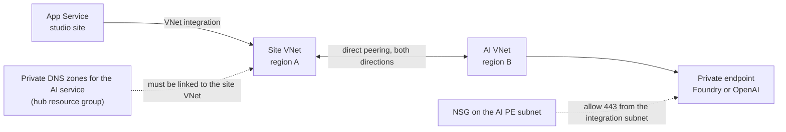

import WhoWhatWhy from '@site/src/components/WhoWhatWhy';

<WhoWhatWhy
  who="Network owners and the engineers who wire the studio into a hub-and-spoke landing zone"
  what="The subnets, private endpoints and DNS zones the studio needs, the GPU NSG baseline, and how to reach a private AI endpoint in another network."
  why="Most failed first deployments are DNS or routing problems, and Terraform cannot fix either because it never owns your network."
/>

## Subnets

You supply the subnets for each region, plus one for the shared host. Terraform validates them and refuses to continue when a check fails.

| Subnet | Used by | Requirements |
| --- | --- | --- |
| GPU subnet (`gpu_subnet_id`) | The `wan-gpu` cluster that hosted Start creates | Dedicated to this studio. Exact CIDR matches `gpu_subnet_cidr`. `defaultOutboundAccess` is `false`. No service delegation. In the same region as that entry. |
| Private endpoint subnet (`private_endpoint_subnet_id`) | Five private endpoints per region | Distinct from the GPU subnet. Same region as that entry. One IP per endpoint. |
| Integration subnet (`portal.subnet_id`) | App Service outbound VNet integration and the shared host's private endpoint | Only when `portal` is set. Delegated to `Microsoft.Web/serverFarms`, empty, distinct from every GPU and PE subnet, in `control_region`. `/28` is the minimum and `/26` is recommended. |

These checks live in the `terraform_data.landing_zone` guard in `infra\modules\region\landing-zone.tf`. One example:

```hcl title="infra/modules/region/landing-zone.tf"
precondition {
  condition     = try(local.gpu_subnet_properties.defaultOutboundAccess == false, false)
  error_message = "The customer must explicitly disable defaultOutboundAccess on the dedicated GPU subnet before deployment."
}
```

Because `defaultOutboundAccess` is off, an NSG allow rule alone gives the GPU nodes no route out. You either provide routed egress (a firewall or NVA with a UDR) or set `manage_compute_egress=true` for that region. Then the hosted Start creates an owned NAT gateway and public IP and attaches the NAT to the dedicated subnet, and Stop removes them. A NAT provides connectivity only. But it does no destination filtering; the NSG allowlist does that.

## Private endpoints and DNS zones

Terraform creates one private endpoint per service and registers each in a zone you supply.

| Endpoint | Subresource | DNS zone variable | Zone name |
| --- | --- | --- | --- |
| `pe-<stem>-blob` | `blob` | `private_dns_zone_ids.blob` | `privatelink.blob.core.windows.net` |
| `pe-<stem>-file` | `file` | `private_dns_zone_ids.file` | `privatelink.file.core.windows.net` |
| `pe-<stem>-vault` | `vault` | `private_dns_zone_ids.vault` | `privatelink.vaultcore.azure.net` |
| `pe-<stem>-registry` | `registry` | `private_dns_zone_ids.registry` | `privatelink.azurecr.io` |
| `pe-<stem>-workspace` | `amlworkspace` | `private_dns_zone_ids.api` and `.notebooks` | `privatelink.api.azureml.ms`, `privatelink.notebooks.azure.net` |
| `pe-<stem>-portal` | `sites` | `portal.dns_zone_id` | `privatelink.azurewebsites.net` |

The names are validated, so a zone with the wrong name fails `terraform plan`. The zones must already be linked to every VNet whose resolvers serve the private runners, the host, the GPU subnet and the creators. Terraform creates no zones and no links.

The registry has a data endpoint (`data_endpoint_enabled = true`), so a second set of records appears in the registry zone. The connectivity checks include those hostnames.

## What the tools check

The hosted Start, the server deployment workflow and the promotion workflow resolve every private-endpoint hostname they depend on and open a TCP connection to port 443. They require private address space, and the pipeline docs describe the addresses as RFC1918. If the runner's DNS or VPN is down, you get a name-resolution failure or a "resolved outside private address space" style message. Neither is a Terraform problem.

`deploy-server.yml` adds the site hostname to that check. `docs\operations\private-pipelines.md` lists the connectivity a private runner needs.

## VPN and client access to the private site

The web app has `public_network_access_enabled = false`. Creators reach it only through `pe-<stem>-portal`. For that to work:

1. Creator devices connect to the VPN or corporate network.
2. Their resolver returns the private endpoint IP for both `app-<stem>.azurewebsites.net` and `app-<stem>.scm.azurewebsites.net`. That usually means a conditional forwarder or an NRPT rule pointing the `azurewebsites.net` suffix at your private DNS resolver. Without it the name resolves to a public address and the connection fails or times out.
3. The PE subnet's NSG allows inbound TCP 443 from the VPN pool and corporate ranges.

Get the IP to hand to the DNS owner after the foundation apply:

```powershell
az network private-endpoint show -g <studio-resource-group> -n pe-<stem>-portal `
  --query "customDnsConfigs[].{fqdn:fqdn,ip:ipAddresses[0]}" --output table
```

Open the site by its exact hostname. The server pins its host and rejects an IP address or another name.

## App Service outbound

The web app uses VNet integration with `vnet_route_all_enabled = false`. Only RFC1918 destinations go through the integration subnet. Entra ID and ARM use the App Service platform path. The integration subnet needs outbound TCP 443 to the private endpoint subnet (blob, Azure ML API and the registry, including its data endpoint). The image is pulled over the VNet with the site identity (`vnet_image_pull_enabled = true`), so the registry endpoint must be reachable from that subnet too.

## GPU NSG baseline

By default Terraform creates the GPU NSG and associates it with the GPU subnet. With one PE prefix the baseline is 18 rules, built from the `gpu_rules` local in `infra\modules\region\network-security.tf`.

| Direction | What is allowed |
| --- | --- |
| Inbound | Node-to-node inside the GPU CIDR. Everything else denied at priority 4096. |
| Outbound, private | TCP 443 and 445 to each PE subnet prefix. |
| Outbound, Azure service tags | `AzureMachineLearning` (TCP 443, 8787, 18881 and UDP 5831), `BatchNodeManagement.<location>`, `AzureActiveDirectory`, `Storage.<location>`, `AzureKeyVault`, `AzureContainerRegistry`, `AzureResourceManager`, `AzureMonitor`, `MicrosoftContainerRegistry`, `AzureFrontDoor.FirstParty` |
| Outbound, other | The instance metadata address `169.254.169.254` on port 80, DNS on port 53 to `VirtualNetwork`, node-to-node, then deny all at 4096. |

There is no public inbound rule and no rule for PyPI, Hugging Face, GitHub or Docker Hub. Models and packages are prepared on the private runner, never on the paid GPU.

When your security team owns the NSG, set `existing_gpu_nsg_id` and apply the exported rules yourself. The rules are in the region-keyed `gpu_nsg_rules` Terraform output:

```powershell
terraform -chdir=infra output -json gpu_nsg_rules
```

Every Start in that mode then needs the customer network confirmation in the Administration page, which is an administrator acknowledgment and not an automated rule check. The repository's `docs\customer-nsg.md` has the full rule table and the review guidance for existing broad allow rules.

## Pattern: a private Foundry or AI endpoint in another VNet or region

The video helper calls a Foundry or Azure OpenAI endpoint from the site. When that resource has public access disabled and its private endpoint sits in a different VNet (or a different region), three separate things have to be true. Each one fails differently, and fixing one reveals the next.



**1. DNS: link the AI private DNS zones to the site VNet.**
Symptom: the helper returns `403`, although the managed identity has the right role. The name resolves to the public address of the service, and a service with public access disabled answers a public request with 403. The role assignment was never the problem.
Fix: link the zones that cover the service to the site VNet. For Foundry and Azure OpenAI those are `privatelink.services.ai.azure.com`, `privatelink.openai.azure.com` and `privatelink.cognitiveservices.azure.com`. The zones usually live in a hub resource group, so the network owner creates the link.

```powershell
az network private-dns link vnet create `
  --resource-group <hub-dns-rg> --zone-name privatelink.openai.azure.com `
  --name link-<site-vnet-name> --virtual-network <site-vnet-resource-id> `
  --registration-enabled false
```

**2. Routing: peer the VNets directly.**
Symptom: after the DNS fix, the call times out. The name now resolves to the private IP, but nothing routes to it from the site VNet.
Fix: create a VNet peering in each direction between the site VNet and the AI VNet. Global peering works across regions. Be careful with the shortcut of sending traffic through a hub VM. A VPN or DNS forwarder VM is not a router unless IP forwarding and its firewall rules are set up for it, and a UDR to such a VM black-holes the traffic. In a larger landing zone, a shared hub private endpoint or a central firewall is the better long-term design. Direct spoke-to-spoke peering is a reasonable choice for a lab.

```powershell
az network vnet peering create --name peer-<site>-to-<ai> `
  --resource-group <site-vnet-rg> --vnet-name <site-vnet-name> `
  --remote-vnet <ai-vnet-resource-id> --allow-vnet-access
az network vnet peering create --name peer-<ai>-to-<site> `
  --resource-group <ai-vnet-rg> --vnet-name <ai-vnet-name> `
  --remote-vnet <site-vnet-resource-id> --allow-vnet-access
```

**3. NSG: allow 443 from the integration subnet to the AI private endpoint subnet.**
Symptom: still a timeout, with correct DNS and a healthy peering. The NSG on the AI endpoint's subnet has no inbound allow for the site's integration subnet, and the default deny wins.
Fix: add an inbound rule on that NSG.

```powershell
az network nsg rule create --resource-group <ai-nsg-rg> --nsg-name <ai-nsg-name> `
  --name allow-studio-portal-443 --priority <free-priority> --direction Inbound --access Allow `
  --protocol Tcp --source-address-prefixes <integration-subnet-cidr> `
  --destination-address-prefixes <ai-pe-subnet-cidr> --destination-port-ranges 443
```

Restart the site after the last change so it drops cached connections. These resources belong to your landing zone. The studio's Terraform does not create them, and `Stop` and destroy do not remove them, so record who owns each one.

The same-region rule in the landing-zone guard applies only to the studio's own GPU and private endpoint subnets. The AI resource may be anywhere you can peer to.
