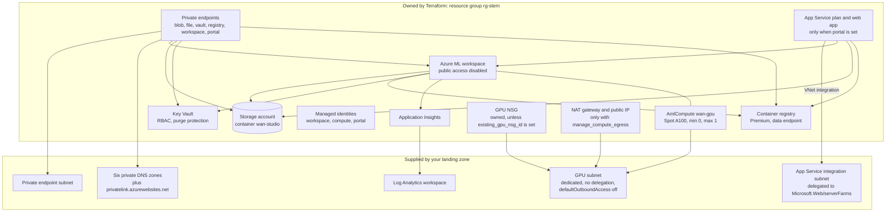

import WhoWhatWhy from '@site/src/components/WhoWhatWhy';

<WhoWhatWhy
  who="Architects and infrastructure engineers reviewing the design"
  what="The resources Terraform creates, the landing-zone resources it only references, and the data and control paths between them."
  why="So you can judge the blast radius, the network footprint and the standing cost before you approve a deployment."
/>

## Two groups of resources

The design splits Azure resources into two groups, and the split drives most of the safety checks in the scripts.

**Owned resources** are created and tagged by Terraform. Every one carries `application=wan-safety-studio`, `deployment=<deployment_name>` and `managedBy=terraform`. The operator script refuses to mutate a resource that lacks those tags.

**Supplied resources** belong to your landing zone: the GPU subnet, the private endpoint subnet, the six private DNS zones, the Log Analytics workspace, and optionally an NSG, a Key Vault and the App Service integration subnet with its DNS zone. Terraform reads them through data sources and variable IDs. It never takes ownership, and `terraform destroy` cannot touch them.

## Diagram

## The control path

The web app (or, for local use, an operator workstation) submits an Azure ML command job to the workspace through the ARM API. The workspace schedules it on the `wan-gpu` cluster. The cluster scales from zero, so the first job in a session waits several minutes for a node. When the queue drains the node scales down after 120 seconds of idle time.

A job runs the prepared GPU image from the registry as the compute identity. It mounts the model folder and the workflow code read-only from the datastore, and writes its video under `video-library/` in the same container.

## The data path

Creators never receive Azure credentials. The site reads the gallery and streams videos itself through `/api/media/...`, using its own managed identity against the private blob endpoint. Uploaded reference images land under `studio/web-inputs/` and generated video under `video-library/`, both in the `wan-studio` container.

## What is private and what is not

All data-plane services have public network access disabled: storage, Key Vault, the registry, the workspace and the web app. Reaching them takes a private endpoint and a DNS name that resolves to it. See [Networking](./networking.mdx).

Two paths still use Microsoft platform endpoints. The GPU cluster is a Batch-backed service, so its outbound rules allow Azure ML, Batch, Entra, ARM and Monitor service tags, not just your private endpoints. The web app reaches Entra ID and ARM through the App Service platform path (`vnet_route_all_enabled=false`). But neither makes the data stores public.

## Optional pieces

| Piece | Switch | What it adds |
| --- | --- | --- |
| Hosted web site | `portal` | App Service plan, web app, private endpoint, portal identity and its role assignments |
| GPU compute | `compute_enabled` | The `wan-gpu` cluster |
| Owned egress | `manage_compute_egress` | NAT gateway and public IP, attached to the GPU subnet only while compute exists |
| Customer NSG | `existing_gpu_nsg_id` | Swaps the owned NSG for yours; you apply the rules |
| Video helper | `agent` | `Agent__*` settings and an optional role on your Foundry resource |
| Key Vault configuration | `key_vault_uri`, `key_vault_id` | `KeyVault__Uri` and a Secrets User role for the portal identity |

[Resources](../resources.mdx) lists every resource with its name pattern and SKU.
