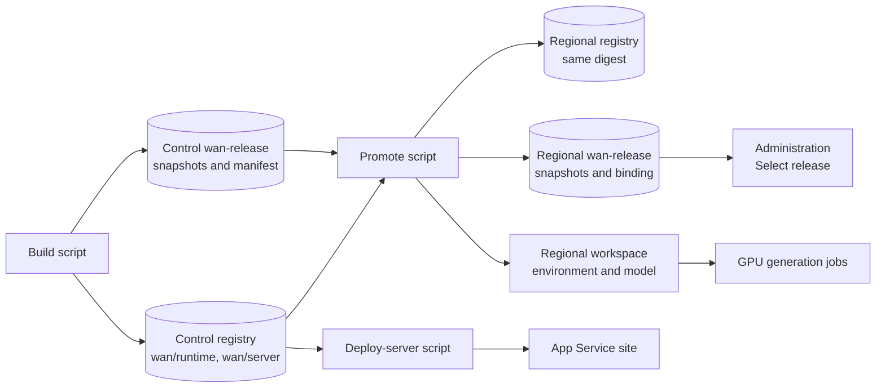

import WhoWhatWhy from '@site/src/components/WhoWhatWhy';
import Tabs from '@theme/Tabs';
import TabItem from '@theme/TabItem';

<WhoWhatWhy
  who="The operator who builds, promotes and deploys the studio, on any CI system or by hand"
  what="The release scripts in scripts/release, their prerequisites, example runs in bash and PowerShell, and the Release artifact ID they print."
  why="So you can ship a GPU release or a server image without the author's GitHub runners, and know which ID goes into Administration."
/>

The `scripts/release` folder has one bash script and one PowerShell script for each release stage. They do what the GitHub
workflows do, on any machine that meets the [prerequisites](#prerequisites): check the settings document, sign in to Azure
CLI, check private DNS and the container engine, install the locked pipeline dependencies, build the contract validator,
run the stage, print the artifact ID and remove the job's credentials. The bash and PowerShell versions take the same
options and print the same report.

The workflows in `.github/workflows` are examples of automating the same stages with GitHub Actions. They run only on the
author's self-hosted runners and environments. See [Automate with GitHub Actions](#automate-with-github-actions).

## The scripts

### The three artifacts

The build produces three things, sealed into two IDs. The GPU runtime image and the GPU snapshots are one release: the build
seals them together under the **Release artifact ID**, and promotion always moves them together. The server image is
separate. Each ID is 64 lowercase hex characters, a SHA-256 content hash, so the same build gives the same ID on any machine.

In the table, `{ContainerRegistry-Primary}`, `{StorageAccount-Primary}` and `{Workspace-Primary}` are the control region's
registry, storage account and Azure ML workspace, and `{ContainerRegistry-Region2}`, `{StorageAccount-Region2}` and
`{Workspace-Region2}` are those of each region you promote to (the control region is promoted to as well). Everything lives in the studio's own private registries and in
the private `wan-release` container of each storage account.

| Artifact | What it is | ID | Built into (control region) | Promoted into (each region) | Used by |
| --- | --- | --- | --- | --- | --- |
| **GPU runtime image** | The ComfyUI runtime container that every generation job runs | Release artifact ID (the image digest is recorded in the release manifest) | `{ContainerRegistry-Primary}.azurecr.io/wan/runtime@sha256:…` | The same digest in `{ContainerRegistry-Region2}`, and Azure ML environment `wan-<release artifact id>` version 1 in `{Workspace-Region2}` | GPU generation jobs |
| **GPU release snapshots** | The workflow code, model weights, licences and build inputs the image runs with, plus the sealed manifest | Release artifact ID: the hash of the manifest | `{StorageAccount-Primary}` / `wan-release`: snapshots under `code/`, `models/`, `licenses/` and `buildInputs/`; the manifest `builds/<release artifact id>/manifest.json` | The same snapshots and manifest in `{StorageAccount-Region2}` / `wan-release`; Azure ML model `wan-models-<hash>` version 1 in `{Workspace-Region2}`; and, written last, the regional binding `releases/<release artifact id>/<scope fingerprint>.json` | Administration (Select release verifies the manifest, the binding and the Azure ML assets), then GPU generation jobs |
| **Server image** | The .NET server and web UI in one container | Server artifact ID: the hash of its catalog record | `{ContainerRegistry-Primary}.azurecr.io/wan/server@sha256:…`, and the catalog record `images/server/<server artifact id>.json` in `wan-release` | Not promoted: the deploy-server script points the App Service at the image by digest | The App Service site |

Only the Release artifact ID goes into Administration, and **Select release** accepts it only in a region that has its
binding. Because promotion writes the binding last, a region either has the whole release or none of it. During a build each
image also carries a temporary `unready-<run id>-<attempt>` tag; promotion and deployment always address images by digest.



### What each script does

| Stage | bash | PowerShell | Runs | Prints |
| --- | --- | --- | --- | --- |
| Build and seal the GPU release (`gpu`) or the server image (`server`) | `build-artifact.sh` | `Build-StudioArtifact.ps1` | `scripts/ci/build_image.py` | The artifact ID. For `gpu` this is the **Release artifact ID**. |
| Promote a sealed GPU release to one, some or all regions | `promote-release.sh` | `Publish-StudioRelease.ps1` | `scripts/ci/publish_region.py`, once per region | The Release artifact ID and the regions it was promoted to |
| Deploy the server, optionally building it first | `deploy-server.sh` | `Deploy-StudioServer.ps1` | `scripts/ci/build_image.py` (with `--build`), then `scripts/ci/deploy_server.py` | The server artifact ID |

Run them from the root of a checkout. Every script has `--help` (bash) or `-Help` (PowerShell), and
`--preflight-only` / `-PreflightOnly`, which runs every check and stops before anything changes.

Before the stage runs, each script:

1. Copies the settings document to a private job folder in the system temp folder, after checking that it is outside the
   checkout and has the values the stage needs.
2. Checks the container engine, when it builds.
3. Signs in to Azure CLI, selects `Studio:SubscriptionId`, and checks that the caller is
   `Pipeline:PublisherPrincipalId` when it builds or promotes.
4. Checks that every endpoint the stage uses resolves to a private address and answers on port 443.
5. Creates or reuses a Python virtual environment (default `.artifacts/release-venv`) and installs
   `scripts/ci/requirements.lock` and `build/gpu/requirements-build.lock` with `--require-hashes`, from the index your pip is
   configured with.
6. Builds `tools/VideoSafetyStudio.Contracts` and points `STUDIO_CONTRACT_TOOL` at it.

When the script ends, on success or failure, it logs the container engine out of every registry it logged in to, and deletes
the job folder and any job-only Azure CLI profile.

## Prerequisites

### Tools

| Tool | Version | Notes |
| --- | --- | --- |
| bash or PowerShell | bash 4.4 or later, or PowerShell 7.4 or later | bash on Linux or WSL. Git Bash on Windows also works. |
| Python | 3.12 (3.11 also works) | pip must be configured with your approved package index. See [Package feeds](#package-feed). |
| .NET SDK | 10 | Builds the contract validator. |
| Azure CLI | Current | Sign-in, tokens and `az acr import`. |
| Git | Any | The build records the checkout's `HEAD` commit. |
| A container engine | See [Container engine](#container-engine) | Only to build. Promotion and deploying an existing server artifact run no container. |

Disk: the GPU build downloads about 45 GB of pinned model weights unless the caches below already hold them, plus the image
build. Promotion copies blobs one file at a time and needs temporary space for the largest model file.

### Container engine

Pass the engine you have: `--container-engine docker|podman|wslc` in bash, `-ContainerEngine Docker|Podman|Wslc` in
PowerShell. The script checks it before doing any work. If the engine or a feature the build needs is missing, it stops and
names the feature.

| Engine | Where | Needs | How the build keeps its guarantees |
| --- | --- | --- | --- |
| `wslc` | Windows with WSL, or inside a WSL distribution (it calls `wslc.exe`) | The WSL container CLI. Set `STUDIO_WSLC` if it is not on `PATH` or in `C:\Program Files\WSL`. | Builds with `--iidfile`, pushes, and reads the pushed digest from the image's `RepoDigests`. This is what the author's runners use. |
| `podman` | Native Linux, rootless or rootful | Podman with `build --secret`, `--iidfile`, `--format` and `push --digestfile`. Set `STUDIO_PODMAN` to override the path. | Builds with `--format docker --platform linux/amd64`, pushes with `--format v2s2 --digestfile`, and runs checks with `--read-only`. |
| `docker` | Linux, or Windows or macOS with Docker | The `buildx` plugin. Set `STUDIO_DOCKER` to override the path. Check your organization's Docker licensing. | Builds and pushes in one step with `buildx build --platform linux/amd64 --provenance=false --sbom=false --output type=image,push=true,oci-mediatypes=false --metadata-file`, and runs checks with `--read-only`. |

With every engine the pipeline requires a linux/amd64 image whose registry manifest is one Docker v2 manifest, binds the
pushed digest to the image that was built, and runs its offline checks with `--network none`, `--pull never` and an empty
writable layer afterwards. The script logs the engine in to your private registry with a short-lived Entra token and logs it
out at the end.

### Identity and sign-in

To build or promote, the Azure CLI caller must be the principal in `Pipeline:PublisherPrincipalId`. The scripts compare the
object ID in the caller's token with it and stop before any work if they differ. That principal can be:

- a service principal (an app registration, ideally with a federated credential or a certificate),
- a managed identity, when the script runs on an Azure VM or a self-hosted agent that has one, or
- your own user account, if you set `Pipeline:PublisherPrincipalId` to your object ID:
  `az ad signed-in-user show --query id -o tsv`.

The principal needs the publisher's Azure roles: AcrPush, Container Registry Data Importer and Data Reader on the registries,
Storage Blob Data Contributor on the `wan-release` containers, and the custom registration roles. See the publisher rows in
[Identity and security](../architecture/identity-and-security.mdx). Deploying the
server checks no publisher. It needs an identity that can read the control region's storage and registry and change the App
Service.

Choose how the script signs in with `--login` (bash) or `-Login` (PowerShell):

| Mode | bash / PowerShell | What happens |
| --- | --- | --- |
| Current (default) | `current` / `Current` | Uses your existing `az login`. The script selects the settings subscription in that profile. |
| Interactive | `interactive` / `Interactive` | Browser sign-in to the settings tenant, in a job-only Azure CLI profile. |
| Device code | `device-code` / `DeviceCode` | Device-code sign-in, for a machine without a browser. Job-only profile. |
| Managed identity | `managed-identity` / `ManagedIdentity` | `az login --identity`. Add `--client-id` / `-ClientId` for a user-assigned identity. Job-only profile. |
| Service principal | `service-principal` / `ServicePrincipal` | `--client-id` plus either `--federated-token-file` or `--certificate` (PEM with its key). Job-only profile. Client secrets are not accepted; sign in yourself and use `current` if you must use one. |

The scripts clear `GITHUB_ACTIONS`, `STUDIO_FEDERATED_IDENTITY`, `AZURE_CLIENT_ID` and the GitHub OIDC variables for the
stage. Those turn on the GitHub-only federated identity checks, which a standalone run must not use.

### Network and DNS

Run the scripts on a machine that resolves the studio's private DNS zones to private addresses and can reach the private
endpoints: a VPN client, a VM or agent in a peered network, or a jump host. The script checks each of these before the stage,
and the stage checks them again:

- every stage: the control region's registry (`<registry>.azurecr.io`) and release storage (`<account>.blob.core.windows.net`);
- promotion: the same two endpoints in each target region, and for the GPU release every entry in that region's
  `Network:PrivateConnectivityHosts`;
- server deployment: the App Service's private hostname, checked by the stage.

A name that does not resolve, resolves to a public address, or does not answer on port 443 stops the script with the list of
failing hosts. The GPU build also needs outbound HTTPS to `github.com` and `huggingface.co`, unless the
[caches](./hosted-lifecycle.mdx#gpu-build-inputs-optional-caches) already hold the pinned inputs, and to your package feed.

### Settings document

The scripts read the same settings document as the workflows: the `Studio` section the site uses, plus the `Pipeline`
section. Keep it outside the checkout. Pass it with `--settings` / `-Settings`, or set `STUDIO_SETTINGS_PATH` or
`STUDIO_SETTINGS_JSON`. See [Pipeline settings](./private-pipelines.mdx#pipeline-settings) and
[Configuration](../configuration.mdx#settings-read-by-pipelines).

### Package feed

The virtual environment installs the locked pipeline dependencies from the index pip is configured with
(`pip config list`). The GPU image also installs Python packages during the build, through a build secret. For
those builds the script takes `PIP_INDEX_URL`, or pip's `global.index-url`, and the build accepts only one HTTPS Azure
Artifacts feed (`packagefeedproxy.microsoft.io` or `pkgs.dev.azure.com`) without credentials in the URL. Feed credential
files for the image builds are passed the same way as in CI: `STUDIO_NPMRC`, `STUDIO_NUGET_CONFIG` and `STUDIO_NETRC`.

## Build and promote the GPU release

### Step 1: build and seal

The build fetches the pinned upstream source and model weights (or reuses the caches), builds the GPU image, runs the CPU
probe against its exact digest, publishes the immutable snapshots and seals the build. It needs a clean checkout: it records
`HEAD` as the source commit and stops on uncommitted changes unless you pass `--allow-dirty` / `-AllowDirty`.

<Tabs groupId="shell">
<TabItem value="bash" label="bash">

```bash
scripts/release/build-artifact.sh --settings ~/wan/settings.json --container-engine podman \
  --model-cache /srv/wan/models --license-cache /srv/wan/licenses --upstream-source /srv/wan/upstream
```

</TabItem>
<TabItem value="pwsh" label="PowerShell">

```powershell
./scripts/release/Build-StudioArtifact.ps1 -Settings ~/wan/settings.json -ContainerEngine Wslc `
  -ModelCache D:\wan\models -LicenseCache D:\wan\licenses -UpstreamSource D:\wan\upstream
```

</TabItem>
</Tabs>

The cache options are optional. They map to `STUDIO_MODEL_CACHE`, `STUDIO_LICENSE_CACHE` and `STUDIO_UPSTREAM_SOURCE`,
described in [GPU build inputs](./hosted-lifecycle.mdx#gpu-build-inputs-optional-caches). The build ends with:

```text title="End of a GPU build"
==============================================================================
  RELEASE ARTIFACT ID (sealed GPU build)

  0123456789abcdef0123456789abcdef0123456789abcdef0123456789abcdef
==============================================================================

Copy this Release artifact ID and keep it: after promotion you paste it into Administration to select
the release in each region.
Next: promote this release (to every configured region unless you pass regions):
  scripts/release/promote-release.sh --settings ~/wan/settings.json --artifact 0123456789abcdef0123456789abcdef0123456789abcdef0123456789abcdef
Administration accepts it for a region only after it has been promoted there.
```

:::info[Copy the Release artifact ID]

Copy the 64-character **Release artifact ID** from this output and keep it. You need it again after you promote it: to use
the release in a region, open the site's **Administration** page, find the region's card, paste the ID into **Release
artifact ID** and choose **Select release**. See [The Release artifact ID](#the-release-artifact-id).

:::

### Step 2: promote

Promotion copies the image by digest with `az acr import`, copies and verifies every blob, registers the Azure ML assets and
writes the create-only regional binding last. It allocates no GPU and needs no container engine. Without a region it
promotes to every region in `Studio:Regions`.

<Tabs groupId="shell">
<TabItem value="bash" label="bash">

```bash
scripts/release/promote-release.sh --settings ~/wan/settings.json \
  --artifact 0123456789abcdef0123456789abcdef0123456789abcdef0123456789abcdef

# only some regions
scripts/release/promote-release.sh --settings ~/wan/settings.json --artifact <id> --region westeurope --region eastus2
```

</TabItem>
<TabItem value="pwsh" label="PowerShell">

```powershell
./scripts/release/Publish-StudioRelease.ps1 -Settings ~/wan/settings.json `
  -Artifact 0123456789abcdef0123456789abcdef0123456789abcdef0123456789abcdef

# only some regions
./scripts/release/Publish-StudioRelease.ps1 -Settings ~/wan/settings.json -Artifact <id> -Region westeurope,eastus2
```

</TabItem>
</Tabs>

Each region prints `Verified regional binding: releases/<id>/<fingerprint>.json` when it succeeds. A failed region does not
stop the others. Promotion is idempotent and resumable: snapshots and bindings are create-only and verified, so you can rerun
the same ID for a region that failed, or one that already succeeded. The report lists both:

```text title="End of a promotion"
==============================================================================
  RELEASE ARTIFACT ID (sealed GPU build)

  0123456789abcdef0123456789abcdef0123456789abcdef0123456789abcdef
==============================================================================
  Promoted to:      eastus2, westeurope
  Not promoted to:  none
==============================================================================

Next, in the studio, signed in with the StudioAdmin role, open Administration. On the card of each
region listed under 'Promoted to' whose phase is Off, paste this ID into 'Release artifact ID'
and choose 'Select release'.
```

The script exits with an error if any region was not promoted, and prints the command that retries only those regions.

:::tip

Now select the release: in **Administration**, on each promoted region's card, paste the Release artifact ID into **Release
artifact ID** and choose **Select release** ([details](#the-release-artifact-id)).

:::

### Step 3: select the release in Administration

See [The Release artifact ID](#the-release-artifact-id).

## Build and deploy the server

The server deployment points the App Service at the server image by registry digest, starts it, waits for `/healthz` and
checks that `/api/status` requires sign-in. If it does not, the site is stopped. It never arms submission and never changes a
region's release. Before the first deployment, the site must be disarmed (`AzureMl__Armed=false`) and have `Auth__ClientId`
and `Auth__TenantId` set (see [Bootstrap Entra sign-in](./deploy.mdx#bootstrap-entra-sign-in)).

Build and deploy in one run:

<Tabs groupId="shell">
<TabItem value="bash" label="bash">

```bash
scripts/release/deploy-server.sh --settings ~/wan/settings.json --build --container-engine docker
```

</TabItem>
<TabItem value="pwsh" label="PowerShell">

```powershell
./scripts/release/Deploy-StudioServer.ps1 -Settings ~/wan/settings.json -Build -ContainerEngine Wslc
```

</TabItem>
</Tabs>

Or build once and deploy the same server artifact later, for example to redeploy a known-good image:

<Tabs groupId="shell">
<TabItem value="bash" label="bash">

```bash
scripts/release/build-artifact.sh --component server --settings ~/wan/settings.json --container-engine docker
scripts/release/deploy-server.sh --settings ~/wan/settings.json --artifact <server artifact id>
```

</TabItem>
<TabItem value="pwsh" label="PowerShell">

```powershell
./scripts/release/Build-StudioArtifact.ps1 -Component server -Settings ~/wan/settings.json -ContainerEngine Wslc
./scripts/release/Deploy-StudioServer.ps1 -Settings ~/wan/settings.json -Artifact <server artifact id>
```

</TabItem>
</Tabs>

Building the server checks the publisher identity like any build. Deploying an existing server artifact does not. The
report prints the **server artifact ID** and says that it is not a Release artifact ID.

## The Release artifact ID

The **Release artifact ID** is the 64-character lowercase hex identity of a sealed GPU build, for example
`0123456789abcdef0123456789abcdef0123456789abcdef0123456789abcdef`. It is a content hash over the build's code, models,
licences and build inputs, so it is the same whichever machine or CI system built it.

- **Where it comes from.** `build-artifact.sh` / `Build-StudioArtifact.ps1` with the `gpu` component prints it at the end,
  and `promote-release.sh` / `Publish-StudioRelease.ps1` prints it again with the regions it reached. It is also the folder
  name under `builds/` in the control region's `wan-release` container.
- **What it is not.** It is not the server artifact ID, an image digest (`sha256:...`), a commit or a CI run ID.
  The host rejects any of those.
- **When you can enter it.** Only after promotion has written a binding for that region, and only while the region is
  `Off`. Select release on an armed region is refused: stop the region first.
- **How to enter it.**
  1. Sign in to the studio with the `StudioAdmin` role and open **Administration**.
  2. On the region's card, paste the ID into **Release artifact ID** and choose **Select release**. The host reads the
     build manifest and the regional binding, checks the Azure ML environment and model, and shows the ID as
     **Approved release**.
  3. Repeat on each region you promoted to. The same ID is used in every region.
  4. When you want to generate, tick the GPU spend approval (and the customer NSG acknowledgement if it applies) and choose
     **Start** for the region.

Select release only reads and verifies. It starts no compute and costs nothing. **Start** is the step that spends money.
If you lose the ID, see [Finding the ID after the fact](./hosted-lifecycle.mdx#finding-the-id-after-the-fact).

## Options

Every script accepts these options. The stage options are listed by `--help` / `-Help`.

| bash | PowerShell | Meaning |
| --- | --- | --- |
| `--settings PATH` | `-Settings PATH` | Settings document, outside the checkout. Default: `STUDIO_SETTINGS_PATH` or `STUDIO_SETTINGS_JSON`. |
| `--container-engine docker\|podman\|wslc` | `-ContainerEngine Docker\|Podman\|Wslc` | Engine for builds. Required to build; accepted and unused otherwise. |
| `--login MODE` | `-Login MODE` | How to sign in to Azure CLI. See [Identity and sign-in](#identity-and-sign-in). |
| `--client-id ID` | `-ClientId ID` | Client ID for a managed identity or service principal. |
| `--federated-token-file PATH` | `-FederatedTokenFile PATH` | Service principal: federated token file. |
| `--certificate PATH` | `-Certificate PATH` | Service principal: PEM certificate with its key. |
| `--python PATH` | `-Python PATH` | Python 3.12 (or 3.11) for the virtual environment. |
| `--venv DIR` | `-Venv DIR` | Virtual environment folder. Default `.artifacts/release-venv`; reused while the locks are unchanged. |
| `--preflight-only` | `-PreflightOnly` | Run every check and stop before anything changes. |
| `--keep-work` | `-KeepWork` | Keep the job folder for troubleshooting. It holds a copy of the settings document. |

Exit codes: `0` on success; `1` when a check or the stage fails, or when any region was not promoted; `2` for a bash usage
error. PowerShell reports invalid parameters with its own non-zero exit code.

## Automate with GitHub Actions

The repository's workflows show one way to run the same stages in CI:

| Workflow | Stage | Script equivalent |
| --- | --- | --- |
| `.github/workflows/release.yml` | Build and seal (`server` or `gpu`) | `build-artifact.sh` / `Build-StudioArtifact.ps1` |
| `.github/workflows/promote.yml` | Promote to every configured region in parallel | `promote-release.sh` / `Publish-StudioRelease.ps1` |
| `.github/workflows/deploy-server.yml` | Deploy a server artifact | `deploy-server.sh` / `Deploy-StudioServer.ps1` |

They are examples, not something that runs in your environment as is. They need self-hosted Linux runners labelled
`wan-private` on the studio's network, protected GitHub environments with required reviewers, and a federated Azure identity
per environment, as described in [Protected private pipelines](./private-pipelines.mdx). They call `scripts/ci` directly
after the `.github/actions/private-context` action does the setup that the release scripts do for you, and they use `wslc`.

To automate in another CI system (Azure DevOps, GitLab, Jenkins and others), call the release scripts from a job on an agent
that meets the [prerequisites](#prerequisites), with `--login service-principal --federated-token-file` or
`--login managed-identity`, and the settings document from a protected secret in `STUDIO_SETTINGS_JSON`. Read the artifact
ID from the job log.

## Troubleshooting

| Message | Cause | Fix |
| --- | --- | --- |
| `Azure CLI is signed in as object ID ..., but Pipeline.PublisherPrincipalId is ...` | The caller is not the publisher. | Sign in as the publisher, or set `Pipeline:PublisherPrincipalId` to the caller's object ID. |
| `This machine cannot reach the studio's private endpoints` | Private DNS is not in effect, or port 443 is blocked. | Run from the studio network or VPN, and check the DNS zone links. The message lists each failing host. |
| `Container engine ... is not usable` | The engine is missing, or lacks a feature the build needs. | Install the engine or the named feature (for Docker, `buildx`), or choose another engine. |
| `The checkout has uncommitted changes` | The build would record a commit that is not what it built. | Commit or stash, or pass `--allow-dirty` / `-AllowDirty`. |
| `PIP_INDEX_URL must be one HTTPS Azure Artifacts feed` | The GPU build has no approved feed. | Set `PIP_INDEX_URL` or pip's `global.index-url` to your Azure Artifacts feed. |
| A region under `Not promoted to` | That region's promotion failed; the others are unaffected. | Fix the cause shown above the report, then rerun the printed command for that region. |

For errors from the stage itself, see [Troubleshooting](./troubleshooting.mdx).
