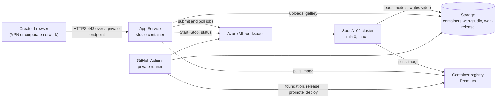

import WhoWhatWhy from '@site/src/components/WhoWhatWhy';
import Steps from '@site/src/components/Steps';

<WhoWhatWhy
  who="Cloud infrastructure and DevOps engineers who host the studio in their own Azure subscription"
  what="What gets deployed, which team owns which piece, and the order of the workflows and lifecycle actions."
  why="So you can plan the landing-zone inputs, approvals and costs before anyone dispatches the first workflow."
/>

WAN Safety Studio generates synthetic safety and equipment-failure video with the Wan 2.2 model. Creators sign in to a private web site, describe scenes, and the site submits GPU jobs to an Azure Machine Learning workspace. The videos land in a private blob container and show up in a gallery. This collection covers the hosting side: the Azure resources, the GitHub Actions workflows that build and deploy them, and the hosted lifecycle that starts and stops the GPU.

If you want to change the code instead, the [developer documentation](/developers/intro) is the place to start.

## Three execution boundaries

| Boundary | What runs there |
| --- | --- |
| .NET App Service | The studio server: operations, generation routing and the admin UI. It runs Start, Stop and release selection with its managed identity, and never runs Terraform, Docker or Python. |
| GitHub Actions on private runners | Build, promotion and deployment: foundation, release, promote, deploy-server and recover. Each needs a protected environment approval. |
| Azure ML jobs | The Python and ComfyUI containers that generate video on the GPU. |

## What you are deploying

Terraform in `infra\` is a durable-only, regional root. For each configured region it creates a private Azure ML workspace and its supporting services (storage, Key Vault, a Premium container registry, Application Insights), user-assigned managed identities, and the private endpoints that put all of it on your network. One optional shared App Service hosts the studio web site as a Linux container. Terraform does not create compute, NAT or a public IP. The GPU is one Spot A100 cluster (`Standard_NC24ads_A100_v4`, at most one node) that the hosted Start creates and Stop deletes.

Everything runs inside a landing zone you supply. Terraform never creates or modifies your VNets, subnets, private DNS zones or Log Analytics workspace. It reads and checks them, then attaches private endpoints. See [Prerequisites](./prerequisites.mdx) for the exact list.

## Who does what

| Role | Responsibility |
| --- | --- |
| Deployment owner | Configures the protected GitHub environments and the private runner group. Dispatches and reviews the workflows. |
| Studio administrator | Holds the `StudioAdmin` role. Selects releases, starts regions after approving GPU spend, and stops them. |
| Network owner | Provides the dedicated GPU subnet, the private endpoint subnet, the private DNS zones and their links, DNS forwarding for clients and runners, and GPU egress. |
| Security owner | Applies the GPU NSG rules when a customer-managed NSG is used. Approves the Entra app registration. |
| Identity owner | Does the one-time Entra bootstrap by hand, grants admin consent, and manages membership of the creators and administrators groups. |
| Azure ML owner | Requests Spot A100 quota and confirms the region has capacity. |

Small teams often fill several of these roles. But the split shows where a request will block. DNS and quota are the two that take the longest in practice.

## The lifecycle at a glance

<Steps
  steps={[
    {
      title: 'Foundation',
      to: '/deployment/guides/deploy#deploy-the-foundation',
      body: 'foundation.yml plans, then a separately approved job applies the exact saved plan. No GPU, NAT or public IP exists yet.',
    },
    {
      title: 'Entra bootstrap',
      to: '/deployment/guides/deploy#bootstrap-entra-sign-in',
      body: 'An identity owner creates the registration, roles, groups and federated credential by hand. No client secret is created.',
    },
    {
      title: 'GPU release',
      to: '/deployment/guides/deploy#build-and-promote-the-gpu-release',
      body: 'release.yml builds a sealed GPU artifact, then promote.yml publishes it per region. No GPU is allocated.',
    },
    {
      title: 'Server',
      to: '/deployment/guides/deploy#build-and-deploy-the-server',
      body: 'release.yml builds the server image, and deploy-server.yml deploys it by digest, with submission still closed.',
    },
    {
      title: 'Start',
      to: '/deployment/guides/operate-and-stop',
      body: 'A StudioAdmin selects a release and approves GPU spend. The host checks price, quota and connectivity, creates the cluster and arms the region.',
    },
    {
      title: 'Stop',
      to: '/deployment/guides/operate-and-stop#stop',
      body: 'The host closes the fence, cancels jobs, deletes the cluster and the owned NAT, and proves it.',
    },
  ]}
/>

Stop is safe to repeat and works without Python, Docker or Terraform. If the host is unavailable, `scripts\recovery\Stop-Studio.ps1`, also run by the `recover.yml` workflow, releases compute independently. Nothing in this lifecycle has been run against real Azure.

## Cost in one paragraph

Stop does not take the bill to zero. The Premium registry, private endpoints, storage, Application Insights ingestion and the App Service plan keep charging while the studio is off. The GPU bills only while a job holds the node. [Compute and cost](./architecture/compute-and-cost.mdx) has the details.

## Where to go next

Read [Architecture overview](./architecture/overview.mdx) first if you are reviewing the design. If you are ready to deploy, work through [Prerequisites](./prerequisites.mdx), fill in the [Terraform variables](./terraform-variables.mdx), then follow the [deploy guide](./guides/deploy.mdx).
