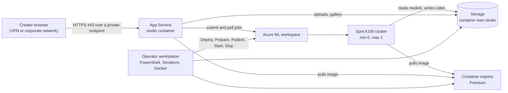

import WhoWhatWhy from '@site/src/components/WhoWhatWhy';
import Steps from '@site/src/components/Steps';

<WhoWhatWhy
  who="Cloud infrastructure and DevOps engineers who host the studio in their own Azure subscription"
  what="What gets deployed, which team owns which piece, and the order of the lifecycle commands."
  why="So you can plan the landing-zone inputs, approvals and costs before anyone runs Deploy."
/>

WAN Safety Studio generates synthetic safety and equipment-failure video with the Wan 2.2 model. Creators sign in to a private web site, describe scenes, and the site submits GPU jobs to an Azure Machine Learning workspace. The videos land in a private blob container and show up in a gallery. This collection covers the hosting side: the Azure resources and the scripts that run their lifecycle.

If you want to change the code instead, the [developer documentation](/developers/intro) is the place to start.

## What you are deploying

Terraform in `infra\` creates a private Azure ML workspace and its supporting services (storage, Key Vault, a Premium container registry, Application Insights), two or three user-assigned managed identities, and the private endpoints that put all of it on your network. An optional App Service hosts the studio web site as a Linux container. A single Spot A100 node (`Standard_NC24ads_A100_v4`) is the only compute, and it exists only after the operator arms the studio.

Everything runs inside a landing zone you supply. Terraform never creates or modifies your VNets, subnets, private DNS zones or Log Analytics workspace. It reads and checks them, then attaches private endpoints. See [Prerequisites](./prerequisites.mdx) for the exact list.

## Who does what

| Role | Responsibility |
| --- | --- |
| Operator | Runs `Invoke-WanSafetyStudio.ps1` and `Initialize-PortalAuth.ps1` from a workstation that can resolve your private DNS. Approves persistent cost and GPU spend with explicit switches. |
| Network owner | Provides the dedicated GPU subnet, the private endpoint subnet, the private DNS zones and their links, DNS forwarding for clients, and GPU egress. |
| Security owner | Applies the GPU NSG rules when a customer-managed NSG is used. Approves the Entra app registration. |
| Identity owner | Grants admin consent for sign-in once, and manages membership of the creators group. |
| Azure ML owner | Requests Spot A100 quota and confirms the region has capacity. |

Small teams often fill several of these roles. But the split shows where a request will block. DNS and quota are the two that take the longest in practice.

## The lifecycle at a glance

<Steps
  steps={[
    {
      title: 'Deploy',
      to: '/deployment/guides/deploy',
      body: 'Terraform creates the foundation. The first run uses compute_enabled=false, so no GPU, NAT or public IP exists yet.',
    },
    {
      title: 'Prepare',
      to: '/deployment/guides/deploy#prepare',
      body: 'Downloads and verifies the Wan model files, builds the GPU image on your CPU, pushes it to the private registry and registers the assets. No GPU is allocated.',
    },
    {
      title: 'Initialize-PortalAuth',
      to: '/deployment/guides/deploy#initialize-portalauth',
      body: 'Creates the Entra app registration, the creators group and a federated credential for the site identity.',
    },
    {
      title: 'Publish',
      to: '/deployment/guides/deploy#publish',
      body: 'Builds the server image, pushes it, points the site at it and writes the release settings.',
    },
    {
      title: 'Start',
      to: '/deployment/guides/operate-and-stop',
      body: 'Checks price, quota and connectivity, creates the cluster if needed, and arms job submission. Approval switches are required.',
    },
    {
      title: 'Stop',
      to: '/deployment/guides/operate-and-stop#stop',
      body: 'Disarms the site, cancels jobs, deletes the cluster and the owned NAT, and reconciles Terraform state.',
    },
  ]}
/>

Stop is safe to repeat. Deploy and Prepare refuse to run while the studio is armed, and Start refuses to run when a previous Stop did not finish.

## Cost in one paragraph

Stop does not take the bill to zero. The Premium registry, private endpoints, storage, Application Insights ingestion and the App Service plan keep charging while the studio is off. The GPU bills only while a job holds the node. [Compute and cost](./architecture/compute-and-cost.mdx) has the details.

## Where to go next

Read [Architecture overview](./architecture/overview.mdx) first if you are reviewing the design. If you are ready to deploy, work through [Prerequisites](./prerequisites.mdx), fill in the [Terraform variables](./terraform-variables.mdx), then follow the [deploy guide](./guides/deploy.mdx).
