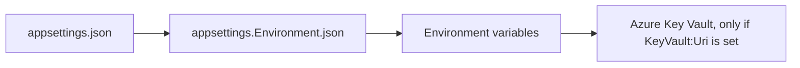

import WhoWhatWhy from '@site/src/components/WhoWhatWhy';
import SettingsTable from '@site/src/components/SettingsTable';

<WhoWhatWhy
  who="Developers adding a setting or debugging which value won"
  what="Typed options classes, the source order, and a reference of the keys that matter."
  why="So a new setting follows the same pattern and reads the same way in every environment."
/>

Configuration is plain ASP.NET Core. Each area has an options class with a `Section` constant, bound in `AddStudio` (or in `AddVideoHelper`), and services take `IOptions<T>`. There are no custom environment variable formats.

## Source order

Later sources win.



- Environment variables use `__` for `:`. `AzureMl:Armed` is `AzureMl__Armed`.
- Key Vault secret names use `--` for `:`. `Auth--ClientSecret` becomes `Auth:ClientSecret`. `Program.cs` adds the vault as the last source through `AddStudioKeyVault`, so it overrides everything else. When `KeyVault:Uri` is empty the server never contacts Key Vault.
- The convention is that environment variables carry connections and identity, and everything else is a default in `appsettings.json`.

Under the AppHost, the settings you put in its configuration are not all forwarded. In Azure ML mode it copies every key starting with `AzureMl:` or `Auth:` plus `KeyVault:Uri` to the server as flat `__` variables. In ComfyUI mode it forwards a fixed list of `ComfyUi:*` keys and `Storage:*`. Restart the AppHost after changing any of them.

## Options classes

| Section | Class | Project |
|---|---|---|
| `Storage` | `StorageOptions` | Infrastructure |
| `ComfyUi` | `ComfyUiOptions` and `GenerationOptions` | Infrastructure and Application |
| `AzureMl` | `AzureMlOptions` (with `AzureMlReleaseOptions`) | Infrastructure |
| `Training` | `TrainingOptions` | Application |
| `Trainers` | `TrainerOptions` | Infrastructure |
| `Agent` | `VideoHelperOptions` | Infrastructure |
| `Auth` | `AuthOptions`, resolved into `AuthSettings` | Server |

The `ComfyUi` section is bound twice on purpose. `ComfyUiOptions` holds the connection (URL, retrieval, share credentials), while the model file names that go into workflow templates sit in `GenerationOptions`. Both read the same section, so one `ComfyUi:UnetHigh` setting reaches the right class without a new section name.

`GenerationOptions` also carries the queue ceilings (`MaxOpenJobs`, `JobRetentionHours`), and those apply whichever provider is selected, despite living under a section named after ComfyUI. That is a wart worth knowing about before you go looking for a `Generation` section that does not exist.

```csharp title="src/VideoSafetyStudio.Infrastructure/DependencyInjection.cs"
services.Configure<StorageOptions>(configuration.GetSection(StorageOptions.Section));
services.Configure<ComfyUiOptions>(configuration.GetSection(ComfyUiOptions.Section));
services.Configure<GenerationOptions>(configuration.GetSection(GenerationOptions.Section));
services.Configure<AzureMlOptions>(configuration.GetSection(AzureMlOptions.Section));
services.Configure<TrainingOptions>(configuration.GetSection(TrainingOptions.Section));
services.Configure<TrainerOptions>(configuration.GetSection(TrainerOptions.Section));
services.PostConfigure<StorageOptions>(options => options.Connection ??= configuration.GetConnectionString("blobs"));
```

Two post-processing rules to know about. `Storage:Connection` falls back to `ConnectionStrings:blobs`, which is how the AppHost hands over the Azurite connection. And relative `Trainers:BuiltIn` and `Trainers:Directories` paths resolve against the server content root.

## Provider selection is read late

`Generation:Provider` is read from `IConfiguration` when the backend is first resolved, not at startup. That lets tests override it with `AddInMemoryCollection`. The server's own default is `azureml`. The AppHost always passes `comfyui` unless you set the provider in its configuration. If you run the server project directly without the AppHost you get Azure ML and a startup error about missing `AzureMl:*` keys unless you set `Generation__Provider=comfyui`.

## Reference

### Mode and identity

<SettingsTable
  settings={[
    {name: 'Generation__Provider', default: 'azureml', description: 'azureml or comfyui. Any other value throws at resolution.'},
    {name: 'Auth__Mode', default: 'None in Development, Entra elsewhere', description: 'None or Entra. An explicit value wins. None outside Development is allowed and logs a warning.'},
    {name: 'Auth__ClientId', default: 'empty', description: 'Entra app registration client id. Required for Entra.'},
    {name: 'Auth__TenantId', default: 'AzureMl__TenantId', description: 'Entra tenant.'},
    {name: 'Auth__PublicOrigin', default: 'empty', description: 'The https origin of the site. Builds the redirect URI and pins the host and CSRF origin.'},
    {name: 'Auth__ClientSecret', description: 'Optional. Without it the managed identity signs a federated assertion. Keep it in Key Vault.'},
    {name: 'Auth__KeysPath', description: 'Where data-protection keys persist. Falls back to /home/.wan-studio/keys when WEBSITE_SITE_NAME is set.'},
    {name: 'Auth__AllowedHosts', description: 'Comma-separated Host names accepted in Auth__Mode=None. Development always accepts localhost, 127.0.0.1 and [::1]. Empty outside Development means any host, for a gateway in front.'},
    {name: 'AZURE_CLIENT_ID', description: 'Client id of the user-assigned managed identity. When set it is the one credential for Azure calls; otherwise DefaultAzureCredential is used.'},
    {name: 'KeyVault__Uri', description: 'https vault URI. Enables Key Vault as the highest-priority source.'},
    {name: 'FEATURE_DATASET_BUILDER_ENABLED', default: 'false', description: 'Maps the /api/vision endpoints and reports datasetBuilder: true from /api/features.'},
    {name: 'Web__Root', description: 'Folder holding the built UI. Otherwise wwwroot, then ../../web/dist from the content root.'},
  ]}
/>

### Azure ML provider

<SettingsTable
  settings={[
    {name: 'AzureMl__SubscriptionId', description: 'Canonical UUID. Required.'},
    {name: 'AzureMl__TenantId', description: 'Canonical UUID. Required.'},
    {name: 'AzureMl__ResourceGroup', description: 'Resource name. Required.'},
    {name: 'AzureMl__Workspace', description: 'Workspace name. Required.'},
    {name: 'AzureMl__Compute', description: 'The one compute jobs may use. Required.'},
    {name: 'AzureMl__ComputeIdentityClientId', description: 'UUID of the identity the job runs as. Required.'},
    {name: 'AzureMl__StorageAccount', description: 'Studio storage account. Also the object store. Required.'},
    {name: 'AzureMl__Container', description: 'Studio container. Required.'},
    {name: 'AzureMl__Datastore', default: 'workspaceblobstore', description: 'Datastore over that container.'},
    {name: 'AzureMl__Release__EnvironmentId', default: 'empty', description: 'azureml:name:version or the workspace environment version id. Empty means not prepared and submits are refused.'},
    {name: 'AzureMl__Release__ModelsRef', default: 'datastore path models/wan/', description: 'A datastore path or an azureml:name:version asset.'},
    {name: 'AzureMl__Release__CodeUri', default: 'datastore path code/{version}-wan/', description: 'A datastore path for the job code.'},
    {name: 'AzureMl__Armed', default: 'false', description: 'Whether jobs may be submitted. Read through IOptionsMonitor on every submit.'},
    {name: 'AzureMl__PollSeconds', default: '5', description: 'Job status polling interval.'},
    {name: 'AzureMl__MaxConcurrency', default: '25', description: 'Jobs the worker submits at once.'},
    {name: 'AzureMl__MaxJobMinutes', default: '120', description: 'Job timeout. Must be 1 to 120, checked at startup.'},
    {name: 'AzureMl__MaxUploadMb', default: '64', description: 'Total size of the reference images in one submit.'},
  ]}
/>

### ComfyUI, storage, trainers, agent

<SettingsTable
  settings={[
    {name: 'ComfyUi__Url', default: 'http://localhost:8188', description: 'ComfyUI base URL.'},
    {name: 'ComfyUi__Retrieval', default: 'api', description: 'api downloads through /view. share reads ComfyUi__OutputDir.'},
    {name: 'ComfyUi__OutputDir', description: 'share only: ComfyUI output folder as mounted here. A UNC path with SmbUser connects on Windows.'},
    {name: 'ComfyUi__WorkflowsDir', default: 'Workflows beside the server', description: 'Folder of workflow templates with the shipped file names.'},
    {name: 'ComfyUi__UnetHigh / UnetLow / Vae / Clip / LoraHigh / LoraLow / Unet5B / Vae5B', description: 'Model file names substituted into templates. Defaults match the Wan 2.2 fp8 scaled files.'},
    {name: 'ComfyUi__MaxOpenJobs', default: '50', description: 'Ceiling on queued plus running jobs, both providers. A submit that would pass it is refused with 409.'},
    {name: 'ComfyUi__JobRetentionHours', default: '24', description: 'How long a finished job stays in the in-memory index. Its record and gallery entry stay in storage.'},
    {name: 'Training__MaxRunHours', default: '12', description: 'Longest a training run may take. After that the container is removed and the run fails. Clamped to 0.01 to 168.'},
    {name: 'RateLimits__SubmitPermits', default: '10', description: 'POST /api/submit calls one creator may make per window.'},
    {name: 'RateLimits__AgentPermits', default: '60', description: 'POST /api/agent calls one creator may make per window.'},
    {name: 'RateLimits__WindowMinutes', default: '10', description: 'Length of the fixed window for both limits. Over the limit is 429, never a queue.'},
    {name: 'Storage__Backend', default: 'local', description: 'local, azurite or azure. Ignored by the azureml provider.'},
    {name: 'Storage__Path', default: '.dev-data/blob', description: 'Folder for the local backend.'},
    {name: 'Storage__Account', description: 'Storage account name for the azure backend.'},
    {name: 'Storage__Container', default: 'studio', description: 'Container name for azurite and azure.'},
    {name: 'Trainers__BuiltIn', default: '../../trainers', description: 'Folder with the built-in trainer manifests.'},
    {name: 'Trainers__Directories__0', description: 'Extra folders holding name/trainer.json. Indexed list binding.'},
    {name: 'Agent__Endpoint / Agent__Model', description: 'Both required to enable the video helper. See the agent page.'},
  ]}
/>

## Verified against code, and a note on the older docs

The table was checked against the options classes and `appsettings.json`. Three points differ from `docs\configuration.md` or add to it:

- `Storage__Container`, `ComfyUi__PollSeconds` and `ComfyUi__TimeoutSeconds` exist in the options classes but are not in the older doc.
- The older doc lists `WAN_STUDIO_TRAINERS_DIR` for trainers. The server does not read it. Use `Trainers:Directories`.
- `Auth__PublicOrigin` must match `https://host` (or a loopback `http://` origin). The pattern is enforced when settings resolve.

## Adding a setting

1. Add a property with a default to the options class. Keep the type simple (string, number, bool, list).
2. If the default should be visible to operators, put it in `src\VideoSafetyStudio.Server\appsettings.json`.
3. If it must reach the server through the AppHost, forward it in `AppHost.cs`, otherwise it works only when set as an environment variable on the server.
4. Validate in one place and name the key in the error message, as `AzureMlConfig` does: `AzureMl:MaxJobMinutes must be between 1 and 120.`
5. Never put a secret in `appsettings.json`. Use an environment variable or Key Vault.
