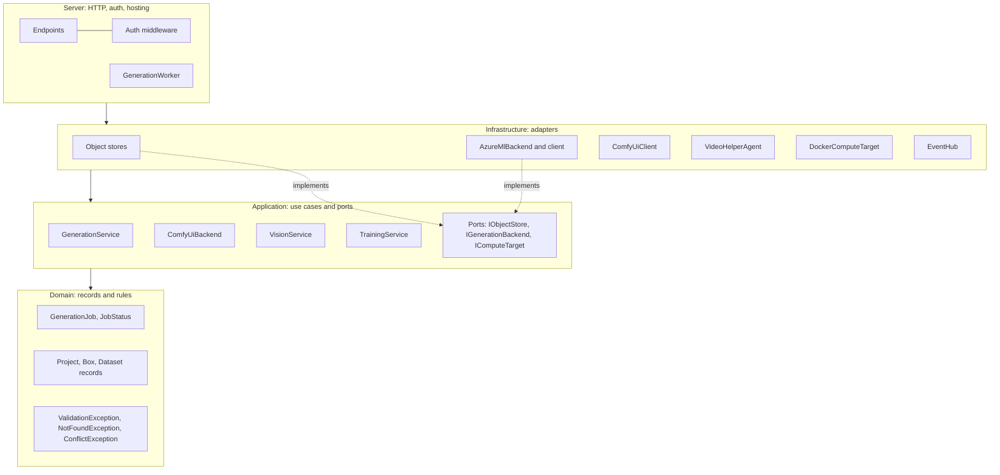

import WhoWhatWhy from '@site/src/components/WhoWhatWhy';

<WhoWhatWhy
  who="Developers adding features or reviewing changes to the .NET backend"
  what="The layers, the project each one lives in, and which direction references may point."
  why="So new code lands in the right project and the HTTP layer stays thin."
/>

The backend is a .NET 10 solution under `src\`. It follows Clean layering: `Domain`, then `Application`, then `Infrastructure`, then `Server`. Two more projects support local development and telemetry: `AppHost` (Aspire) and `ServiceDefaults`.

## Dependency rule

A project may reference only the one before it. The project files show it directly:

| Project | References |
|---|---|
| `VideoSafetyStudio.Domain` | nothing |
| `VideoSafetyStudio.Application` | `Domain` |
| `VideoSafetyStudio.Infrastructure` | `Application` |
| `VideoSafetyStudio.Server` | `Infrastructure`, `ServiceDefaults` |
| `VideoSafetyStudio.AppHost` | `Server` (to launch it) |

But `Server` reaches `Domain` and `Application` through `Infrastructure`, which is why its endpoint files can use types such as `GenerationService` without a direct reference.



## What each project owns

**Domain** holds plain records and rules with no dependencies: `GenerationJob`, `JobStatus`, `Stages`, `StageTimer`, the vision records (`Project`, `Box`, COCO types), `TrainingRun`, and the three business exceptions in `Errors.cs`. Validation that does not need I/O lives here, for example `Names.Check` and `Box.Checked`.

**Application** holds the use cases and the ports (interfaces) they need. `GenerationService`, `VisionService` and `TrainingService` live here, along with `ComfyUiBackend` (a backend that needs only ports), `WorkflowRenderer`, `WanModes` and the options classes for generation. `Abstractions.cs` declares `IObjectStore`, `IMediaTools`, `IComputeTarget`, `ITrainerRegistry`, `IComfyUiClient`, `IVideoRetrieval`, `IWorkflowSource`, `IEventPublisher` and `IGenerationTelemetry`.

**Infrastructure** implements those ports and owns anything that talks to the outside: blob and folder stores, the ComfyUI HTTP and websocket client, the Azure ML ARM client and backend, ffmpeg, Docker, the SSE `EventHub`, the credential, and the video helper agent. `DependencyInjection.AddStudio` wires it all.

**Server** is the host. `Program.cs`, the endpoint files, `Auth\`, `ErrorMappingMiddleware`, `KeyVaultConfiguration` and the `GenerationWorker` background service. Endpoints hand the parsed request to a service and shape what comes back. They hold no business rules.

**AppHost** starts the server, Azurite and the Vite dev server for local work. **ServiceDefaults** adds OpenTelemetry, health checks (`/health`, `/alive`, mapped in Development only) and a standard resilience handler on every `HttpClient`.

## Where the rule is bent

The layering has two exceptions:

- `AzureMlBackend` is in `Infrastructure`, not `Application`, because it needs the ARM client and Azure identity types. It still implements the `IGenerationBackend` port that `Application` owns, so `GenerationService` does not know it exists.
- The video helper agent (`Infrastructure\Agent`) is mapped by `Server\Endpoints\AgentEndpoints.cs`. It has no port in `Application`, because nothing in the use-case layer depends on it.

## Error handling across layers

Lower layers throw `ValidationException`, `NotFoundException` or `ConflictException`. `ErrorMappingMiddleware` turns them into 400, 404 and 409 with a `{"error": "..."}` body. `MissingWorkflowException` also maps to 409. Anything else becomes a 500 with a generic message, and the real exception goes to the log.

```csharp title="src/VideoSafetyStudio.Server/ErrorMappingMiddleware.cs"
private static int? Map(Exception error) => error switch
{
    ValidationException => StatusCodes.Status400BadRequest,
    BadHttpRequestException => StatusCodes.Status400BadRequest,
    NotFoundException => StatusCodes.Status404NotFound,
    ConflictException or MissingWorkflowException => StatusCodes.Status409Conflict,
    OperationCanceledException => null,
    _ => StatusCodes.Status500InternalServerError,
};
```

Throw a domain exception when you want the client to see your message. A plain `InvalidOperationException` hides it behind "The operation failed."

## Where to change things

| You want to | Change |
|---|---|
| Add an endpoint | A file in `Server\Endpoints\` and a `Map...` call in `Program.cs` |
| Add a business rule | `Domain` if it needs no I/O, otherwise the service in `Application` |
| Talk to a new external system | A port in `Application\Abstractions`, an adapter in `Infrastructure`, a registration in `DependencyInjection.cs` |
| Add a generation backend | See [Azure ML provider](../domains/azure-ml-provider.mdx) |
