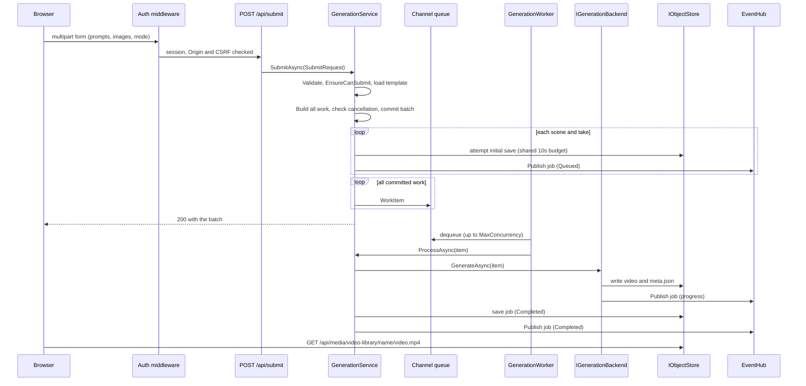

import WhoWhatWhy from '@site/src/components/WhoWhatWhy';
import Steps from '@site/src/components/Steps';

<WhoWhatWhy
  who="Developers debugging or extending the submit and progress path"
  what="What happens between pressing Generate and a playable video, including the server-sent events."
  why="So you know which component owns each step when something stalls."
/>

A generation request does not run inside the HTTP call. The endpoint validates and queues the job. A background worker runs it, and the browser follows progress on a server-sent event stream.



<Steps
  steps={[
    {
      title: 'Parse the form',
      to: '/developers/domains/server-api',
      body: 'GenerationEndpoints reads prompt, scene_name, input_image_N, aspect_ratio, duration_seconds, takes and mode from the multipart form and builds a SubmitRequest. The route allows a 324 MB body and is rate limited per creator.',
    },
    {
      title: 'Validate and fail fast',
      to: '/developers/domains/generation',
      body: 'GenerationService.SubmitAsync checks scene count, prompt and negative prompt length, names, aspect ratio, duration and takes. Then the backend gets to refuse (EnsureCanSubmit), the workflow template for the mode must exist, and the open-jobs ceiling must leave room.',
    },
    {
      title: 'Create one job per scene and take',
      body: 'Build every WorkItem before commitment. After the final caller-cancellation check, register the batch, attempt initial saves within one independent ten-second budget, then queue all items without caller cancellation.',
    },
    {
      title: 'Run on a worker slot',
      to: '/developers/domains/azure-ml-provider',
      body: 'GenerationWorker owns active new and recovered tasks under one backend-sized semaphore and awaits them at shutdown. ComfyUI runs one at a time. Azure ML queues accepted jobs on the node.',
    },
    {
      title: 'Store the result',
      to: '/developers/architecture/storage-and-state',
      body: 'The backend writes the video and meta.json under video-library/job-name/. The service then marks the job Completed or Failed and saves the record again.',
    },
    {
      title: 'Serve it',
      body: 'GET /api/media/video-library/... opens the blob as a stream and returns it with range processing so players can seek without the server buffering the file.',
    },
  ]}
/>

## Server-sent events

`GET /api/events` returns an SSE stream backed by `EventHub`. Anything that implements `IEventPublisher` can push to it. Two event types exist today:

| Event | Payload | Published by |
|---|---|---|
| `job` | The full `GenerationJob` JSON | `JobRecords.SaveAsync`, `JobRecords.Publish`, and the ComfyUI progress callback |
| `run` | The full `TrainingRun` JSON | `TrainingService.SaveAsync` |

The stream also sends a `ready` event when it opens and a `ping` every 15 seconds so proxies do not close an idle connection.

The stream owns a linked lifetime token for its subscription and timer. Closing or disposing it cancels both pending waits, observes their completion, and disposes the event enumerator. The timer uses the injected `TimeProvider`.

```csharp title="src/VideoSafetyStudio.Infrastructure/Events/EventHub.cs"
public void Publish(string type, object payload)
{
    var message = new ServerEvent(type, System.Text.Json.JsonSerializer.Serialize(payload, payload.GetType(), Application.Json.Options));
    lock (_gate)
    {
        foreach (var subscriber in _subscribers)
        {
            subscriber.Writer.TryWrite(message);
        }
    }
}
```

### Gotchas

- The payload is serialized at publish time. Mutating the job afterwards does not change what clients already received, so publish after you set the fields you want them to see.
- Each subscriber has a bounded channel of 256 events with `DropOldest`. A slow client loses old events and never blocks a job. The UI must treat events as hints and be able to refetch `/api/jobs/{name}`.
- Ordinary `JobRecords.SaveAsync` logs storage errors and still publishes; cancellation of its token propagates. Accepted provider identities use awaited `SaveRequiredAsync` calls, which surface persistence failures. See [Azure ML provider](../domains/azure-ml-provider.mdx) for the bounded handoff.
- `/api/events` is a long-lived GET. In Entra mode it needs a session like any other `/api` path, but it needs no CSRF token because it is not a mutating method.

## Failure paths

| Failure | What the client sees |
|---|---|
| Bad input | 400 with `{"error": ...}` before anything is queued |
| Backend refuses (not armed, not prepared) | 409 before anything is queued |
| Too many unfinished jobs | 409 "Too many unfinished jobs. Wait for some to finish." |
| Too many submits in the window | 429, with nothing queued |
| Workflow file missing | 409 (`MissingWorkflowException`) |
| Job fails on the worker | Job status `Failed` with a redacted message cut to 200 characters; the queue keeps going |
| Provider timeout without host cancellation | Job becomes `Failed`; it is not mistaken for server shutdown |
| Server restarts mid-job | Jobs the provider already accepted resume; others become `Failed` with "Interrupted by a restart" |
| Unknown job name | `/api/jobs/{name}` returns a `Failed` stub so the browser stops waiting |

The recovery logic is in `GenerationService.RecoverAsync`, called once when the worker starts. But batches are not persisted: after a restart `GET /api/batches/{id}` returns 404 even though the jobs themselves are restored.

Recovery and gallery reads isolate malformed JSON and invalid record shapes. A damaged document is logged and skipped, leaving healthy records available. A real worker shutdown preserves accepted remote identities for recovery; terminal saves use their own ten-second budget.
