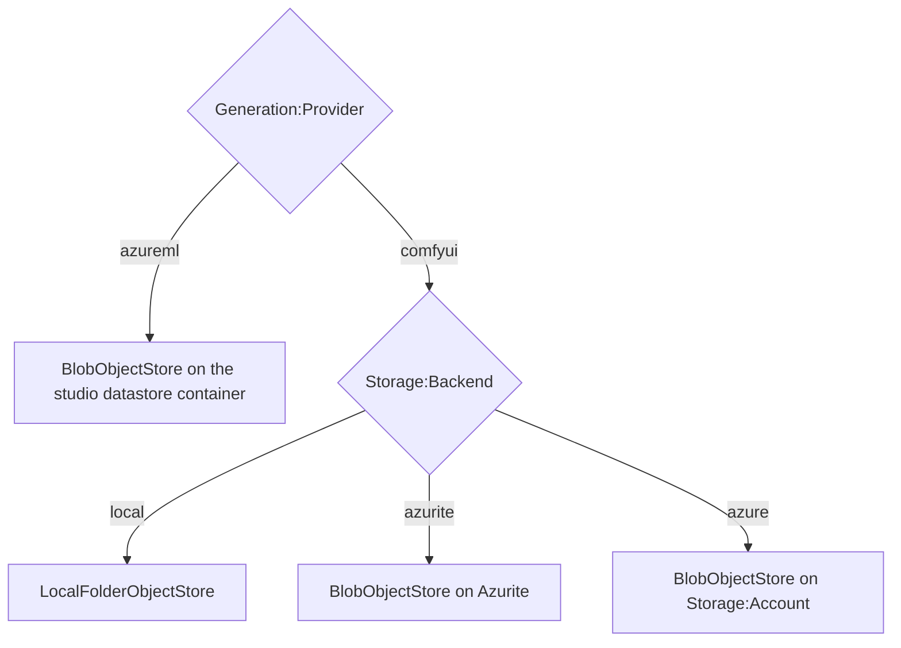

import WhoWhatWhy from '@site/src/components/WhoWhatWhy';

<WhoWhatWhy
  who="Developers who read or write files, job records or dataset artifacts"
  what="The IObjectStore port, how a backend is chosen, and the prefix layout for the library, jobs and vision projects."
  why="So you put new data under the right prefix and do not rely on memory that a restart wipes."
/>

The server has no database. All durable state is JSON and media files in one object store, addressed by slash-separated keys. But a small amount of state (the job index and batches) is held in memory and rebuilt from the store on start.

## The port

```csharp title="src/VideoSafetyStudio.Application/Abstractions/Abstractions.cs"
public interface IObjectStore
{
    Task<bool> ExistsAsync(string key, CancellationToken ct = default);
    Task<byte[]?> ReadAsync(string key, CancellationToken ct = default);
    Task<Stream?> OpenReadAsync(string key, CancellationToken ct = default);
    Task WriteAsync(string key, ReadOnlyMemory<byte> data, bool overwrite = true, CancellationToken ct = default);
    Task UploadAsync(string key, string path, bool overwrite = false, CancellationToken ct = default);
    Task DownloadAsync(string key, string path, CancellationToken ct = default);
    Task<IReadOnlyList<string>> ListAsync(string prefix, CancellationToken ct = default);
}
```

`WriteAsync` with `overwrite: false` throws `IOException` when the key exists. `VisionService.CreateProjectAsync` relies on that to turn a duplicate project into a 409. `ListAsync` returns full keys in ordinal order and works on a prefix without a trailing slash.

`OpenReadAsync` returns a seekable stream the caller disposes, or `null` when the key does not exist. Use it for media: `GET /api/media` hands the stream straight to `Results.Stream`, so a 400 MB video is never copied into a byte array first. `ReadAsync` is still the right call for JSON documents.

## Choosing a store

`StoreSelection` in `DependencyInjection.AddStudio` picks the implementation:



| Backend | Class | Notes |
|---|---|---|
| `local` | `LocalFolderObjectStore` | A folder. Default `.dev-data\blob` under the server content root. A mounted share works the same way. |
| `azurite` | `BlobObjectStore` | Connection string from `ConnectionStrings:blobs` (the AppHost sets it) or `Storage:Connection`. |
| `azure` | `BlobObjectStore` | `https://{Storage:Account}.blob.core.windows.net` with the shared credential. |
| (azureml provider) | `BlobObjectStore` | Always the studio storage account and container from `AzureMl:*`. `Storage:*` is ignored. The container is not created, because the identity may hold data access only. |

Every store runs keys through `StoreKey.Check`, which rejects empty keys, a leading slash, backslashes, colons (so a Windows drive letter cannot slip through) and `.` or `..` segments. Do not build keys from user input without going through a method that checks them: `Names.Check` for project and class names, `Names.CheckVideo` for a video id, `Names.CheckFrame` for a frame number.

:::warning
In Azure ML mode the object store and the job's run-data datastore are the same container. The server writes inputs under `studio/web-inputs/` and the job writes its output under `video-library/{job}/`, and both sides must agree on those paths. The prepared code and models sit in a separate release container the server cannot write. See [Azure ML provider](../domains/azure-ml-provider.mdx).
:::

## Key layout

```text
video-library/{job}/video.mp4            generated video (ComfyUI: video plus the ComfyUI extension; Azure ML: the file the job wrote)
video-library/{job}/meta.json            GalleryMeta: prompt, seed, size, timing, mode
video-library-jobs/{job}.json            GenerationJob record (outside the library prefix)
studio/web-inputs/{yyyyMMdd}/...         Azure ML job inputs: reference image and rendered workflow
vision/projects/{project}/
  project.json                           name and classes
  sources/{video}/video.mp4 + source.json
  frames/{video}/index.json + 000001.jpg ...
  labels/{video}/000001.json             boxes for one frame
  datasets/v001/{train,val,manifest}.json
  runs/{run}/run.json
  runs/{run}/out/...                     everything the trainer wrote
```

Two prefixes need explaining.

**`video-library/` is what the gallery scans.** `GetGalleryAsync` lists the prefix and reads every `meta.json`. Job records are deliberately stored under `video-library-jobs/`, a separate prefix, so the gallery never sees them. The blob store lists with `prefix + "/"`, so the two names do not collide.

**`vision/projects/` is flat by project.** Keys are built by `VisionService.Key(project, ...)`, which validates the project name first. Video ids are `v` plus the first 12 hex characters of the file's SHA-256, so importing the same file twice reuses the same source.

## Job records

`GenerationJob` is the persisted shape. `JobRecords.SaveAsync` writes it to `video-library-jobs/{name}.json` and publishes a `job` event.

```csharp title="src/VideoSafetyStudio.Domain/Generation/Job.cs"
public sealed class GenerationJob
{
    public required string Name { get; init; }
    public required string DisplayName { get; init; }
    public string Status { get; set; } = JobStatus.Queued;
    public string? Mode { get; init; }
    public string? PromptId { get; set; }   // ComfyUI
    public string? RemoteId { get; set; }   // Azure ML job name
    public JobContext? Context { get; set; }
    public JobProgress? Progress { get; set; }
    public TimingSummary? Timing { get; set; }
    // ...
}
```

A ComfyUI job is resumable when it has `PromptId` and `Context`; for Azure ML it is `RemoteId` and `Context`. `RecoverAsync` asks the backend `CanResume(job)` for each non-terminal record found on start.

## What lives only in memory

| State | Where | Effect of a restart |
|---|---|---|
| Job index (`_jobs`) | `GenerationService` | Rebuilt from `video-library-jobs/`, skipping finished jobs older than `ComfyUi:JobRetentionHours` |
| Batches (`_batches`) | `GenerationService` | Lost. `GET /api/batches/{id}` returns 404. |
| The work queue | `Channel<WorkItem>` | Lost. Queued jobs that never reached the provider are marked `Failed`. |
| SSE subscribers | `EventHub` | Clients reconnect |
| Azure ML status cache | `AzureMlBackend`, 15 seconds | Refetched |
| Training busy lock | `TrainingService` | Reset. A run in progress is not resumed; shutdown cancels its container. |

The index also shrinks while the server runs. Every submit prunes finished jobs past the retention, and whole batches go once all their jobs qualify. Storage keeps the records either way, so this only affects what `GET /api/jobs` and `GET /api/batches/{id}` can still answer.

The server is built for one instance. Nothing here is safe to scale out: the queue, the index and the training lock are all process-local, and the auth data-protection keys are persisted to a single folder.

## Where to change things

- A new durable artifact: add a key under an existing prefix and write it through `IObjectStore`. Avoid a new top-level prefix unless a service owns it.
- A new store backend: implement `IObjectStore`, add a case to `ObjectStoreFactory.Create` and a value to `Storage:Backend`.
- Anything the gallery should show: write a `meta.json` beside the video with the `GalleryMeta` shape.
