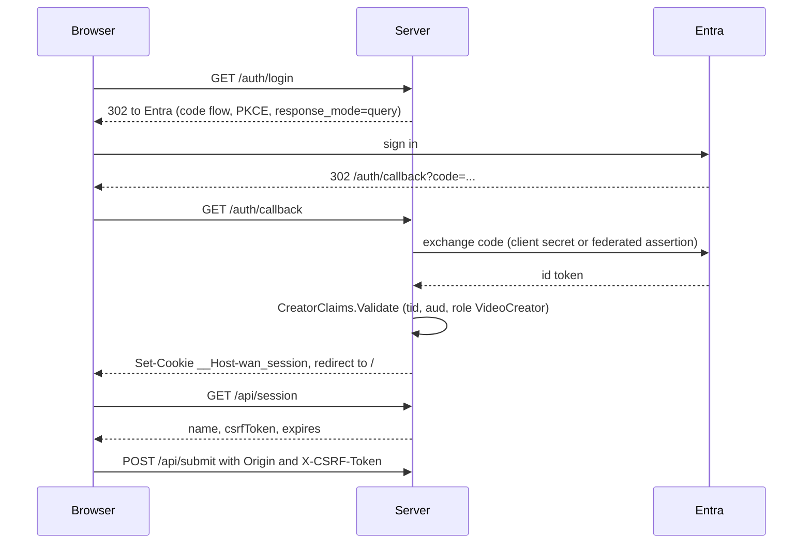

import WhoWhatWhy from '@site/src/components/WhoWhatWhy';

<WhoWhatWhy
  who="Developers touching sign-in, sessions or anything that mutates state over HTTP"
  what="How the two auth modes work, what the middleware enforces, and the reason the callback uses a GET."
  why="So a new endpoint is protected by default and a sign-in change does not break the CSRF check."
/>

Auth lives in `Server\Auth`. There are two modes, chosen by `Auth:Mode`.

| Mode | When | Behavior |
|---|---|---|
| `None` | Default in Development | Every request gets one fixed identity, "Local developer". No cookie and no CSRF token, but the host and cross-origin checks below still run. |
| `Entra` | Default everywhere else | Microsoft Entra sign-in, a role check, a session cookie and CSRF protection. |

An explicit `Auth:Mode` always wins. `None` outside Development is allowed, because a gateway in front of the site may already authenticate, but the server logs a warning at start: anyone who can reach the site can submit GPU jobs.



## Settings resolution

`AuthSettings.Resolve` runs when the settings singleton is first requested, which `UseStudioAuth` and `MapAuth` do at startup. A misconfigured Entra site fails at startup, before anyone tries to sign in. It requires:

- `Auth:ClientId`
- `Auth:PublicOrigin`, matching `https://host` or a loopback `http://` origin
- a tenant, from `Auth:TenantId` or `AzureMl:TenantId`
- a client credential: `AZURE_CLIENT_ID` (managed identity, federated) or `Auth:ClientSecret`

Without a secret, the managed identity signs a client assertion for the token exchange. The assertion comes from `credential.GetTokenAsync` with scope `api://AzureADTokenExchange/.default`.

`Auth:AllowedHosts` is read only in `None` mode, where it is the list of `Host` values the middleware accepts.

## The role check

After Entra returns a token, `CreatorClaims.Validate` accepts it only if all of these hold:

- `tid` equals the configured tenant
- `aud` contains the client id
- `roles` contains `VideoCreator` (`AuthSettings.RequiredRole`)
- `oid` is a GUID and `exp` parses

The verdict is `Accepted`, `Forbidden` (wrong tenant, audience or role) or `Failed` (expired token). The handler redirects to `/?signin=forbidden` or `/?signin=failed`. On success it replaces the principal with a small session identity of `oid`, `name` and a random 32-byte `csrf` claim. The session lasts at most one hour (it never outlives the token) and does not slide.

```csharp title="src/VideoSafetyStudio.Server/Auth/CreatorClaims.cs"
if (tenant != settings.TenantId || !audiences.Contains(settings.ClientId) || !roles.Contains(AuthSettings.RequiredRole))
{
    return ClaimsVerdict.Forbidden;
}
```

## Why response_mode=query

```csharp title="src/VideoSafetyStudio.Server/Auth/AuthExtensions.cs"
// A GET callback: the default form_post would arrive as a cross-origin POST and fail the CSRF/Origin check.
oidc.ResponseMode = OpenIdConnectResponseMode.Query;
```

OpenID Connect's default `form_post` makes Entra send the browser back to `/auth/callback` with a cross-origin POST. The middleware rejects any non-GET whose `Origin` is not the site's own, so that callback would be refused. Using the query response mode turns the callback into a GET, which the middleware does not CSRF-check. If you change the response mode, you must exempt the callback path from the origin check as well.

Other OIDC settings: PKCE is on, `SaveTokens` is off, claim mapping is off (`MapInboundClaims = false`), and the redirect URI and prompt (`select_account`) are pinned in `OnRedirectToIdentityProvider`, because behind an App Service proxy the request URL is not the public one.

## The request middleware

`UseStudioAuth` installs a middleware (`Protect`) that runs before every endpoint. In `Entra` mode it does this for each request:

1. For any host other than `Auth:PublicOrigin`'s authority, return 403. `/healthz` is the exception, because platform probes may not send the site host.
2. Read the session from the session cookie.
3. Decide whether the path is public. Public are `/`, `/videos`, `/healthz`, `/health`, `/alive`, `/auth/login`, `/auth/callback`, `/auth/logout`, plus GET or HEAD of the built UI's own files: anything under `/assets/`, `/index.html` and `/favicon.ico`. Everything else needs a session.
4. If the path is not public and there is no session, return 401.
5. For non-GET, non-HEAD, non-OPTIONS methods, require `Origin` to equal `Auth:PublicOrigin` and the `X-CSRF-Token` header to equal the session's CSRF claim (compared in constant time). Otherwise 403.

Step 3 fails closed. An earlier version treated every path outside `/api` and `/auth` as public, so a new top-level route was anonymous until someone noticed. Now a new route is protected unless you name it, and the only anonymous files are the ones the browser needs before sign-in.

```csharp title="src/VideoSafetyStudio.Server/Auth/AuthExtensions.cs"
// Fail closed: only the listed pages and the built UI's static files are anonymous; any new route needs a session.
var isStatic = (HttpMethods.IsGet(context.Request.Method) || HttpMethods.IsHead(context.Request.Method)) &&
    (path.StartsWith("/assets/", StringComparison.Ordinal) || path is "/index.html" or "/favicon.ico");
var isPublic = PublicPaths.Contains(path) || isStatic;
```

```csharp title="src/VideoSafetyStudio.Server/Auth/AuthExtensions.cs"
var originOk = context.Request.Headers.Origin == settings.Origin;
var token = context.Request.Headers["X-CSRF-Token"].ToString();
var tokenOk = session is not null && CryptographicOperations.FixedTimeEquals(Encoding.UTF8.GetBytes(token), Encoding.UTF8.GetBytes(session.Csrf));
```

The CSRF token reaches the browser through `GET /api/session`, which returns `name`, `csrfToken` and `expires`. The UI sends it back on every write.

Because anything outside the public list needs a session, a new endpoint in an endpoint file is protected without extra code. That includes `/api/events`, `/api/media/...` and `/api/agent`.

### None mode

In `None` mode the middleware stores a fixed `StudioSession` on `HttpContext.Items` and calls the next delegate. `/api/session` then returns the local identity with a far-future expiry, so the UI works unchanged. `/auth/login` just redirects to `/`.

Two checks survive the lack of sign-in, because a dev machine on a shared network is still reachable:

- The `Host` header must be in the allow list. In Development that list is `localhost`, `127.0.0.1` and `[::1]`, plus anything in `Auth:AllowedHosts` (comma separated). Outside Development an empty `Auth:AllowedHosts` means any host, which is what a gateway in front of the site needs.
- A POST, PUT, PATCH or DELETE that carries an `Origin` header must carry this site's own origin. A request with no `Origin` passes, since that is what curl and the Aspire health probes send. Anything else gets 403 with "Cross-origin request refused."

That second rule is what stops a page on another site from driving your local studio through the browser you already have open.

## Session storage

The cookie name depends on the origin. On https it is `__Host-wan_session`; the `__Host-` prefix is a browser rule that only holds when the cookie is `Secure`, has `Path=/` and names no `Domain`, which is exactly how the cookie is configured. On a plain http origin that prefix would be rejected outright, so the name falls back to `wan_session`. Either way it is `HttpOnly` with `SameSite=Lax`.

Cookies are protected with ASP.NET Data Protection under the application name `wan-safety-studio`. When `Auth:KeysPath` is set (or `WEBSITE_SITE_NAME` is, which implies `/home/.wan-studio/keys`) and the mode is Entra, the keys persist to that folder so sessions survive a restart. But if the folder cannot be created the site still starts, logs a warning and sessions end on restart.

:::warning
Single instance only. Keys live on one disk and the queue is in memory. Running more than one instance would break sessions and job state.
:::

## Headers, rate limits and body size

`Server\Auth\Hardening.cs` holds three things that are not sign-in but share the same middleware pipeline.

**Security headers.** `UseSecurityHeaders` runs before the error mapper and before auth, so a 401 or 403 carries them too. Every response gets `X-Content-Type-Options: nosniff`, `Referrer-Policy: no-referrer`, `X-Frame-Options: DENY` and a Content-Security-Policy. The policy keeps `script-src` at `'self'` and allows inline styles, because the diagram renderer injects `<style>` elements. `media-src` is `'self' blob:`, and when `Storage:Backend` is `azure` it also names `https://<Storage:Account>.blob.core.windows.net` so videos served straight from the account still play.

**Rate limits.** Two fixed-window policies, partitioned by the session name (`anonymous` in None mode), reject with 429:

| Policy | Applied to | Default |
|---|---|---|
| `paid` | `POST /api/submit` | `RateLimits:SubmitPermits`, 10 per window |
| `agent` | `POST /api/agent` | `RateLimits:AgentPermits`, 60 per window |

The window is `RateLimits:WindowMinutes`, 10 by default, and there is no queue: over the limit is a refusal, not a wait. Both routes cost real money, which is the whole reason they are the two with a limit.

**Body size.** Kestrel's global ceiling is 32 MB (`BodyLimits.Default`). The two upload routes raise it with `RequestSizeLimit` metadata: 512 MB for a vision video upload, 324 MB for a submit (five scenes at 64 MB plus form text). Anything else that grows a request body needs its own limit, or it stops at 32 MB.

```csharp title="src/VideoSafetyStudio.Server/Endpoints/GenerationEndpoints.cs"
}).RequireRateLimiting(Hardening.PaidPolicy).WithMetadata(new RequestSizeLimitAttribute(BodyLimits.Submit));
```

## Gotchas

- The OpenID Connect scheme is registered even in `None` mode, with placeholder values that are never used. Do not read anything from it when `Mode` is `None`.
- `Protect` compares `Origin` with a string equals. A site served on a second hostname (for example a custom domain next to the default one) will fail every POST. Set `Auth:PublicOrigin` to the one hostname users actually use.
- The tests in `AuthTests.cs` mint a session cookie with the real data-protection ticket format through `IOptionsMonitor<CookieAuthenticationOptions>`. Reuse that helper instead of mocking auth.

## Where to change things

| You want to | Change |
|---|---|
| Change the allowed role | `AuthSettings.RequiredRole` and the app role in the Entra registration |
| Allow another public path | `AuthExtensions.PublicPaths` |
| Allow another host in None mode | `Auth:AllowedHosts` |
| Change session length | `CreatorClaims.SessionLifetime` |
| Change a rate limit or body ceiling | `RateLimits:*` for the numbers, `Hardening` and `BodyLimits` for the policies themselves |
| Add a claim to the session | `CreatorClaims.Validate`, then read it from `HttpContext.Items[typeof(StudioSession)]` |
