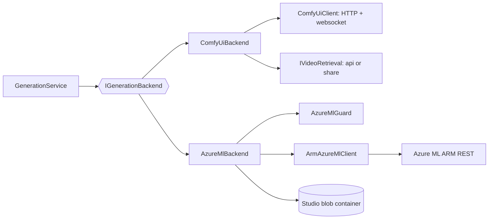

import WhoWhatWhy from '@site/src/components/WhoWhatWhy';

<WhoWhatWhy
  who="Developers working on where generations run, or adding a new backend"
  what="The backend port, the two implementations, the Azure ML job spec and its spending guard."
  why="So changes to submission stay inside the safety checks and a new provider needs no change to GenerationService."
/>

Generation can run on a local ComfyUI server or as Azure ML command jobs. `GenerationService` talks only to `IGenerationBackend`, and `Generation:Provider` decides which implementation the container builds.

## The port

```csharp title="src/VideoSafetyStudio.Application/Generation/IGenerationBackend.cs"
public interface IGenerationBackend
{
    string Provider { get; }
    int MaxConcurrency { get; }
    string NewJobName();
    void EnsureCanSubmit(SubmitRequest request);
    bool ModeAvailable(WanMode mode);
    Task<object> StatusAsync(string storage, CancellationToken ct);
    Task<IReadOnlyList<object>> OpenJobsAsync(IReadOnlyList<GenerationJob> local, CancellationToken ct);
    Task GenerateAsync(WorkItem item, double started, CancellationToken ct);
    bool CanResume(GenerationJob job);
    Task ResumeAsync(GenerationJob job, CancellationToken ct);
}
```

`GenerateAsync` runs one job to completion and must leave a video and a `meta.json` under `video-library/{job}/`. It throws on failure and the service marks the job `Failed`.

## Two backends

| | `ComfyUiBackend` | `AzureMlBackend` |
|---|---|---|
| Project | Application | Infrastructure |
| Job name | `local-` + 12 hex | `wan-` + 12 hex |
| `MaxConcurrency` | 1 | `AzureMl:MaxConcurrency` (25) |
| Submit check | none | prepared release, armed, image check |
| How it runs | Upload image, render workflow, queue on ComfyUI, follow the websocket | Upload inputs to blob, create an ARM command job, poll |
| Video | Fetched through `IVideoRetrieval` and written to the store | Already written by the job into the same container |
| Resume key | `PromptId` and `Context` | `RemoteId` and `Context` |
| Stage timings | Yes, from the websocket | No, phases only |



## Azure ML job flow

`AzureMlBackend.GenerateAsync` does this in order:

1. Render the workflow template and write the reference image and `workflow.json` under `studio/web-inputs/{yyyyMMdd}/...`.
2. Build an `AzureMlJobSpec` with `AzureMlJobSpecBuilder.Build`.
3. Run `AzureMlGuard.Validate` on the spec.
4. Create the job through `IAzureMlClient.CreateJobAsync`. This call is never retried and never cancelled halfway.
5. Read the job back and run `AzureMlGuard.VerifyCreated`. If that fails, cancel the job and throw `AzureMlSafetyException`.
6. Save `RemoteId` and the studio URL on the job record.
7. Poll until the job reaches a terminal state, mapping Azure ML statuses to `JobStatus`. If the poll loop gives up before seeing a terminal state (twenty consecutive transport failures, say), it cancels the remote job on the way out, waits at most thirty seconds for that call, and logs if the cancel also fails. A cancelled poll from server shutdown skips this, because the job should survive for a resume.
8. List `video-library/{job}/`, pick the video with `AzureMlOutput.PickVideo`, write `meta.json` beside it.

### Job spec to ARM body

The spec is a record, and `ToArmBody()` produces the REST payload. The job is a `Command` job on experiment `comfyui-wan`, one instance, with the repo and models mounted read-only and the image and workflow downloaded.

```csharp title="src/VideoSafetyStudio.Infrastructure/AzureMl/AzureMlJobSpec.cs"
["outputs"] = new JsonObject { ["generated"] = new JsonObject { ["jobOutputType"] = "uri_folder", ["uri"] = OutputUri, ["mode"] = "ReadWriteMount" } },
["limits"] = new JsonObject { ["jobLimitsType"] = "Command", ["timeout"] = $"PT{TimeoutSeconds}S" },
["resources"] = new JsonObject { ["instanceCount"] = InstanceCount },
["identity"] = new JsonObject { ["identityType"] = "Managed", ["clientId"] = IdentityClientId },
```

Prompts and other settings travel as literal inputs that Azure ML pastes into a shell command inside double quotes. `ShellDoubleQuoted` escapes backslash, quote, dollar and backtick, and turns carriage returns into spaces. Any new literal input that contains user text must go through it.

The REST API wants full ARM ids for a registered environment or model, not the short `azureml:name:version` form. `EnvironmentArmId` and `ModelVersionArmId` expand them.

### Guard rules

`AzureMlGuard` is a port of the Python cost guard. It runs twice: on the spec before creation, and on the job Azure ML stored afterwards.

| Rule | Where |
|---|---|
| Generation must be armed (`AzureMl:Armed`) | `Validate` |
| Experiment and compute must be the approved ones | `Validate` |
| Timeout 1 to 7200 seconds | `Validate` |
| Exactly one instance, batch size one | `Validate` |
| Command, environment, models and code must match the prepared release | `Validate` |
| Compute identity must be the configured one | `Validate` |
| Output must be under the datastore's `video-library/` | `Validate` |
| Inputs must be datastore paths under `studio/web-inputs/`, not signed URLs | `Validate` |
| Returned job has the same name, a timeout no greater than requested, one instance and the studio compute | `VerifyCreated` |

`IsDatastorePath` rejects `?`, `#`, `..`, backslash and `%` in paths. `NormalizeTimeout` accepts a number, a numeric string or an ISO 8601 duration and refuses to assume a limit when the field is missing.

```csharp title="src/VideoSafetyStudio.Infrastructure/AzureMl/AzureMlBackend.cs"
AzureMlGuard.Validate(spec, foundation, current, gate.IsArmed(current)); // re-checked per job: Stop halts a batch
var createdJob = await client.CreateJobAsync(spec, CancellationToken.None); // never retried; not cancelled halfway
```

But `AzureMlGate.IsArmed` reads `IOptionsMonitor<AzureMlOptions>`, so changing `AzureMl:Armed` takes effect on the next job in a running batch.

### Output discovery

The job writes into `video-library/{job}/` through the mounted output. `FinishAsync` lists that folder up to four times, waiting one poll interval between attempts, because blob listing can lag a finished job. `PickVideo` prefers `.mp4`, then `.webm`, `.mov`, `.webp`, and ranks names containing `preview` last.

### Configuration validation

`AzureMlConfig.Foundation` and `AzureMlConfig.Release` validate everything once, in `AzureMlRuntime.Load`, the first time something resolves it. Missing keys raise `Azure ML is not configured: AzureMl:Workspace, ...` naming each key. The release is `null` when `AzureMl:Release:EnvironmentId` is empty, and that is how "not prepared" is represented.

## Gotchas

- The ARM client is built with a plain `HttpClient`, not the client factory. The default resilience handler from `ServiceDefaults` would retry job creation and bill twice.
- Polling treats `AzureMlException { Transient: true }` and `HttpRequestException` as retryable, up to 20 consecutive failures. When polling gives up while the remote job may still be running, the backend cancels that job before rethrowing, so a lost poll loop does not leave a GPU billing. A shutdown is the exception: cancellation flows through untouched, so a restart can resume the job.
- `AzureMlException` carries the provider's error body in `Detail` rather than in `Message`. `ToString()` prints both, so logs keep it while the UI shows only "Azure ML POST failed (409)".
- Status mapping: `NotStarted`, `Queued`, `Starting`, `Preparing` and `Provisioning` map to `Queued`. `Running`, `Finalizing` and `CancelRequested` map to `Running`.
- In Azure ML mode `Storage:*` is ignored. The store is the studio container, built with `CreateContainer = false`.
- `OpenJobsAsync` scans the newest 200 jobs in the workspace, filtered to experiment `comfyui-wan`, so it also shows jobs submitted by other tools.
- The studio URL is only trusted when it is an `https` URL on `ml.azure.com`. Otherwise it is rebuilt from the workspace ids.
- A cancel failure after a failed verification is swallowed on purpose. The error text tells the operator to run Stop on the control plane.

## Adding another backend

1. Implement `IGenerationBackend`. Put it in `Application` if it needs only ports, otherwise in `Infrastructure`.
2. Pick a `NewJobName()` prefix. The name is also the library folder.
3. In `GenerateAsync`, write `video-library/{job}/{video}` and a `GalleryMeta` as `meta.json`, set `job.Progress` and call `JobRecords.Publish` for live updates, and throw on failure.
4. Set `job.RemoteId` or another resume key as soon as the provider accepts the work, save the record, and return `true` from `CanResume` when you have enough to continue.
5. Add a value to `DependencyInjection.ProviderOf` and a branch in the `IGenerationBackend` registration.
6. Put the spending rules (limits, allowed resources) in a guard class like `AzureMlGuard` and test each rule.
7. Decide which of your exceptions a user may read. Mark those with `ISafeMessage` and keep the provider's own error text in a separate property, as `AzureMlException.Detail` does. Everything unmarked turns into a generic message on the job.

Test it with the same fake-the-edge approach the existing tests use: see `AzureMlTests.cs`, where `FakeAzureMl` stands in for the workspace, and the [testing guide](../guides/testing.mdx).
