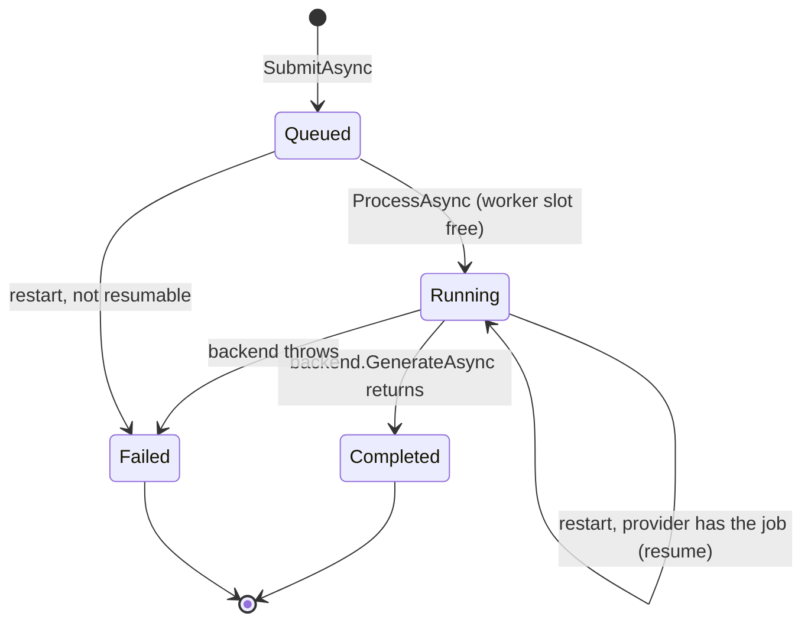

import WhoWhatWhy from '@site/src/components/WhoWhatWhy';

<WhoWhatWhy
  who="Developers working on queueing, quality modes or workflow templates"
  what="How a request becomes jobs, how a mode picks a template and sampler settings, and how placeholders are filled."
  why="So you can add a mode or change a template without touching the HTTP layer or a backend."
/>

Generation lives in `Application\Generation`. `GenerationService` owns the queue and the job index. It does not know how a video is made: that belongs to an `IGenerationBackend` (see [Azure ML provider](./azure-ml-provider.mdx)).



## Modes

A mode is a preset of workflow template and sampler settings. The list is code, in `WanModes.All`.

| Id | Template | Steps (split) | CFG | Sampler | FPS | Model |
|---|---|---|---|---|---|---|
| `draft` | `wan22_i2v_lightning.api.json` | 4 (2) | 1.0 | euler | 16 | 14B + lightx2v 4-step LoRA |
| `fast` | `wan22_i2v_lightning.api.json` | 7 (3) | 1.0 | euler | 16 | 14B + lightx2v 4-step LoRA |
| `turbo` | `wan22_ti2v_5b.api.json` | 20 (20) | 5.0 | uni_pc | 24 | Wan 2.2 TI2V-5B |
| `prime` | `wan22_i2v.api.json` | 20 (10) | 3.5 | euler | 16 | Wan 2.2 14B |

`prime` is the default (`WanModes.DefaultId`). Split is the step where the 14B model hands from the high-noise expert to the low-noise one. Turbo has a single sampler, so its split equals its step count.

```csharp title="src/VideoSafetyStudio.Application/Generation/WanModes.cs"
public static WanMode Get(string? id) =>
    All.FirstOrDefault(mode => mode.Id == (string.IsNullOrWhiteSpace(id) ? DefaultId : id))
    ?? throw new VideoSafetyStudio.Domain.ValidationException($"Mode must be one of: {string.Join(", ", All.Select(m => m.Id))}.");
```

`GET /api/modes` lists them with an `available` flag from `backend.ModeAvailable(mode)`. ComfyUI marks a mode available when its template file exists. Azure ML also needs a prepared release.

## Submit

`SubmitAsync` takes a `SubmitRequest` and returns a `Batch`:

```csharp title="src/VideoSafetyStudio.Application/Generation/GenerationOptions.cs"
public sealed record SubmitRequest(
    IReadOnlyList<string> Prompts,
    string NegativePrompt,
    string AspectRatio,
    double DurationSeconds,
    int Takes,
    IReadOnlyList<SceneImage?> Images,
    string? Mode = null,
    IReadOnlyList<string>? Names = null);
```

The rules in `Validate`:

- 1 to 5 scenes, each prompt 1 to 4000 characters.
- The negative prompt is at most 4000 characters.
- Aspect ratio is `16:9` (1024x576), `4:3` (896x672) or `1:1` (768x768).
- Duration 5 to 10 seconds. Takes are 1, 3 or 5.
- Scene 1 must have an image. A later scene without an image reuses scene 1's.
- Custom names are at most 50 characters (`MaxNameLength`).

Every scene and take becomes one job, and on the Azure ML path each job is a billed GPU run. A batch of 5 scenes with 5 takes is 25 jobs.

### The open-jobs ceiling

After validation, `SubmitAsync` takes a submit gate (a one-slot semaphore), prunes the job index, and refuses the request when the jobs it would create plus the jobs already unfinished would pass `ComfyUi:MaxOpenJobs`, 50 by default. The refusal is a `ConflictException`, so the caller sees 409 and "Too many unfinished jobs. Wait for some to finish."

The gate matters because the check and the registration have to be one step. Two submits arriving together would otherwise both read the old count and both pass.

```csharp title="src/VideoSafetyStudio.Application/Generation/GenerationService.cs"
Prune();
if (OpenJobs().Count + request.Prompts.Count * request.Takes > Math.Max(1, options.Value.MaxOpenJobs))
{
    throw new ConflictException("Too many unfinished jobs. Wait for some to finish.");
}
```

`Prune` drops finished jobs older than `ComfyUi:JobRetentionHours` (24 by default) from `_jobs`, and drops a batch once every job in it is both finished and past the retention. Only memory is freed. The job record under `video-library-jobs/` and the gallery entry stay where they are, so an old video is still playable and `GET /api/jobs/{name}` for a pruned job returns the usual `Failed` stub. `RecoverAsync` applies the same cutoff on start, so a restart does not reload years of finished work.

### Per-scene video names

`SubmitRequest.Names` carries optional titles, one per scene. They come from the repeated `scene_name` form field. A blank entry falls back to the image file name plus ` Scene n`. When a scene has several takes the display name gets ` Take n` appended.

```csharp title="src/VideoSafetyStudio.Application/Generation/GenerationService.cs"
var title = request.Names?.ElementAtOrDefault(scene - 1) is { Length: > 0 } custom ? custom : $"{Path.GetFileNameWithoutExtension(image.Name)} Scene {scene}";
// ...
DisplayName = request.Takes > 1 ? $"{title} Take {take}" : title,
```

The display name is separate from the job name. The job name (`wan-...` or `local-...`, from `backend.NewJobName()`) is the library folder and the stable id; the Library shows the display name, which is stored in both the job record and `meta.json`.

## WorkItem

`WorkItem` is what the queue carries. It holds everything a backend needs and nothing it has to look up:

```csharp title="src/VideoSafetyStudio.Application/Generation/GenerationService.cs"
public sealed record WorkItem(GenerationJob Job, string Prompt, SceneImage Image, string Negative, double Duration, int Width, int Height, WanMode Mode);
```

The queue is an unbounded `Channel<WorkItem>`. `GenerationWorker` reads it with `DequeueAllAsync`, takes a slot from a `SemaphoreSlim` sized by `backend.MaxConcurrency`, and calls `ProcessAsync` on a background task. One failed job sets `Failed` and logs, and the loop continues.

## Workflow rendering

Templates are ComfyUI API-format JSON in `src\VideoSafetyStudio.Server\Workflows\`. String values of the form `{{name}}` are replaced by `WorkflowRenderer.Render`. A value that is exactly one placeholder keeps its type, so `"{{seed}}"` becomes a number. A placeholder inside longer text is substituted as a string.

```csharp title="src/VideoSafetyStudio.Application/Generation/WorkflowValues.cs"
public static int Length(double seconds, int fps) => (int)Math.Round(seconds * fps / 4) * 4 + 1;
```

Wan needs a frame count of `4n + 1`. Five seconds at 16 fps is 81 frames. `WorkflowValues.Build` assembles the dictionary of values from the mode, the options (model file names) and the request.

Supported placeholders, from `WorkflowRenderer.Supported`:

`positive_prompt`, `negative_prompt`, `input_image`, `seed`, `width`, `height`, `length`, `fps`, `filename_prefix`, `unet_high`, `unet_low`, `vae_name`, `clip_name`, `steps`, `split_step`, `cfg`, `shift`, `sampler`, `lora_high`, `lora_low`, `unet_5b`, `vae_5b`.

An unknown whole-value placeholder throws `ComfyUiException` that lists the supported ones. Unknown placeholders embedded in longer text are left as they are, without an error.

`GET /api/modes/{mode}/workflow` renders a template with example inputs so you can import it into ComfyUI by hand. It calls `GenerationService.ExportWorkflowAsync`.

`Stages.Of` maps ComfyUI node class types to benchmark stages (`load_models`, `sample_high_noise`, `vae_decode`, and so on). `StageTimer` uses it to turn the ComfyUI websocket events into per-stage timings.

## Timing

Each backend records `phases` (wall-clock spans such as `waiting`, `upload_image`, `comfyui`, `retrieve`, `store_video`) and the ComfyUI path adds per-stage timings. They land in `meta.json` as `TimingSummary` and go to OpenTelemetry through `IGenerationTelemetry`. The meter and trace source names start with `VideoSafetyStudio.`, which `ServiceDefaults` subscribes to.

## What a failed job tells the user

`Fail` writes a short message onto the job, and that message goes to the browser. `SafeMessage` decides what it may contain:

- `ConflictException`, `ValidationException` and anything marked `ISafeMessage` (`AzureMlException`, `AzureMlSafetyException`) keep their own text. These are written for users.
- A `ComfyUiException` keeps its text up to the HTTP status, and whatever the node said after `-> 500:` is cut.
- Anything else becomes "Generation failed unexpectedly. The server log has the details."

Whatever survives then has URLs, `/subscriptions/...` paths and GUIDs replaced with `[redacted]`, and is truncated to 200 characters. The provider's own error body is not thrown away: `AzureMlException.Detail` holds it and `ToString()` prints it, so the log keeps the detail the UI does not get.

```csharp title="src/VideoSafetyStudio.Application/Generation/GenerationService.cs"
text = Regex.Replace(text, @"https?://\S+|/subscriptions/\S+|\b[0-9a-fA-F]{8}-[0-9a-fA-F]{4}-[0-9a-fA-F]{4}-[0-9a-fA-F]{4}-[0-9a-fA-F]{12}\b", "[redacted]");
return text.Length > 200 ? text[..200] : text;
```

## Gotchas

- `Validate` runs before the backend check, and the backend check runs before the template check. All three happen before any job exists, so a rejected request leaves no records.
- `JobRecords.SaveAsync` never throws. A storage outage during submit still lets the request succeed. The job just will not survive a restart. It does take a per-job lock and serializes inside it, so a slow write of an older state cannot land after a newer one.
- The 4n+1 rounding means a requested 7 seconds at 16 fps is 113 frames, which is slightly over 7 seconds. Do not compare durations exactly.
- Each take draws a fresh seed through `WorkflowValues.NewSeed()`, so takes differ even with identical prompts.
- `RecoverAsync` resumes in the background with `CancellationToken.None` for the task itself, so a shutdown does not cancel the poll loop mid-write.

## Where to change things

| You want to | Change |
|---|---|
| Add or tune a mode | `WanModes.All`, plus a template file if it needs a new graph |
| Add a placeholder | `WorkflowRenderer.Supported`, `WorkflowValues.Build`, and the templates that use it |
| Change limits (scenes, duration, takes) | `GenerationService.Validate` and the constants above it. The UI and `VideoHelperTools` mirror these limits, so change them too. |
| Change how many jobs may be open, or how long finished ones stay in memory | `ComfyUi:MaxOpenJobs` and `ComfyUi:JobRetentionHours`, no code change |
| Change an aspect ratio | The `Aspects` dictionary in `GenerationService` |
| Change model file names | `ComfyUi:UnetHigh` and the other keys, no code change |
