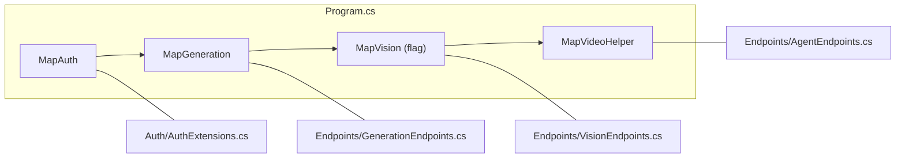

import WhoWhatWhy from '@site/src/components/WhoWhatWhy';

<WhoWhatWhy
  who="Developers calling or adding endpoints"
  what="Every route the server maps, grouped by area, with its handler file and service."
  why="So you can find the code behind a URL and follow the conventions for a new one."
/>

The server uses minimal APIs. Each area is an extension method on `IEndpointRouteBuilder` in `Server\Endpoints\`, called from `Program.cs`. Handlers parse the input and call one service; the result goes back as JSON.



## Conventions

- JSON property names follow `Application.Json.Options` (the same policy for the HTTP layer, job records and events). Config for it is copied into `ConfigureHttpJsonOptions` in `Program.cs`.
- API rejections use `{"error": "message"}`. [ErrorMappingMiddleware](../architecture/overview.mdx) preserves `BadHttpRequestException.StatusCode`, including 413; 5xx messages are generic. Status-code pages supply an envelope for otherwise empty `/api` error responses, including binding failures and method mismatches. Rate-limit rejections and missing media also return JSON.
- In Entra mode every route outside the public list needs a session, and every non-GET needs the `Origin` and `X-CSRF-Token` checks. In None mode the `Host` and cross-origin checks still apply. See [Auth](./auth.mdx).
- Every response carries `nosniff`, `no-referrer`, `X-Frame-Options: DENY` and a Content-Security-Policy, set before auth so 401s carry them too.
- Request bodies stop at 32 MB unless the route raises it. `POST /api/submit` allows 324 MB and the vision video upload allows 512 MB, both through `RequestSizeLimit` metadata. Azure ML adds its own total image limit (`AzureMl:MaxUploadMb`).
- `POST /api/submit` and `POST /api/agent` are rate limited by stable Entra object identity, with one shared bucket in None mode. They answer 429 when a window is used up. Display names do not affect quotas, and the public session response is unchanged.
- Unknown `/api/...` paths return `{"error": "Not found."}` with 404 when the UI is served by the same host.

## Platform and auth

| Method and path | Purpose | Defined in |
|---|---|---|
| `GET /healthz` | `{status, mode}` where mode is `local-dev` or `hosted` | `Program.cs` |
| `GET /health`, `GET /alive` | Aspire health checks, Development only | `ServiceDefaults` |
| `GET /api/session` | Current user name, CSRF token and expiry. 401 when not signed in. | `AuthExtensions.MapAuth` |
| `GET /auth/login` | Start Entra sign-in. Redirects to `/` in None mode. | `AuthExtensions.MapAuth` |
| `GET /auth/callback` | OIDC callback, handled by the OpenID Connect middleware | `AuthExtensions` |
| `POST /auth/logout` | Clear the session cookie | `AuthExtensions.MapAuth` |
| `GET /api/features` | `{datasetBuilder}` | `Program.cs` |

## Generation

All in `GenerationEndpoints.cs`, backed by `GenerationService`.

| Method and path | Purpose |
|---|---|
| `GET /api/status` | Backend status document (mode, workspace, compute state, armed, limits) |
| `POST /api/submit` | Multipart submit. Fields: `prompt` (repeated), `scene_name` (repeated), `input_image_0..n`, `negative_prompt`, `aspect_ratio`, `duration_seconds`, `takes`, `mode`. Returns `{batch}`. Rate limited; 409 when too many jobs are unfinished. |
| `GET /api/modes` | The four modes with `available` flags and the default |
| `GET /api/modes/{mode}/workflow` | The rendered API-format workflow with example inputs |
| `GET /api/batches/{id}` | One batch with its jobs. 404 after a restart. |
| `GET /api/jobs` | Unfinished jobs, as the backend reports them |
| `GET /api/jobs/{name}` | One job. An unknown name returns a `Failed` stub rather than 404. |
| `GET /api/gallery` | Finished videos with metadata and timing |
| `GET /api/media/{**key}` | Stored video bytes, streamed with range support. Only keys under `video-library/` and none containing `..`. |
| `GET /api/events` | Server-sent events (`job`, `run`, `ready`, `ping`) |

```csharp title="src/VideoSafetyStudio.Server/Endpoints/GenerationEndpoints.cs"
api.MapGet("/media/{**key}", async (string key, IObjectStore store, CancellationToken ct) =>
{
    if (!key.StartsWith(GenerationService.Library, StringComparison.Ordinal) || key.Contains(".."))
    {
        return Results.NotFound(new { error = "Media not found." });
    }
    // ...
```

`/api/media` serves content types for `.mp4`, `.webm`, `.mov` and `.mkv`, and `application/octet-stream` for anything else. It opens the blob as a seekable stream through `IObjectStore.OpenReadAsync` and hands that to `Results.Stream`, so a gigabyte of video never sits in server memory while a browser seeks through it.

`POST /api/submit` and the vision video-upload route share `FormRequests.ReadAsync`. Unsupported content types return 415 before the use case runs. Malformed forms return 400; an existing HTTP request status such as 413 is preserved. Both form content types supported by ASP.NET (`multipart/form-data` and `application/x-www-form-urlencoded`) reach parsing, though file-bearing requests need multipart.

`GET /api/events` owns its subscription and timer through a linked lifetime token. Disposing the stream cancels and awaits pending event/timer waits before disposing the enumerator. See [Request flow](../architecture/request-flow.mdx).

## Vision and training

Mapped only when `FEATURE_DATASET_BUILDER_ENABLED=true`. Handlers in `VisionEndpoints.cs`, backed by `VisionService` and `TrainingService`.

| Method and path | Purpose | Status |
|---|---|---|
| `GET /api/vision/projects` | List project names | 200 |
| `POST /api/vision/projects` | Create `{name, classes}` | 201, 409 on duplicate |
| `GET /api/vision/projects/{project}` | Project record | 200 |
| `GET /api/vision/projects/{project}/videos` | Source videos with frame counts | 200 |
| `POST /api/vision/projects/{project}/videos` | Upload one video as the `file` field | 201 `{id}` |
| `POST /api/vision/projects/{project}/videos/from-gallery` | Import from the library by `{blob}` | 201 `{id}` |
| `POST /api/vision/projects/{project}/videos/{video}/extract` | Extract frames, `{fps}` default 2 | 201 `{frames}`, 409 if already extracted |
| `GET /api/vision/projects/{project}/frames/{video}` | Frame index | 200 |
| `GET /api/vision/projects/{project}/frames/{video}/{frame}.jpg` | One frame image | 200 |
| `GET /api/vision/projects/{project}/labels/{video}/{frame}` | Labels for a frame | 200 |
| `PUT /api/vision/projects/{project}/labels/{video}/{frame}` | Replace labels `{reviewed, boxes}` | 200 |
| `POST /api/vision/projects/{project}/datasets` | Freeze a version `{valFraction, seed}` (defaults 0.2 and 0) | 201 |
| `GET /api/vision/projects/{project}/datasets` | List versions | 200 |
| `GET /api/vision/trainers` | Registered trainer manifests | 200 |
| `POST /api/vision/projects/{project}/runs` | Start a run `{dataset, trainer, preset, epochs}` | 202, 409 when busy |
| `GET /api/vision/projects/{project}/runs` | List runs, newest first | 200 |
| `GET /api/vision/projects/{project}/runs/{run}` | One run | 200 |

## Video helper

In `AgentEndpoints.cs`.

| Method and path | Purpose |
|---|---|
| `GET /api/agent/status` | `{enabled, model, endpoint host, vision, auth, hint}`. Always mapped. |
| `POST /api/agent` | AG-UI event stream. Mapped only when the helper is fully configured. |

## Adding an endpoint

1. Add a handler to an existing endpoint file, or create `Server\Endpoints\<Area>Endpoints.cs` with a `Map<Area>` extension.
2. Inject the service (and `CancellationToken`) as parameters. Do not put business rules in the handler.
3. Throw `ValidationException`, `NotFoundException` or `ConflictException` for expected failures.
4. Return `Results.Json(value, Json.Options)` so naming matches the rest of the API.
5. Call the new `Map` method in `Program.cs`. Anything outside the public path list is behind the auth middleware already.
6. If the route spends GPU or model money, add `.RequireRateLimiting(Hardening.PaidPolicy)`. If it accepts an upload, add `RequestSizeLimit` metadata, or the body stops at 32 MB.
7. Add a test with `WebApplicationFactory<Program>` (see the [testing guide](../guides/testing.mdx)).
