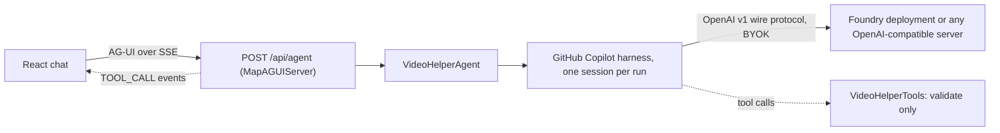

import WhoWhatWhy from '@site/src/components/WhoWhatWhy';
import SettingsTable from '@site/src/components/SettingsTable';

<WhoWhatWhy
  who="Developers changing the prompt assistant on the Create page"
  what="How the agent is hosted, why every run is stateless, the eight form tools and the auth options."
  why="So you can add a control or a model endpoint without opening the agent to anything else."
/>

The Video Production Helper is a chat panel on the Create page. It writes and improves Wan 2.2 prompts and can set form fields for the user. It is off unless its configuration is valid: endpoint and model are required, the endpoint must be an absolute HTTP or HTTPS URL, and the resolved wire API must be `completions` or `responses`. Invalid configuration leaves only the status route mapped, with a hint explaining the error.



## How it is built

`AgentEndpoints.AddVideoHelper` binds `VideoHelperOptions`, registers `VideoHelperAgent` as a singleton and calls `AddAGUIServer()`. `MapVideoHelper` always maps `GET /api/agent/status`, and maps the AG-UI stream at `/api/agent` only when the options are complete.

```csharp title="src/VideoSafetyStudio.Server/Endpoints/AgentEndpoints.cs"
if (app.Services.GetRequiredService<IOptions<VideoHelperOptions>>().Value.Enabled)
{
    app.MapAGUIServer("/api/agent", app.Services.GetRequiredService<VideoHelperAgent>());
}
```

`VideoHelperAgent` derives from the Microsoft Agent Framework `AIAgent` and delegates each run to a `GitHubCopilotAgent` backed by a shared `CopilotClient`. The Copilot harness supplies the agent loop and tool calling. Tokens never go to GitHub. They go to the endpoint you configure, so this is bring-your-own-key.

### Stateless runs

The server keeps no conversation. The browser owns the transcript and sends it with every request, and each message starts with a `<form_state>` JSON block describing the current form. The agent flattens earlier turns into one labelled prompt because the harness takes a single prompt per run:

```csharp title="src/VideoSafetyStudio.Infrastructure/Agent/VideoHelperAgent.cs"
var builder = new StringBuilder("Conversation so far (the form state is only current in the final user message):\n\n");
foreach (var turn in turns.Take(turns.Count - 1))
{
    builder.Append(turn.Role == ChatRole.User ? "User: " : "Assistant: ").AppendLine(StripFormState(turn.Text)).AppendLine();
}
```

`StripFormState` removes the old `<form_state>` blocks from earlier turns so the model never reads a stale copy. Only the newest user turn contributes images (at most five, one per scene), and only when `Agent:Vision` is true.

## Tools

The tools only validate. The browser applies each one when it sees the tool call, and returns nothing the model depends on beyond the `Applied` or `Rejected` text.

```csharp title="src/VideoSafetyStudio.Infrastructure/Agent/VideoHelperTools.cs"
[Description("Set the clip duration in whole seconds, 5 to 10. Longer clips take longer and can drift; 5 is the tuned value.")]
private static string SetDuration([Description("Seconds, 5 to 10")] int seconds) =>
    seconds is >= 5 and <= 10 ? Applied() : "Rejected: duration must be 5 to 10 seconds.";
```

| Tool | Limit enforced |
|---|---|
| `set_scene_prompt` | Scene 1 to 5, non-empty prompt |
| `set_negative_prompt` | none (empty clears it) |
| `add_scene` | at most 5 scenes (enforced by the form) |
| `remove_scene` | scene 1 cannot be removed |
| `set_aspect_ratio` | `16:9`, `4:3`, `1:1` |
| `set_duration` | 5 to 10 whole seconds |
| `set_takes` | 1, 3 or 5 |
| `set_quality` | `draft`, `fast`, `turbo`, `prime` |

These limits mirror `GenerationService.Validate` and `WanModes`. If you change one, change the other. The browser side lives in `web\src\features\create\helper\formTools.ts`.

### Locked down by construction

Each run builds a `SessionConfig` that exposes only those eight tools and turns off config discovery, skills and custom instructions. The system message replaces the harness default with `VideoHelperInstructions.Text`. The permission handler approves a custom tool call only when its name is in the tool set, and rejects everything else:

```csharp title="src/VideoSafetyStudio.Infrastructure/Agent/VideoHelperAgent.cs"
OnPermissionRequest = (request, _) => Task.FromResult(
    request is PermissionRequestCustomTool tool && ToolNames.Contains(tool.ToolName)
        ? PermissionDecision.ApproveOnce()
        : PermissionDecision.Reject("The Video Production Helper may only use the Create page form tools.")),
```

The harness's own shell, file and web tools are therefore unreachable. Keep this property when you add features.

## Authentication to the model endpoint

`VideoHelperOptions.ResolvedAuth` decides how the server authenticates to the model endpoint. This is separate from user sign-in (see [Auth](./auth.mdx)).

| `Agent:Auth` | Credential | Use for |
|---|---|---|
| `ApiKey` | `Agent:ApiKey` sent as the key | Non-Azure OpenAI-compatible servers, or Foundry key auth |
| `AzureCli` | `AzureCliCredential` | Local development against Foundry after `az login` |
| `SystemAssignedManagedIdentity` | `ManagedIdentityCredential` | Azure-hosted, system identity |
| `UserAssignedManagedIdentity` | `ManagedIdentityCredential` with `Agent:ManagedIdentityClientId` | Azure-hosted, shared identity |

Token methods request the scope `https://cognitiveservices.azure.com/.default`. When `Auth` is unset: an `*.azure.com` endpoint with no key uses `AzureCli`, anything else uses `ApiKey`. Several aliases are accepted (`key`, `cli`, `entra`, `managedidentity` and others).

The credential instance is shared, but each run's bearer-token callback uses that run's cancellation token for acquisition. Cancelling a disconnected run stops its pending token request without disabling the credential for later runs.

`WireApi` defaults to `responses` for `*.azure.com` endpoints because Foundry reasoning models reject function tools on `completions`. But for other endpoints it defaults to `completions` for the widest compatibility.

<SettingsTable
  settings={[
    {name: 'Agent__Endpoint', description: 'Absolute HTTP or HTTPS OpenAI v1 base URL. Empty or an unsupported scheme disables the helper.'},
    {name: 'Agent__Model', description: 'Model or Foundry deployment name.'},
    {name: 'Agent__Auth', description: 'ApiKey, AzureCli, SystemAssignedManagedIdentity or UserAssignedManagedIdentity.'},
    {name: 'Agent__ApiKey', description: 'Key for ApiKey auth. Under the AppHost it is the secret parameter agent-api-key.'},
    {name: 'Agent__ManagedIdentityClientId', description: 'Client id for UserAssignedManagedIdentity.'},
    {name: 'Agent__WireApi', description: 'completions or responses. Defaults by endpoint host.'},
    {name: 'Agent__Vision', default: 'true', description: 'Let the helper see scene images. Use false for text-only models.'},
    {name: 'Agent__StateDirectory', description: 'Writable folder for the Copilot runtime state.'},
  ]}
/>

## Gotchas

- Failures are reported twice on purpose. The AG-UI host reduces exceptions to a generic message, so `VideoHelperAgent` logs the real cause and emits it into the chat as a warning text update.
- `GET /api/agent/status` includes `hint` with `ConfigurationError`, so the Create page can say exactly what is missing. It returns the endpoint host only, never the full URL or key.
- On non-Windows hosts the agent sets `HOME` for the Copilot runtime to the state directory, because the container user has a read-only home on App Service. `WritableStateDirectory` tries the configured folder, then local app data, then temp, and takes the first one it can write to.
- The Copilot SDK downloads its CLI at build time. `Infrastructure.csproj` points `CopilotNpmRegistryUrl` at the approved package feed, and `Provider.BearerTokenProvider` is an experimental API in that SDK.
- `/api/agent` lives under `/api`, so in Entra mode it needs a session, a matching `Origin` and the CSRF header, like any other POST.

## Where to change things

| You want to | Change |
|---|---|
| Tune prompt advice | `Agent\VideoHelperInstructions.cs` |
| Add a form control | Define it in `VideoHelperTools.cs` (validation only), implement it in `formTools.ts`, add a test |
| Add an auth method | `VideoHelperAuth`, `ResolvedAuth`, `CreateCredential` and the validation in `ConfigurationError` |
| Support another model API shape | `CreateProvider` in `VideoHelperAgent.cs` |

Tests are in `VideoHelperTests.cs`: tool validation, the transcript builder, option resolution and the unconfigured status response.
