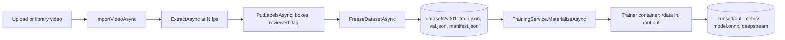

import WhoWhatWhy from '@site/src/components/WhoWhatWhy';

<WhoWhatWhy
  who="Developers working on datasets, labelling, training runs or trainer plug-ins"
  what="How video becomes a frozen COCO dataset, how a trainer container is run, and what the server expects back."
  why="So a customer can swap the detector without the server ever importing a model library."
/>

Everything after generation is the vision domain: import a video, extract frames, label boxes, freeze a dataset version, train, and collect an ONNX model with DeepStream config for the Jetson. It is split across `VisionService` and `TrainingService` in `Application`, with records in `Domain\Vision` and `Domain\Training`.

## Feature gate

The dataset builder is off by default. `Program.cs` reads `FEATURE_DATASET_BUILDER_ENABLED` and maps the `/api/vision` routes only when it is true. `/api/features` always exists and reports the flag so the UI can hide the pages.

```csharp title="src/VideoSafetyStudio.Server/Program.cs"
var datasetBuilder = app.Configuration.GetValue<bool>("FEATURE_DATASET_BUILDER_ENABLED");
app.MapGet("/api/features", () => new { datasetBuilder });
if (datasetBuilder) app.MapVision();
```

The services are always registered; only the routes are gated. `FeatureGateTests` asserts both sides: with the flag unset `/api/vision/projects` is not 200, with `true` it is.

## The data path



### Projects, names and boxes

A project is a name and a list of classes. `Names.Check` requires 2 to 63 lowercase letters, digits or hyphens, and it is used for projects and classes. A project has 1 to 64 unique classes.

A `Box` is in pixel coordinates of the source frame. `Box.Checked` rejects unknown classes, a state other than `auto` or `reviewed`, non-positive size, and boxes outside the frame (with half a pixel of tolerance).

```csharp title="src/VideoSafetyStudio.Domain/Vision/Project.cs"
if (!(W > 0 && H > 0 && X >= 0 && Y >= 0 && X + W <= width + 0.5 && Y + H <= height + 0.5))
{
    throw new ValidationException("Box must have positive size and lie inside the frame.");
}
```

### Sources and frames

A video id is `v` plus the first 12 hex characters of the SHA-256 of the file. Importing the same bytes twice yields the same id and does not upload again. Library imports (`ImportGalleryVideoAsync`) accept only `.mp4` or `.webm` keys under `video-library/` with no `..`.

`ExtractAsync` runs ffmpeg through `IMediaTools` at 0 to 30 fps, up to `MaxFrames = 2000`. It refuses to run twice for one video, because labels depend on frame numbers.

### Freezing a dataset

`FreezeDatasetAsync` builds an immutable version (`v001`, `v002`, ...). It splits by source video, never by frame, so train and validation never share a scene. The split is deterministic: videos are ordered by `SHA256(seed:videoId)` and the first `ceil(videos × valFraction)` go to validation.

Only frames marked `Reviewed` become COCO images. A split with no reviewed frames in training is an error, and a class with no training boxes produces a warning in the manifest.

## Training

`TrainingService.StartAsync` checks the preset and epochs, confirms the dataset exists, then takes a single-slot lock. A second start while one is running gets a 409 (`ConflictException`: "The GPU node is busy").

```csharp title="src/VideoSafetyStudio.Application/Training/TrainingService.cs"
// Fire and forget: the run owns the busy lock until it finishes.
_current = Task.Run(() => ExecuteAsync(run, manifest), CancellationToken.None);
return run;
```

Run status moves through `Queued`, `Preparing`, `Running`, `Uploading` and then `Completed` or `Failed`. Each change is saved to `runs/{id}/run.json` and published as a `run` event.

`ExecuteAsync` does four things:

1. Materialize the dataset into a temp folder (`classes.json`, `train.json`, `val.json`, `images/`).
2. Call `IComputeTarget.RunAsync` with the trainer image and the arguments `all --preset <p> [--epochs N]`.
3. Upload every file from the output folder to `runs/{id}/out/`.
4. Read `metrics.json` into `RunMetrics` (`map50`, `map50_95`, per class) when present.

A non-zero exit code fails the run with "see out/train.log". But the output is uploaded first so the log is kept.

### Compute target

The only `IComputeTarget` in the code is `DockerComputeTarget`, named `local-docker`:

```csharp title="src/VideoSafetyStudio.Infrastructure/Compute/DockerComputeTarget.cs"
foreach (var argument in new[] { "run", "--rm", "--gpus", gpus, "--shm-size", shmSize, "-v", $"{Path.GetFullPath(dataDirectory)}:/data:ro", "-v", $"{Path.GetFullPath(outDirectory)}:/out", image }.Concat(args))
```

So training runs on the machine that hosts the server and needs Docker with a GPU. The older notes describe an Azure ML adapter on the shared node as the next step, but no such class exists yet. The abstraction is in place for it.

## The trainer container contract

The server never imports a model library. A trainer is a container image with a manifest. What the server guarantees:

| Direction | Contract |
|---|---|
| Command | `all --preset <preset>` with an optional `--epochs <n>` |
| `/data` (read-only) | `classes.json` (list of names), `train.json` and `val.json` (COCO, 1-based category ids), `images/` |
| `/out` (writable) | Everything the trainer writes. The server uploads it all. |
| Exit code | 0 is success |

What the server reads back is only `metrics.json`, shaped like `RunMetrics`. By convention the SDK also writes `model.onnx`, `model.json` and a `deepstream\` folder with the nvinfer config, labels and `NOTES.txt`, which the edge bundle uses.

The Python side of the contract is `trainers\sdk.py`: a `Trainer` protocol with `train`, `evaluate`, `export` and `deepstream`, and `run_cli` that wires the commands. See [Add a model trainer](../guides/add-a-model-trainer.mdx).

### Registry

`FileTrainerRegistry` scans for `trainer.json` files under `Trainers:Directories` and then `Trainers:BuiltIn`.

```json title="trainers/yolox/trainer.json"
{
  "name": "yolox",
  "version": "0.1.0",
  "image": "wan-trainer-yolox:dev",
  "licenseCode": "Apache-2.0",
  "licenseWeights": "Apache-2.0 (YOLOX release weights, initialised from COCO; COCO annotations CC BY 4.0, attribution required)",
  "presets": ["nano", "tiny", "s"],
  "defaultPreset": "nano"
}
```

A manifest is valid when the name matches `^[a-z0-9][a-z0-9-]{1,40}$`, there is at least one preset and the default preset is in the list. An invalid manifest throws a `ValidationException` naming the file. Folders whose name starts with `_` are skipped, which is how `trainers\_template` stays out of the list. Both licences are recorded in the manifest on purpose: the weights licence matters as much as the code's.

## Gotchas

- The registry adds `Directories` first and `BuiltIn` last, and later entries replace earlier ones with the same name. A customer trainer named `yolox` is replaced by the built-in. Pick a different name.
- Stored `run.json` files stay `Running` if the server dies mid-run. Nothing marks them failed on start, unlike generation jobs.
- Frame ids are six digits (`000001`) and `Names.CheckFrame` enforces it. Do not invent other id formats.
- `PutLabelsAsync` re-validates every box against the stored frame size, so a UI that scales boxes must send source-pixel coordinates.
- Temp folders under the OS temp path hold downloaded videos, frames and the materialized dataset. They are deleted in `finally` blocks, but a crash leaves them behind.
- Training and generation do not share a lock in code. The "one GPU job at a time" rule is enforced per service, and the node-level limit comes from the single GPU.

## Where to change things

| You want to | Change |
|---|---|
| Change the split or add a stratified split | `VisionService.FreezeDatasetAsync` |
| Add a label field | `Box` in `Domain\Vision\Project.cs` and the COCO build in `BuildCocoAsync` |
| Run training somewhere other than local Docker | Implement `IComputeTarget` and register it in `DependencyInjection.cs` |
| Add a preset | The trainer's own manifest and code, no server change |
| Change the trainer arguments | `TrainingService.ExecuteAsync` and every trainer's CLI |
