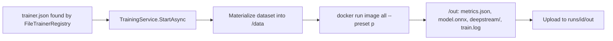

import WhoWhatWhy from '@site/src/components/WhoWhatWhy';
import Steps from '@site/src/components/Steps';

<WhoWhatWhy
  who="Customer AI engineers and developers adding a model other than YOLOX"
  what="The files a trainer needs, the container contract, and how the server discovers and runs it."
  why="So you can train a detector under your own licence without changing server code."
/>

A trainer is a container image plus a `trainer.json`. The server does not import it. It runs the image and reads `metrics.json` back, so the trainer can use any framework and any Python version.



:::note
Only Apache-2.0 trainers ship in this repo (YOLOX). Keep a trainer with a different licence in your own repository and add its folder to `Trainers:Directories`, so the licence stays with you.
:::

<Steps
  steps={[
    {
      title: 'Copy the template',
      body: 'Copy trainers\\_template to trainers\\your-name (in this repo) or to a folder in your own repo. The name of the folder does not matter to the registry, unless it starts with `_`, which hides it. The name field in trainer.json is what counts.',
    },
    {
      title: 'Implement the four methods',
      body: 'A class with an info attribute and train, evaluate, export and deepstream methods, as defined in trainers\\sdk.py. Convert the COCO data to your framework format inside the class.',
    },
    {
      title: 'Write the Dockerfile',
      body: 'Copy sdk.py and your folder into the image and set an ENTRYPOINT that calls run_cli. Model the file on trainers\\yolox\\Dockerfile: pinned requirements from your package feed, checksum-verified weights, and a non-root user that owns /out.',
    },
    {
      title: 'Fill in trainer.json',
      body: 'Image tag, both licences and presets. The registry validates it when it loads.',
    },
    {
      title: 'Point the server at it',
      body: 'Add the parent folder to Trainers__Directories__0, restart the api resource and check GET /api/vision/trainers.',
    },
  ]}
/>

## 1. The trainer class

The contract is a Python `Protocol` in `trainers\sdk.py`. The sdk uses only the standard library, so a trainer image can copy that one file.

```python title="trainers/_template/trainer.py"
class MyTrainer:
    info = TrainerInfo("my-trainer", "0.1.0", "SPDX-code-licence", "weights-licence", ("small", "large"), "small")

    def train(self, request: TrainRequest):
        # Read request.data/{train,val}.json + images; write checkpoints under request.out; honour request.resume.
        raise NotImplementedError

    def evaluate(self, weights, request: TrainRequest) -> Metrics:
        raise NotImplementedError

    def export(self, weights, out, request: TrainRequest) -> OnnxModel:
        # Write out/model.onnx and return its input size. request carries the preset, so export works standalone.
        raise NotImplementedError

    def deepstream(self, model: OnnxModel, classes) -> DeepStreamConfig:
        # nvinfer config + labels (+ parser notes).
        raise NotImplementedError
```

`run_cli` supplies the command line. For the command `all` it runs `train`, `evaluate`, `export` and `deepstream` in order, and it writes:

| File | Written by |
|---|---|
| `metrics.json` | `evaluate` result (`map50`, `map50_95`, `per_class`) |
| `model.onnx`, `model.json` | `export` and the returned `OnnxModel` |
| `deepstream\*` and `deepstream\NOTES.txt` | `deepstream` result |

The server reads only `metrics.json`, parsed as `RunMetrics`. Use the keys `map50`, `map50_95` and `per_class`. Everything else is uploaded and kept for whoever builds the edge bundle.

Each command also runs on its own, which saves re-training when an export flag is wrong. `evaluate` and `export` take `--weights`, or fall back to the first `best.*` file under `--out`. `deepstream` reads the `model.json` that `export` wrote. Each prints a plain message and exits when its input is missing, so write `train`'s best checkpoint as `best.<ext>` under `request.out` and let the rest follow.

### What your code receives

The server mounts the dataset read-only at `/data`:

```text
classes.json      ["leak", "fire", ...]
train.json        COCO, category ids are 1-based
val.json          COCO
images/<video>_<frame>.jpg
```

`file_name` in each COCO image is relative to `/data`, for example `images/v1a2b3c_000001.jpg`. The data was split by source video, so do not reshuffle train and validation. Boxes are `[x, y, w, h]` in source pixels.

`request.epochs` is `None` unless the user set it. Fall back to your preset's default.

## 2. The Dockerfile

Follow the YOLOX image. It copies the SDK to the module path the trainer imports and sets the entrypoint:

```dockerfile title="trainers/yolox/Dockerfile"
WORKDIR /app
# The trainer code keeps the module path vision.trainers.* it was written with.
RUN mkdir -p vision/trainers && touch vision/__init__.py vision/trainers/__init__.py
COPY sdk.py vision/trainers/sdk.py
COPY yolox vision/trainers/yolox
# Non-root. /data is mounted read-only; /out must be writable by uid 10001 (a bind mount keeps the host directory's ownership).
RUN useradd --uid 10001 --create-home --home-dir /home/trainer --shell /usr/sbin/nologin trainer \
    && mkdir -p /out && chown -R trainer:trainer /out /home/trainer ${YOLOX_HOME}
USER 10001
ENTRYPOINT ["python", "-m", "vision.trainers.yolox"]
```

Build with `trainers` as the context so `sdk.py` is reachable, and pass the package feed, which the YOLOX Dockerfile requires:

```powershell
docker build -f trainers/yolox/Dockerfile --build-arg PIP_INDEX_URL=<your pypi/simple feed> -t wan-trainer-yolox:dev trainers
```

The server passes no `--data` or `--out`. `run_cli` defaults to `/data` and `/out`, so your image must keep that behavior. Three more things the YOLOX image does that yours should copy: pin dependencies in a `requirements.txt` installed from the feed, verify downloaded weights against recorded SHA-256 values (`trainers\yolox\weights.sha256`) so a changed asset fails the build, and run as a non-root uid with write access to `/out`.

The container runs with `--network none`, so nothing can be fetched at run time. Bake it in.

## 3. The manifest

```json title="trainers/_template/trainer.json"
{
  "name": "my-trainer",
  "version": "0.1.0",
  "image": "my-trainer:dev",
  "licenseCode": "SPDX id of your trainer code",
  "licenseWeights": "licence of the pretrained weights you start from",
  "presets": ["small", "large"],
  "defaultPreset": "small"
}
```

`FileTrainerRegistry.Load` accepts it when the name matches `^[a-z0-9][a-z0-9-]{1,40}$`, there is at least one preset and `defaultPreset` is one of them. `TrainingService.StartAsync` then rejects any preset not in the list, and epochs outside 1 to 1000.

## 4. Register it

For a trainer outside the repo:

```powershell
$env:Trainers__Directories__0 = 'D:\my-trainers'   # a folder that contains my-trainer\trainer.json
```

Or in configuration:

```json title="appsettings.Development.json"
{ "Trainers": { "Directories": ["D:\\my-trainers"] } }
```

The registry searches the folder recursively for `trainer.json`. A manifest in a directory whose name starts with `_` is skipped.

## Gotchas

- Do not reuse a built-in name. The registry adds your folders first and the built-in folder last, and the last entry with a name wins, so `yolox` always resolves to the repo copy.
- The `_template` README, written earlier, mentions `vision/trainers/<name>/`, `WAN_STUDIO_TRAINERS_DIR` and a `test_trainer_contract` module. In this repo the sources are under `trainers\`, the setting is `Trainers:Directories`, and no `test_trainer_contract` file exists. The `vision.trainers` path exists only inside the image.
- A non-zero exit fails the run. But the server still uploads whatever is in `/out`, including `train.log`. Write the log there.
- Local training uses `DockerComputeTarget`, which runs the image with `--network none --cap-drop ALL --security-opt no-new-privileges --pids-limit 4096 --gpus all --shm-size 8g`. The host needs Docker and a GPU. For another runner, implement `IComputeTarget` (see [Vision and training](../domains/vision-and-training.mdx)).
- One run at a time, and it is killed after `Training:MaxRunHours` (12 by default) or when the server shuts down. A second start returns 409 until the first finishes.
- The YOLOX notes in `docs\vision-trainers.md` say the PyTorch and CUDA pairing and the ONNX export flags have not been validated on a GPU. Treat any new trainer the same way until you have run it on your hardware.
