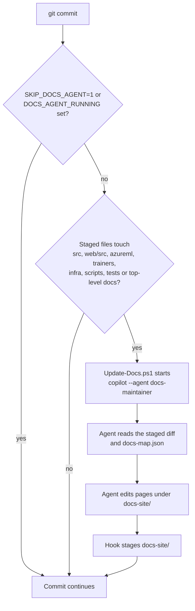

import WhoWhatWhy from '@site/src/components/WhoWhatWhy';

<WhoWhatWhy
  who="Anyone who commits to this repository."
  what="A pre-commit hook that asks a Copilot agent to update these docs for the staged change, then stages the edits in the same commit."
  why="Docs written once and never touched go stale within a sprint. Putting the update in the commit keeps the code and its explanation in one reviewable diff."
/>

# Documentation automation

## Turn it on

Hooks live in `.githooks/`. Git ignores them until you point it there, once per clone:

```powershell
pwsh scripts/Install-GitHooks.ps1
```

You need the `copilot` CLI on your PATH and signed in. Without it the hook prints a note and the commit goes ahead.

## What happens on commit



The agent definition is `.github/agents/docs-maintainer.agent.md`. It may edit only `docs-site/`, it cannot run `git commit`, `git add` or `git push` (the hook denies them), and it has to follow the same prose rules as every other page: read the humanize-writing skill, then run `node docs-site/scripts/check-prose.mjs` on what it changed.

The hook always lets the commit through. A timeout (15 minutes by default), a CLI error or a missing CLI becomes a warning. The agent's output is in the temp folder as `docs-agent-<timestamp>.log`.

## The docs map

`docs-site/docs-map.json` lists which source paths each page describes. The agent starts there and adds a line when it finds code with no page. If you add a new area, add its entry in the same commit.

## Skip it once

```powershell
$env:SKIP_DOCS_AGENT = '1'; git commit -m "wip"
```

## Check the result before you push

The agent is fast and wrong sometimes. Read the staged `docs-site/` diff the way you would read a teammate's change, and run the site build, which fails on broken links:

```powershell
cd docs-site
npm run build
node scripts/check-prose.mjs
```

## CI checks

`.github/workflows/docs.yml` runs on pushes and pull requests, or by manual dispatch. It uses Node.js 22 and the approved CFS npm registry, installs with `npm ci`, then builds the site and scans every documentation page for prose issues. It keeps lockfile URLs unchanged. Runners need access to that feed; the workflow has no public-registry fallback.

The npm audit step is report-only. A successful build on `main`, outside a pull request, uploads the site artifact and deploys it to GitHub Pages.
