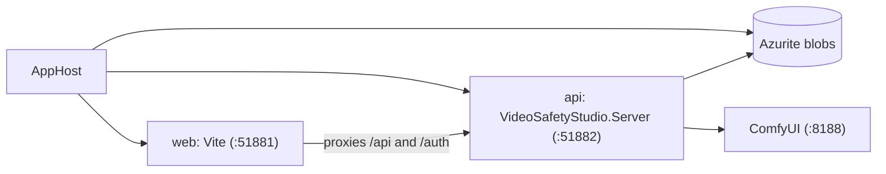

import WhoWhatWhy from '@site/src/components/WhoWhatWhy';

<WhoWhatWhy
  who="Developers setting up a working local environment"
  what="Starting the AppHost, the default ports, restarting only what changed, and running tests."
  why="So you iterate quickly without restarting the whole stack or fighting file locks."
/>

Local work runs under the Aspire AppHost. It starts the .NET server (`api`), the Vite dev server (`web`) and, in ComfyUI mode with the default storage, an Azurite emulator. Sign-in is off in Development (`Auth:Mode` defaults to `None`).



## Prerequisites

- .NET 10 SDK and the Aspire CLI
- Node.js for the web app in `web\`
- ffmpeg on the PATH if you use the vision builder (`FfmpegMediaTools`)
- Docker with a GPU only for training runs
- A ComfyUI server with the Wan 2.2 models for the `comfyui` provider, or `az login` and the `AzureMl:*` settings for the `azureml` provider

## Configure

Generate the git-ignored `src\VideoSafetyStudio.AppHost\appsettings.Development.json` with the helper script:

```powershell
.\scripts\Initialize-LocalDev.ps1                      # Azurite + ComfyUI at http://localhost:8188
.\scripts\Initialize-LocalDev.ps1 -Provider azureml    # Azure ML provider instead
.\scripts\Initialize-LocalDev.ps1 -Storage local -StoragePath \\nas\wan
```

The AppHost's own default provider is `comfyui`, and it always passes `Generation__Provider` to the server. For `azureml` it forwards every `AzureMl:*` and `Auth:*` key and `KeyVault:Uri` from its configuration. See [Configuration](../architecture/configuration.mdx) for the rules.

To enable the video helper, set `Agent:Endpoint` and `Agent:Model` in the same file. Key auth adds a secret parameter, `agent-api-key`, that the dashboard prompts for.

## Run

```powershell
aspire ps                       # is an AppHost already running?
aspire start --non-interactive  # only if none is
aspire describe                 # resources and state
aspire logs api                 # logs for one resource
```

:::warning
If an AppHost is already running, leave it running. Start one only when `aspire ps` shows none, and stop or restart it only when `AppHost.cs` itself changed (resources, parameters, environment wiring, packages).
:::

| Service | Default address | Override |
|---|---|---|
| UI (Vite) | `http://localhost:51881` | `Ports:Web` |
| Server API | `http://localhost:51882` | `Ports:Api` |
| ComfyUI | `http://localhost:8188` | parameter `comfyui-url` |

Running the Server project on its own uses `http://localhost:5288` from `launchSettings.json`. But then there is no AppHost to set the provider, so pass `Generation__Provider=comfyui` or the server will try to start the Azure ML provider.

## Restart only what you changed

| You changed | Run |
|---|---|
| .NET code in `src\` | `aspire resource api rebuild` (or `restart` if nothing needs compiling), then `aspire wait api` |
| Web code in `web\` | Nothing. Vite hot-reloads. If needed, `aspire resource web restart`. |
| `AppHost.cs` or AppHost settings | Restart the AppHost |
| Workflow JSON templates | `aspire resource api rebuild`. The server reads them from a `Workflows` folder copied to its output, so edits in `src\` need a build. |

Prefer `aspire describe`, `aspire logs` and `aspire otel traces|logs` over restarting to see what happened. Every generation emits a `generation.job` span with a child span per workflow stage, plus the `wan.generation.*` metrics.

## Tests

```powershell
dotnet test tests\VideoSafetyStudio.Tests
```

While the AppHost holds the server binaries, a normal test build cannot overwrite them. Build through the AppHost with `aspire resource api rebuild`, and run tests into a separate output folder:

```powershell
dotnet test tests\VideoSafetyStudio.Tests --artifacts-path .artifacts
```

More patterns are in the [testing guide](./testing.mdx).

## Gotchas

- The UI pushes updates over SSE. If the page looks stale, check `GET /api/events` in the browser network tab before suspecting the server.
- With `Retrieval=share` and a UNC output path, the AppHost asks for `comfyui-smb-user` and `comfyui-smb-password` parameters. Set them as environment variables or user secrets, not in a committed file.
- The default Azurite container is persistent (a data volume). Delete the volume to reset library and vision data.
- Training needs the `trainers\yolox` image built first: `docker build -f trainers/yolox/Dockerfile -t wan-trainer-yolox:dev trainers`. Pass `--build-arg PIP_INDEX_URL=<feed>` on machines that only reach the approved package feed.
- The dataset builder routes stay hidden until `FEATURE_DATASET_BUILDER_ENABLED=true` is set in the server's environment. `AppHost.cs` does not forward it explicitly, so confirm it reached the `api` resource with `aspire describe` or `GET /api/features`.
