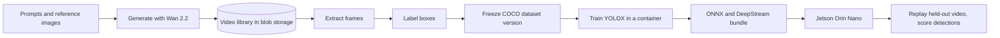

import WhoWhatWhy from '@site/src/components/WhoWhatWhy';

<WhoWhatWhy
  who="Developers who change or extend the platform"
  what="What the studio does end to end, and which page covers which part of the backend."
  why="So you can find the right layer before you start editing."
/>

WAN Safety Studio is an accelerator that closes a loop most vision teams do by hand. It generates synthetic video of safety hazards and equipment failures with Wan 2.2, lets a person label that video with bounding boxes, trains an Apache-licensed YOLOX detector on the result, and then checks the detector on a Jetson Orin Nano by replaying a held-out generated video as a virtual camera.

Two groups use it. Approved video creators (an Entra security group) write prompts and collect footage. Customer AI engineers build datasets and train detectors for their own equipment, and they can bring their own trainer.

The reason it exists is cost and control. Real footage of a gas leak or a failed flange is rare and hard to stage. Synthetic footage is cheap per clip. But only if generation, labelling and training sit in one place with the spending limits visible. Everything except the Jetson runs in the customer's Azure subscription.

## End-to-end flow

Generation runs either on a local ComfyUI server (development) or as Azure ML command jobs on one GPU node. The labelling and training half is behind a feature flag: the dataset builder routes only exist when `FEATURE_DATASET_BUILDER_ENABLED=true`. Without it the server answers `/api/features` with `datasetBuilder: false` and maps no `/api/vision` endpoints.

## What is in the repo

| Path | What it holds |
|---|---|
| `src\` | The .NET 10 solution: `Domain`, `Application`, `Infrastructure`, `Server`, plus `AppHost` and `ServiceDefaults` for Aspire. |
| `tests\VideoSafetyStudio.Tests` | One xUnit project for every layer. |
| `trainers\` | Python trainer containers and the SDK they implement. |
| `azureml\` | The Python operator control plane for the Azure ML node. |
| `web\` | The React UI. |
| `docs\` | Older working notes. These pages replace them where the two disagree. |

## Where to read next

| If you want to | Read |
|---|---|
| See how the projects depend on each other | [Architecture overview](./architecture/overview.mdx) |
| Follow one generation from browser to stored video | [Request flow](./architecture/request-flow.mdx) |
| Know where files and job records live | [Storage and state](./architecture/storage-and-state.mdx) |
| Change a setting or add one | [Configuration](./architecture/configuration.mdx) |
| Work on queueing, modes or workflow templates | [Generation](./domains/generation.mdx) |
| Work on the Azure ML path or add a backend | [Azure ML provider](./domains/azure-ml-provider.mdx) |
| Change the prompt assistant | [Video helper agent](./domains/video-helper-agent.mdx) |
| Touch sign-in or CSRF | [Auth](./domains/auth.mdx) |
| Work on datasets, labels or trainers | [Vision and training](./domains/vision-and-training.mdx) |
| Find an endpoint | [Server API](./domains/server-api.mdx) |
| Run the stack locally | [Local development](./guides/local-development.mdx) |
| Write or run tests | [Testing](./guides/testing.mdx) |
| Plug in another detector | [Add a model trainer](./guides/add-a-model-trainer.mdx) |

Hosting in Azure, the React UI and the Python control plane have their own sections. This one covers the backend.

:::note
The older files in `docs\` were written while the backend moved from Python to .NET. Where this site and those notes disagree, this site was checked against the code. For example, `PRODUCT.md` and `docs\video-helper.md` still say the .NET server has no sign-in, but `Server\Auth` implements it.
:::
