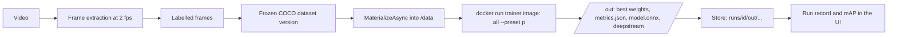

import WhoWhatWhy from '@site/src/components/WhoWhatWhy';

<WhoWhatWhy
  who="Developers working on detector training and the path to the Jetson Orin Nano"
  what="The flow from labelled frames to a trainer container's outputs, which parts exist in code today, and which are only in the plan."
  why="So nobody builds on a stage that is still a proposal, and so the first GPU run has a checklist of what has never been tried."
/>

The goal, from `docs\vision-training-plan.md`, is a closed loop: generate synthetic safety video, label it, train a small detector, and check it on a Jetson Orin Nano Super by replaying a held-out generated video as a virtual camera. Only the middle of that loop has code. This page separates the two.

## Status at a glance

| Stage | State | Where |
|---|---|---|
| Import or upload a video, extract frames | Built | `VisionService`, `/api/vision/.../videos` |
| Draw and review bounding boxes | Built | [Vision dataset UI](../web-ui/vision-dataset-ui.mdx) |
| Freeze a versioned COCO dataset, split by source video | Built | `VisionService`, `POST /datasets` |
| Write the dataset in the trainer layout | Built | `TrainingService.MaterializeAsync` |
| Run a trainer container on the local GPU | Built, **not yet run on a GPU** | `DockerComputeTarget` |
| YOLOX train, evaluate, export ONNX | Written, **unverified on hardware** | `trainers\yolox\` |
| DeepStream `nvinfer` config and labels | Written, **parser unverified** | `trainers\yolox\deepstream.py` |
| Run record, metrics, live updates in the UI | Built | `TrainingService`, `Train` panel |
| Train on the Azure ML node | Planned | only the local Docker target exists |
| Auto-labelling with a detector or SAM | Planned | not in the API |
| Edge bundle zip, bundle and eval endpoints | Planned | no routes exist for them |
| Orin Nano run, RTSP virtual camera, scoring | Planned | no code in the repo |
| Real-image validation set | Planned | the plan calls for it |

No trained model and no edge result exist yet. Any mAP you see in the UI came from a test or a smoke run. Do not quote it as accuracy.

## The flow that exists



The server does not import any model library. It runs a container, mounts two folders, and reads files back. `TrainingService` owns the sequence:

1. `StartAsync` validates the trainer, preset (against the manifest), epochs (1 to 1000) and that the dataset version exists. It takes a single-slot lock. A second start while one is running throws `ConflictException`, which the API turns into a 409 with "The GPU node is busy with another job."
2. The run record is saved as `Queued` and the work moves to a background task. The HTTP call returns right away.
3. `Preparing`: the dataset is written into a temp folder as `classes.json`, `train.json`, `val.json` and `images\`.
4. `Running`: `compute.RunAsync(image, ["all", "--preset", p, "--epochs", n], data, output, logPath)`.
5. `Uploading`: everything under `/out` is copied to the store under `runs/<id>/out/`, including `train.log`, even when the trainer failed.
6. A non-zero exit becomes `Failed` with the first 500 characters of the message. Otherwise `metrics.json` is parsed and the run is `Completed`.

Each status change is saved and published as a `run` server-sent event, which is what the Train panel listens to.

## The compute target

Only one `IComputeTarget` exists, `DockerComputeTarget`. It is a thin `docker run`:

```csharp title="src/VideoSafetyStudio.Infrastructure/Compute/DockerComputeTarget.cs"
foreach (var argument in new[] { "run", "--rm", "--gpus", gpus, "--shm-size", shmSize, "-v", $"{Path.GetFullPath(dataDirectory)}:/data:ro", "-v", $"{Path.GetFullPath(outDirectory)}:/out", image }.Concat(args))
{
    info.ArgumentList.Add(argument);
}
```

Defaults are `--gpus all` and `--shm-size 8g`. The plan describes an Azure ML target that would run the same image on the shared Spot node, with training deferring to generation. That target is not written. If you add it, implement `IComputeTarget` and keep the same image and arguments, so a run is reproducible on either.

## What the YOLOX trainer does

`trainers\yolox\trainer.py` implements the SDK's four methods by calling the upstream YOLOX tools inside the container. The trainer code and release weights are Apache-2.0.

| Step | What runs |
|---|---|
| Layout | `layout.py` copies the dataset into `annotations\instances_{train,val}2017.json` and `{train,val}2017\`, the layout YOLOX's `COCODataset` reads |
| Train | `tools/train.py -f exp.py -d 1 -b <batch> --fp16 -o -c <weights>`, resuming with `--resume` when asked |
| Evaluate | `tools/eval.py ... --fuse`, then `parse.py` reads the pycocotools text for AP50, AP50:95 and per-class AP |
| Export | `tools/export_onnx.py --opset 11 --batch-size 1` |
| DeepStream | `deepstream.py` renders `config_infer_primary.txt` and `labels.txt` |

The presets come from `presets.py`:

```python title="trainers/yolox/presets.py"
PRESETS = {
    "nano": Preset("yolox-nano", 416, "yolox_nano.pth", 32, 100),
    "tiny": Preset("yolox-tiny", 416, "yolox_tiny.pth", 32, 100),
    "s": Preset("yolox-s", 640, "yolox_s.pth", 16, 100),
}
```

Fields are the YOLOX experiment name, input size, weight file, batch size and default epochs. `exp.py` renders a per-run `Exp` subclass with the class count, paths, epoch count, warmup and no-augmentation epochs derived from the total (`min(5, max(1, epochs // 10))` and `min(15, max(1, epochs // 5))`), which is YOLOX's documented way to customize an experiment.

Training starts from COCO-initialized release weights baked into the image, under `/weights`, with their SHA-256 list in `/weights/SHA256SUMS`. The COCO annotations are CC BY 4.0, so a model card has to carry attribution.

## What nobody has verified

The Dockerfile and `docs\vision-trainers.md` both say it: the image has not been built and run on a GPU. The plan calls this "Phase 0". These are the open checks, and each is a place the pipeline may fail on first contact:

- **PyTorch and CUDA pair.** The base image is `pytorch/pytorch:2.5.1-cuda12.4-cudnn9-runtime`. Which pair works on your GPU is unrecorded.
- **ONNX export flags.** `--opset 11` with `tools/export_onnx.py` is the documented YOLOX default and nothing more. Whether TensorRT on the Orin accepts the graph is untested.
- **The DeepStream parser.** The generated config names `NvDsInferParseYolo` and a custom library, `nvdsinfer_custom_impl_Yolo`, from the community DeepStream-Yolo project. The generated notes say to build it on the Orin and "VERIFY against DeepStream 9.1 before relying on it". It is not yet known whether the parser decodes this YOLOX export (raw head output or decoded).
- **Speed.** FLOPs from the YOLOX model zoo do not predict latency on an Orin Nano. The plan asks for measured fps for Nano, Tiny and s at FP16 and INT8.
- **The local GPU.** The plan names a throttled mining-class card as the dev runner. Treat it as a functional target only.

What the config does fix, for the record: BGR input with `net-scale-factor=1.0`, FP16 (`network-mode=2`), `cluster-mode=2`, NMS IoU 0.45, pre-cluster threshold 0.25, top-k 300. The first run on the Jetson builds the TensorRT engine from `model.onnx`; the Azure side ships ONNX and config, never an engine.

## Limits to keep in view

Synthetic video shows that the pipeline works and says nothing about real-world accuracy. Datasets are split by source video, never by frame, or the metrics leak. A human must confirm boxes. The plan's remedy for the synthetic-to-real gap is a small set of real validation images, so the demo shows the gap instead of hiding it. But that set does not exist yet.

Licences get the same scrutiny as code. The project ships only permissive trainers (YOLOX). Ultralytics YOLO is excluded for its AGPL licence. Other models come in through the [trainer contract](./trainer-containers.mdx), with both code and weights licences recorded in `trainer.json`.
