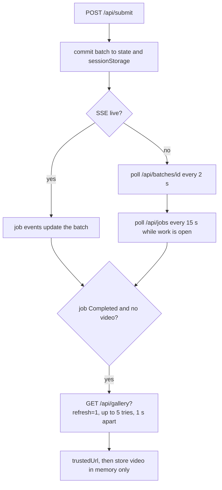

import WhoWhatWhy from '@site/src/components/WhoWhatWhy';

<WhoWhatWhy
  who="Developers changing the Create form, job tracking or the video library"
  what="Scene state, the submit payload, batch tracking and its polling fallback, video naming, and the library grid."
  why="So you can add a form control or change tracking without breaking resume-after-reload or the one-GPU-job-per-take cost rule."
/>


## Scene state

A request is up to five scenes (`MAX_SCENES` in `features\create\scenes.ts`), each with a reference image, a name and a prompt, multiplied by 1, 3 or 5 takes (`TAKE_OPTIONS`). Every take is one GPU job, so the form shows the product before you submit:

```ts title="web/src/features/create/scenes.ts"
export const MAX_SCENES = 5;
export const TAKE_OPTIONS = [1, 3, 5] as const;

export const totalJobs = (scenes: number, takes: number): number => scenes * takes;

export const batchSummary = (scenes: number, takes: number, mode?: string | null): string => {
  const base = `${plural(scenes, 'scene')} × ${plural(takes, 'video')} = ${plural(totalJobs(scenes, takes), 'GPU job')}`;
  return mode ? `${base} · ${mode}` : base;
};
```

`CreateView` holds the scene list in `useState`. Each scene carries a stable numeric `key` from a module counter, which the DOM ids and focus management use (`scene-<key>-prompt`):

```tsx title="web/src/features/create/SceneEditor.tsx"
export interface Scene {
  key: number;
  prompt: string;
  file: File | null;
  /** null while the user has not edited it, so the default follows the image and scene position. */
  name: string | null;
}
```

Scene 1 is required and cannot be removed. Scenes 2 and up reuse scene 1's image unless you pick another one (`imageRequirementLabel`). Dropping files onto the upload area accepts exactly one image and reports an error otherwise.

### Video names

The `name` field is `null` until the user types. While it is `null` the input shows a default computed from the image file name and the scene position:

```ts title="web/src/features/create/scenes.ts"
export const MAX_NAME_LENGTH = 50;

/** The reference image's name without its extension plus the scene number; later scenes reuse Scene 1's image. */
export const defaultVideoName = (file: File | null, index: number): string =>
  file ? `${file.name.replace(/\.[^.]*$/, '')} Scene ${index + 1}`.slice(0, MAX_NAME_LENGTH) : '';
```

Storing `null` lets the name follow a changed image. Copy the default into state on first render and replacing the image leaves a stale name behind. The name is sent as `scene_name` and shows in the library as `display_name`.

### Quality modes

Modes (`draft`, `fast`, `turbo`, `prime` on the server today) come from `GET /api/modes`, and the UI hardcodes none of them. `fetchModes` resolves to `null` on a 404, which is how a host without mode support looks. `resolveMode` picks the saved choice if it is still available, then the server default, then the first available mode. A mode whose workflow file is missing arrives with `available: false` and the form lists it as unavailable.

## Submitting

`onSubmit` builds one `FormData` and posts it to `/api/submit`. Prompts, names and images go out as repeated or indexed form fields (there is no JSON body):

```tsx title="web/src/features/create/CreateView.tsx"
const form = new FormData();
form.set('profile', 'wan');
scenes.forEach((scene, index) => {
  form.append('prompt', scene.prompt);
  form.append('scene_name', (scene.name ?? defaultVideoName(scene.file ?? files[0] ?? null, index)).trim());
  const file = files[index];
  if (file) form.append(`input_image_${index}`, file);
});
form.set('aspect_ratio', aspect);
form.set('duration_seconds', String(duration));
form.set('takes', String(takes));
form.set('negative_prompt', negativePrompt);
if (modeInfo && mode) form.set('mode', mode);
```

Before that, the handler refuses to run while a batch is still submitting, when generation is disabled, when the browser's own validation fails, and when the combined image size exceeds `environment.maxUploadMb`. If a submission is not confirmed, the UI says so and does not retry. Don't add an automatic retry here. A retry after a timeout could queue the same GPU jobs twice, and each one costs money.

Aspect ratios offered are `16:9` (1024 × 576), `4:3` (896 × 672) and `1:1` (768 × 768). Duration is 5 to 10 seconds. If you change either list, the helper tool limits in `helper\formTools.ts` and on the server need the same change. See [Video helper UI](./video-helper-ui.mdx).

## Batch tracking

`useJobTracker` owns everything after the POST. The server returns a `Batch` immediately and keeps submitting jobs one at a time in the background. But the page can be closed meanwhile, and the hook has to cope with that.



Points worth knowing before you edit it:

- **State in refs.** Timers and event handlers read `batchRef` and `openRef`, never stale closures. `commit` is the single place that updates the batch, saves it and calls `setBatch`.
- **Persistence.** `saveBatch` writes the batch to `sessionStorage` but strips `video` and `videoChecks`, because signed video URLs are not stored. After a reload `loadSavedBatch` restores the batch and the hook fetches the URLs again.
- **Terminal statuses** are `Completed`, `Failed`, `Canceled`, `Cancelled` and `NotResponding` (`isTerminal` in `batch.ts`). A job that is not terminal keeps the poll loop alive.
- **Video lookup.** A completed job without a video URL is looked up in the gallery. `needsVideoLookup` allows three checks per job in the poll loop (`MAX_VIDEO_CHECKS`), and the event path retries five times at one second spacing.
- **Open jobs.** `mergeJobs` lists the batch's own jobs first, then any other unfinished jobs on the same compute, because they share one GPU and run in order.
- **Failure wording.** Error messages tell the user not to submit the same request again when job state could not be read. Keep that when you add new error paths.

The progress text under a running job comes from `progress.ts`, which maps stage ids such as `sample_high_noise` to labels and appends `step/maxSteps`.

## Video helper wiring

`CreateView` also hosts the helper panel (lazy-loaded) and passes it three callbacks: apply a tool call, read the live form, and list scene images. The form state it exposes is rebuilt on every render, so a tool call always sees what the controls show. The details are on the [Video helper UI](./video-helper-ui.mdx) page.

## Library


`LibraryView` loads `GET /api/gallery?refresh=1` and `GET /api/archived` in parallel every time it becomes active and on **Refresh library**. The gallery response has `items`, `count` and `scanned_jobs`; the archive response has an `archived` array of job names. Either request failing fails the load and reports an error.

When videos are loaded, the status line reads "N of M completed videos shown across J recent jobs." N counts all matches after filtering, including those on other pages; M is the gallery's unfiltered count.

Every item's `video_url` is checked with `trustedUrl(url, 'blob', storage)`. One untrusted URL fails the whole load with an error. That is stricter than skipping the bad item, and I think it is the right call. A URL outside the workspace's storage means the response itself is wrong.

```tsx title="web/src/features/library/LibraryView.tsx"
const trusted = data.items.map((item) => {
  const url = trustedUrl(item.video_url, 'blob', storage);
  if (!url) throw new Error("A video URL does not belong to this workspace's private storage.");
  return { item, url };
});
```

The grid card shows the video, `display_name` (falling back to the job name), `width × height`, duration and the mode label, then the recorded prompt. The aspect ratio of the player comes from `ratioClass`, which maps the real width and height to the nearest of five classes so no inline style is needed:

```ts title="web/src/features/library/LibraryView.tsx"
const RATIOS = [
  { name: 'ratio-16-9', value: 16 / 9 },
  { name: 'ratio-4-3', value: 4 / 3 },
  { name: 'ratio-1-1', value: 1 },
  { name: 'ratio-3-4', value: 3 / 4 },
  { name: 'ratio-9-16', value: 9 / 16 },
];
```

Add an aspect ratio to Create without adding the class to `app.css` and an entry here, and the library will show its nearest neighbor.

### Search, sort and pages

`pageLibrary` in `libraryPaging.ts` filters and pages the loaded items in the browser. It does not fetch another page from the server.

- **Search name or prompt** trims the query and matches a case-insensitive substring against the displayed name and prompt. The displayed name is `display_name`, falling back to `job_name`.
- **Newest first** keeps the server's descending creation order and is the default. **Oldest first** reverses it. **Name A-Z** compares displayed names with `localeCompare`.
- Pages contain 25 videos (`PAGE_SIZE`). **Previous** and **Next** appear only when more than 25 items match. Changing a filter or sort returns to the first page, as does a successful reload. If archiving removes the last item on a page, the page number is clamped to the last remaining page.

The "No completed videos yet" panel appears only when the gallery itself is empty. A search with no matches, or hiding every video through archiving, leaves an empty grid instead.

### Shared archiving

Each card has **Archive** or **Unarchive**. Archived videos are hidden by default; **Show archived** includes them alongside other videos so they can be unarchived. Archiving only changes visibility in this view. It does not delete the video or remove it from `GET /api/gallery`.

The button posts the job name and the desired state, then replaces the local archive set with the server's full response:

```tsx title="web/src/features/library/LibraryView.tsx"
const saved = await api.post<ArchivedResponse>('/api/archived', { json: { jobName, archived: !archived.has(jobName) } });
setArchived(new Set(saved.archived));
```

The clicked video's button is disabled while its request is pending. A failed request reports an error and leaves the local archive set unchanged.

Archive choices are shared by everyone using the same object store and survive server restarts. But archiving emits no SSE event. Refresh or reopen the Library to pick up another browser's changes. See [Server API](../domains/server-api.mdx#generation) for the request contract and [Storage and state](../architecture/storage-and-state.mdx#shared-video-archive) for persistence and concurrency limits.
