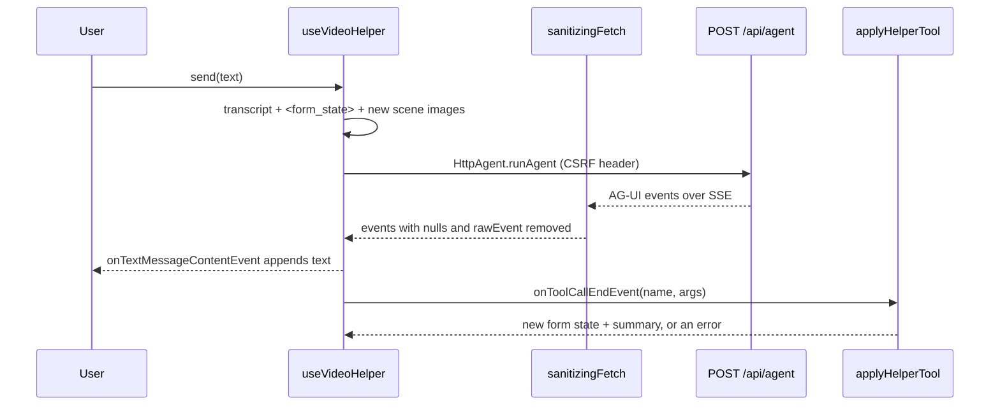

import WhoWhatWhy from '@site/src/components/WhoWhatWhy';
import Steps from '@site/src/components/Steps';

<WhoWhatWhy
  who="Developers extending the Create page's AI helper"
  what="The AG-UI client hook, the stream cleaner, the form tools that apply the model's actions, and the full path for adding one more tool."
  why="So the model can only do what the form's own controls allow, and a new control does not need changes in more places than it should."
/>

The helper is a chat panel on the Create page. It writes and improves prompts, and it can operate the form. The server side (Microsoft Agent Framework, the BYOK endpoint settings) is covered in [Video helper agent](../domains/video-helper-agent.mdx). This page is about the browser.

## The pieces



| File | Job |
|---|---|
| `helper\useVideoHelper.ts` | Status check, message list, building the request, running the agent |
| `helper\sseSanitize.ts` | Cleans the event stream before the AG-UI client parses it |
| `helper\formTools.ts` | Pure functions: validate a tool call, return the next form state |
| `helper\images.ts` | Downscales a reference image to a 1024 px JPEG and base64-encodes it |
| `helper\HelperPanel.tsx` | The chat UI. Renders Markdown with Streamdown |

## The client hook

`useVideoHelper` asks `GET /api/agent/status` once. The panel only appears when `status.enabled` is not `false`, and a disabled status carries a `hint` that the panel shows (usually which `Agent` setting is missing).

The server keeps no conversation, so every turn resends the transcript. The hook builds the AG-UI messages itself:

```ts title="web/src/features/create/helper/useVideoHelper.ts"
const content = [
  { type: 'text' as const, text: `${formState()}\n\n${label}${prompt}` },
  ...encoded.map(({ image }) => ({ type: 'image' as const, source: { type: 'data' as const, value: image.data, mimeType: image.mimeType } })),
];
const wire = [
  ...prior.map(({ id, role, text: body }) => ({ id, role, content: body })),
  { id: user.id, role: 'user' as const, content },
];
```

Three details trip people up:

- The live form goes in as a `<form_state>` JSON block in front of the user's text. The model reads the form as it is now, whatever it remembers from earlier turns.
- Each scene's reference image is sent once. A `WeakSet<File>` remembers which files went out already, so the same image is not re-sent on every message. Images are sent only when `status.vision` is true.
- `@ag-ui/client` is imported with a dynamic `import()` inside `send`, and `HelperPanel` itself is `lazy()` in `CreateView`. Users who never open the helper never download either.

Text arrives through `onTextMessageContentEvent` and is appended to the reply. Tool calls arrive through `onToolCallEndEvent`, which hands the name and arguments to the `applyTool` callback and records the returned summary on the message, so the panel can show "Updated the prompt for scene 2" under the reply.

## Why the stream is sanitised

The Agent Framework server writes optional AG-UI fields as explicit `null` (`"parentRunId": null`) and adds a `rawEvent` debug copy to each event. The `@ag-ui/client` schema accepts a missing optional field and rejects a `null`. Left alone, the run dies on the first event.

`sseSanitize.ts` fixes it in the fetch layer. `sanitizingFetch` wraps `fetch`, and if the response is `text/event-stream` it pipes the body through a `TransformStream`. The transform splits on blank lines, so it only rewrites whole SSE blocks, and removes nulls and `rawEvent` from each `data:` line:

```ts title="web/src/features/create/helper/sseSanitize.ts"
const withoutNulls = (value: unknown): unknown => {
  if (Array.isArray(value)) return value.map(withoutNulls);
  if (value !== null && typeof value === 'object') {
    return Object.fromEntries(
      Object.entries(value as Record<string, unknown>)
        .filter(([key, item]) => item !== null && key !== 'rawEvent')
        .map(([key, item]) => [key, withoutNulls(item)]),
    );
  }
  return value;
};
```

Lines that are not `data:` pass through untouched, and a `data:` line that is not valid JSON is left as it was. `sseSanitize.test.ts` covers both. If you upgrade the Agent Framework or `@ag-ui/client`, check whether the nulls are still there before deleting this.

## Form tools

The form belongs to the browser. The server's tool handlers only validate arguments and answer "Applied in the form." so the model learns right away when it asks for something impossible. The real change happens when the page sees the tool call.

`applyHelperTool(form, name, rawArgs, limits)` in `formTools.ts` is a pure function from the current form to either a new form with a summary, or an error:

```ts title="web/src/features/create/helper/formTools.ts"
export type ToolOutcome = { form: HelperForm; summary: string } | { error: string };

    case 'set_takes': {
      const count = whole(args.count);
      if (count === null || !(TAKE_OPTIONS as readonly number[]).includes(count)) return { error: `Takes must be ${TAKE_OPTIONS.join(', ')}.` };
      return { form: { ...form, takes: count }, summary: `Set videos per scene to ${count}` };
    }
```

The current tools are `set_scene_prompt`, `set_negative_prompt`, `add_scene`, `remove_scene`, `set_aspect_ratio`, `set_duration`, `set_takes` and `set_quality`. Limits are imported from the same constants the form uses (`MAX_SCENES`, `TAKE_OPTIONS`), and the aspect ratios and available modes arrive through `HelperLimits`. So the helper can never set a value the controls would refuse.

In `CreateView`, `applyHelperAction` runs the function against a `live` ref, then pushes the result into the real `useState` setters. The ref is rewritten on every render and after every applied call, so two tool calls arriving in the same tick build on each other instead of the second overwriting the first.

An added scene arrives with `key: null`. `CreateView` gives it a real key and keeps the existing scenes' files and names by matching on `key`. But the helper cannot attach images. It changes text and settings, nothing else.

## Add a helper tool, end to end

Say you want `set_seed`. A new tool touches six places, in this order.

<Steps steps={[
  {
    title: 'Declare it on the server',
    body: <>In <code>src\VideoSafetyStudio.Infrastructure\Agent\VideoHelperTools.cs</code>, add an <code>AIFunctionFactory.Create(SetSeed, "set_seed")</code> entry to <code>Create()</code> and a private handler with a <code>[Description]</code> the model reads. The handler validates and returns <code>Applied()</code> or a "Rejected: ..." string. It does not change anything. Mirror any limits you add as constants.</>,
  },
  {
    title: 'Tell the model when to use it',
    body: <>Update <code>VideoHelperInstructions.cs</code> in the same folder if the tool needs guidance, such as when to ask first. <code>VideoHelperAgent</code> builds its allow-list of tool names from <code>VideoHelperTools.Create()</code>, so the name is permitted automatically.</>,
  },
  {
    title: 'Extend the form model if needed',
    body: <>If the control does not exist yet, add the field to <code>HelperForm</code> in <code>formTools.ts</code> and to the <code>live.current = ...</code> object in <code>CreateView.tsx</code>. Include it in <code>formStateBlock</code> so the model can see its current value.</>,
  },
  {
    title: 'Implement the case in applyHelperTool',
    body: <>Add a <code>case 'set_seed'</code> to the switch. Validate with the same rules as the control, using <code>whole()</code> or <code>text()</code> to coerce, and return an <code>error</code> string that tells the model what range is allowed.</>,
  },
  {
    title: 'Apply it in CreateView',
    body: <>In <code>applyHelperAction</code>, push the new field from <code>next</code> into the matching setter, the same way the aspect ratio and duration are.</>,
  },
  {
    title: 'Test both sides',
    body: <>Add a case to <code>formTools.test.ts</code> (accepting a valid value, rejecting an invalid one). On the server, <code>tests\VideoSafetyStudio.Tests\VideoHelperTests.cs</code> exercises the tools. Then <code>npm test</code> and <code>dotnet test tests\VideoSafetyStudio.Tests</code>.</>,
  },
]} />

:::tip
Keep the server and browser limits identical. The server comment says it directly: the handlers "mirror the form". If they drift, the model hears "Applied" and the form then rejects the value, or the reverse.
:::

The existing test file shows the pattern, using a plain `HelperForm` fixture:

```ts title="web/src/features/create/helper/formTools.test.ts"
const ok = (name: string, args: unknown, from = form) => {
  const outcome = applyHelperTool(from, name, args, limits);
  if ('error' in outcome) throw new Error(outcome.error);
  return outcome.form;
};

expect(ok('set_takes', { count: 3 }).takes).toBe(3);
```

## Chat rendering

`HelperPanel` renders assistant text with Streamdown (`import 'streamdown/styles.css'`) and styles it under `.helper-md` in `app.css`. Because Streamdown is a dependency and its stylesheet is a normal imported file, it follows the same CSP rule as the rest of the app: no inline styles. Enter sends, Shift+Enter adds a line, and the Stop button calls `abortRun()` on the active `HttpAgent`. An aborted run is not shown as an error.
