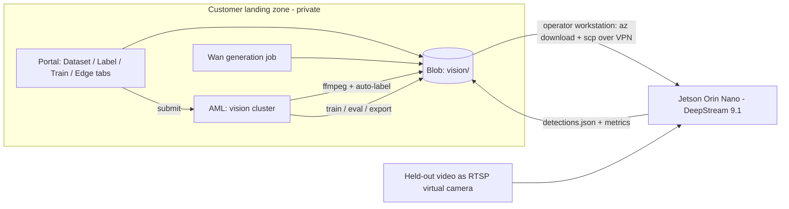

# Vision training and edge validation: plan

Status: proposal for branch `feat/edge-model-training`. Nothing here is built yet.
Items marked **(verify)** are version- or hardware-specific claims to confirm before committing to them.

## 1. Goal

Close the loop from synthetic video to an edge-deployed detector:

```text
Wan generation -> import -> frame extract -> label (auto + human) -> dataset version
   -> train (Azure ML) -> evaluate -> export bundle -> Jetson Orin Nano (DeepStream 9.1)
   -> "virtual camera" replays a held-out Wan video -> detections -> score vs ground truth
```

Everything except the last hop runs in the customer's existing private Azure landing zone. The Orin Nano is the only external device.

## 2. Key decisions

### 2.1 Model choice: not BEVFusion
BEVFusion fuses multi-camera and LiDAR into bird's-eye-view 3D boxes for vehicles. A fixed CCTV-style camera has one view and no LiDAR, so it is the wrong fit and will not run well on an Orin Nano. The task is **2D object detection** on a single stream.

**Constraint: Apache-2.0 (or similarly permissive) only. No Ultralytics YOLO (AGPL-3.0).** The pretrained weights' licence matters as much as the code's; record both per trainer. For YOLOX this is settled: code and released weights are Apache-2.0 and COCO annotations are CC BY 4.0 (attribution only).

| Option | Licence | Fit for Orin Nano + DeepStream | Notes |
|---|---|---|---|
| **YOLOX (Nano/Tiny/s)** | Apache-2.0 code and released weights | Light, anchor-free, simple ONNX output; community DeepStream-Yolo parser exists **(verify fps on Orin Nano)** | **Default.** Weights are initialised from COCO (annotations CC BY 4.0: record attribution in the model card) |
| RT-DETR (R18/R34; PaddleDetection / lyuwenyu / HF Transformers) | Apache-2.0 | NMS-free transformer, strong on small data; needs a custom nvinfer parser **(verify)** | Second plug-in |
| RF-DETR (Nano-Large) | Apache-2.0 for these sizes (XL sizes differ) **(verify)** | Same parser caveat as RT-DETR | Candidate third plug-in |
| NVIDIA TAO (RT-DETR, etc.) | TAO code Apache-2.0; pretrained models under NVIDIA licence **(verify)** | First-class DeepStream path | Use only if the model licence is acceptable |

**Decision:** ship **YOLOX-Nano and YOLOX-s** as presets of one trainer. RT-DETR-R18 is a candidate second plug-in. Customers with licences for other models add them through the trainer architecture in 5.4.
### 2.1a Edge compute budget (Orin Nano Super)
Per the [YOLOX model zoo](https://yolox.readthedocs.io/en/latest/model_zoo.html): YOLOX-s is 9.0 M params / **26.8 GFLOPs at 640**; YOLOX-Tiny 5.06 M / 6.45 GFLOPs at 416; YOLOX-Nano 0.91 M / 1.08 GFLOPs at 416. Those are small workloads next to the Orin Nano Super's 67 TOPS (which is INT8 *sparse* peak; real FP16 throughput and memory bandwidth are much lower), so YOLOX-s should fit comfortably for one or a few streams, but **FLOPs do not predict latency**. Measure in Phase 0: fps and per-frame latency for Nano / Tiny / s at FP16 and INT8, 1 vs N streams, with decode and tracker enabled, at the Super power mode **(verify)**. Add **YOLOX-Tiny** as a middle preset (the docs list Nano/Tiny/s as the mobile-deployment models).

### 2.2 Training compute: make it portable, not A100-dependent
Detector fine-tuning on a few thousand frames needs ~16-24 GB VRAM. An A100 is overkill; do not design around it.

- One training container image, one job spec, **three targets**: AML Spot A100 (existing cluster), a cheaper AML GPU SKU if the customer has quota (A10/T4/V100-class; **verify** per-region availability), and a local Docker runner (your CMP 170HX).
- Spot-safe by default: checkpoint every epoch to Blob, `resume=auto` on restart, AML retry on preemption. This makes Spot A100 reliable enough.
- **Training shares the existing generation node** (no extra A100 capacity). The cluster stays at max 1 node, so GPU jobs serialize. Rules:
  - One GPU job at a time, enforced in the portal with the existing submit lock plus an open-jobs check (`/api/jobs`); a second request is rejected with a clear "node busy" message, not silently queued.
  - **Generation has priority.** Training is checkpointed every epoch, so the portal can cancel a run when someone needs Wan and resume it afterwards from the last checkpoint.
  - Training only runs while the node is Started/armed (same `armed.json` flow and cost guard as generation; training adds no new lifecycle). Time-box each run with `maxJobMinutes`-style limits.
  - When Azure is busy or unavailable, the same job runs on the local CMP 170HX runner.
- CMP 170HX caveats **(verify before relying on it)**: mining-oriented card with throttled FP32/tensor throughput and a narrow PCIe link, so data loading, not VRAM, is the likely bottleneck. Treat it as a functional dev/test target (same container, same code path), not a performance proxy for Azure. Benchmark it in Phase 0 with a 1-epoch run.

### 2.3 Honest limits of synthetic-only proof
- Wan output is 512x512, a few seconds, 16-24 fps. Hazards (leaks, flame, smoke, missing PPE, corroded/failed equipment) are generated from prompts and may be inconsistent. Treat the prompt as a *weak* label; a human must confirm boxes.
- A held-out *generated* video proves the pipeline, not real-world accuracy. Always **split by source scene/seed, never by frame**, or metrics leak. Add a small real-image validation set (public stills) so the demo shows the synthetic-to-real gap instead of hiding it.
- The Orin Nano compiles TensorRT engines **on the device**; the Azure side ships ONNX plus config, not an engine.

## 3. Architecture



No new always-on services. The portal (aiohttp, already in `app\portal.py`) gains routes and a web module; heavy work is AML command jobs; state is Blob. This reuses the existing MSAL sign-in, CSRF, CSP, submit lock, and cost guard.

### 3.1 Storage layout (existing studio container)
```text
vision/projects/<project>/
  project.json                    # classes, trainer, edge target
  sources/<videoId>/video.mp4 + source.json   # origin: wan job | upload | stills
  frames/<videoId>/000123.jpg
  labels/<videoId>/<frame>.json   # boxes, class, state: auto|reviewed|rejected, track id
  datasets/<version>/             # immutable: manifest.json (COCO) + split lists
  runs/<runId>/                   # config, checkpoints, metrics, onnx, report.html
  bundles/<runId>/edge-bundle.zip
  eval/<runId>/<videoId>/         # detections from Jetson + scored report
```
Dataset versions are immutable manifests that point at frames and label files, so a run is reproducible by `datasetVersion + trainerVersion + config`. No database in Phase 1 (YAGNI); revisit if concurrent labelers need locking.

### 3.2 Portal API (new, under `/api/vision/`)
| Route | Purpose |
|---|---|
| `POST projects`, `GET projects` | Create/list; classes defined here |
| `POST projects/{p}/videos` | Import from a Wan job (one click from Gallery), or upload mp4/mov (size capped like `maxUploadMb`) |
| `POST projects/{p}/images` | Upload stills/zip (the "random web images" path) |
| `POST projects/{p}/extract` | AML job: ffmpeg frame sampling (fps / scene-change), dedupe near-identical frames |
| `POST projects/{p}/autolabel` | AML job: pre-label with open-vocabulary detector (Grounding DINO or similar) from class prompts; SAM2 tracking to propagate boxes across frames |
| `GET/PUT labels/{video}/{frame}` | Review UI read/write |
| `POST projects/{p}/datasets` | Freeze a version; split by video/scene |
| `POST projects/{p}/train`, `GET runs/{id}` | Submit/monitor; reuses the `/api/jobs` polling pattern |
| `POST runs/{id}/bundle` | Export ONNX + DeepStream configs |
| `POST runs/{id}/eval` | Score uploaded detections against ground truth |
| `POST runs/{id}/edge-results` | Operator uploads the detections file pulled back from the Orin (no SAS or device-facing endpoint) |

Hosted-mode rules still apply (private host check, group authorization, per-request audit logging). Containers for these jobs are built and pinned the same way as the Wan image in `app\runtime.py` (`prepare`), including the no-public-egress and checksum posture.

### 3.3 Services/code layout (new package, no change to Wan code)
```text
app\vision\
  routes.py        # aiohttp handlers, thin
  store.py         # Blob paths + manifest read/write (one place that knows the layout)
  jobs.py          # builds AML command-job specs (same function for cloud and local runner)
  coco.py          # COCO/YOLO import-export, split logic
  eval.py          # pycocotools mAP, per-class P/R, latency summary
  domain\ ports\ usecases\ adapters\ trainers\   # layered per Section 5.4
vision-runtime\    # separate container image: ffmpeg, torch, trainer deps, auto-label models
edge\              # DeepStream bundle templates + virtual-camera scripts + README
app\web\vision.*   # UI modules
```
Python follows the project standards: separated layers, OpenTelemetry spans around every Azure/AML/Blob call (reuse `TRACER`/`step`).

## 4. Edge side (Orin Nano, DeepStream 9.1)

Confirm the JetPack/DeepStream/TensorRT compatibility matrix for Orin Nano with DeepStream 9.1 **(verify)** and pin it in `edge\README.md`.

**Bundle contents** (`edge-bundle.zip`): `model.onnx`, `labels.txt`, `config_infer_primary.txt` (nvinfer, FP16 default, INT8 optional with calibration frames), `deepstream_app_config.txt` or a small Python GStreamer app, `run.sh`, `bundle.json` (dataset version, run id, classes, input size, SHA-256).

**Pipeline:** `rtspsrc/filesrc -> nvstreammux -> nvinfer(PGIE) -> nvtracker -> nvdsosd -> sink`, plus `nvmsgconv/nvmsgbroker` or a file writer for detections. First run builds the TensorRT engine; cache it.

**Virtual camera:** the held-out Wan video is served as an RTSP stream on the Orin (MediaMTX or `gst-rtsp-server` fed by `ffmpeg -re -stream_loop -1`), so DeepStream consumes it exactly as it would a real camera (reconnect, decode, latency). A `--file` fallback runs without RTSP.

**Transport (no IoT Hub, no device-facing storage access):** the operator workstation is the proxy. It already has private connectivity and data-plane access to Blob, so a script (`edge\Sync-EdgeDevice.ps1`, wrapped by `wan-vision edge push|pull`) does: download the bundle (and the held-out video) from Blob with the operator's Azure CLI credentials, verify the SHA-256 in `bundle.json`, `scp` to the Orin over the VPN, run `run.sh` over `ssh`, `scp` back `detections.json` and `metrics.json`, and upload them to `eval/`. The Orin holds no Azure credentials and never talks to Azure.

**Return path:** `run.sh` writes `detections.json` (frame, class, box, score, track id, timestamp) plus `metrics.json` from `tegrastats` (fps, per-frame latency, GPU/mem), to a local folder on the Orin.

**Scoring** happens in Azure (`eval.py`): match detections to ground-truth boxes by IoU per frame, report mAP@0.5 and 0.5:0.95, per-class precision/recall/confusion, time-to-first-detection for hazard events, and device fps/latency. Output is an HTML report linked in the portal.

## 5. Making it easy for customer AI engineers

### 5.1 Principle: opinionated defaults, every stage replaceable
Each stage reads and writes open formats (COCO JSON, YOLO txt, ONNX, plain MP4/JPEG). Engineers can enter or leave at any stage: bring existing labels, label elsewhere, train elsewhere, or only use the Jetson validation.

### 5.2 Workflow in the UI (one new "Vision" area, a stepper)
1. **Project**: name, class list (with a hazard/failure template for oil & gas: leak, flame/fire, smoke, missing PPE, corroded/failed equipment, ... editable), edge target.
2. **Sources**: import from Gallery (one click), upload video, upload stills/zip. Shows provenance and licence note per source.
3. **Label**: frame filmstrip, box drawing, class hotkeys, **accept/reject pre-labels**, track-propagation ("apply to next N frames"), review queue sorted by lowest auto-label confidence. Keyboard-first.
4. **Dataset**: split by scene, class balance chart, empty-frame ratio, duplicate warnings, then freeze a version.
5. **Train**: pick trainer + size preset (Nano/Small/Medium), compute target (Azure Spot / local), estimated cost and time; live loss/mAP; one-click resume.
6. **Evaluate**: confusion matrix, worst failures as image galleries (this is what engineers actually use to improve a dataset).
7. **Deploy to edge**: download the bundle, or run the displayed `wan-vision edge push` command from the VPN-connected workstation.
8. **Validate**: upload Jetson results, view overlay video and score report.

### 5.3 Bring-your-own paths
- Import/export COCO and YOLO; CVAT / Label Studio import for teams with existing labeling tooling.
- "Bring your own model": point at a trainer container image meeting the contract below.
- A CLI (`wan-vision ...`) wrapping the same API, plus a documented notebook, for engineers who prefer scripts over UI.

### 5.4 Trainer plug-in architecture (replace YOLOX without touching the rest)

Defaults: **YOLOX-Nano** (smallest, fastest on Orin Nano) and **YOLOX-s** (better accuracy), both Apache-2.0, exported to ONNX and run through DeepStream nvinfer.

Structure follows CLEAN / ports-and-adapters. Dependencies point inward only: portal and jobs depend on the port, never on a trainer.

```text
app\vision\
  domain\            # pure Python, no I/O: Dataset, Label, Box, Run, Metrics, Bundle
  ports\             # interfaces (typing.Protocol): Trainer, DatasetStore, ComputeTarget
  usecases\          # train_model, evaluate_run, export_bundle (depend only on ports + domain)
  adapters\
    storage\blob.py  # DatasetStore
    compute\aml.py, compute\local_docker.py   # ComputeTarget
  trainers\
    yolox\           # the only code that imports YOLOX
    _template\       # copy to add a model
    registry.py      # name -> trainer, via a manifest directory
```

**The port** (the whole surface a customer implements):

```python
class Trainer(Protocol):
    info: TrainerInfo                        # name, version, licence (code + weights), presets, input size
    def train(self, data: DatasetView, preset: str, out: Path, resume: Path | None) -> None: ...
    def evaluate(self, weights: Path, data: DatasetView) -> Metrics: ...
    def export(self, weights: Path, out: Path) -> OnnxModel: ...     # model.onnx + I/O description
    def deepstream(self, model: OnnxModel, labels: list[str]) -> DeepStreamConfig: ...  # nvinfer cfg + parser lib
```

Rules that keep it replaceable:
- `DatasetView` hands the trainer COCO-format data; the trainer converts to whatever it needs internally. Nothing outside `trainers\<name>\` knows the model's native format.
- The trainer runs in **its own container image**, so its dependencies, CUDA stack and licence never mix with the portal. The job spec runs `python -m trainer <command>`; the same image works on AML and the local runner.
- Metrics are returned in the shared `Metrics` type and logged to AML MLflow, so runs from different models compare directly.
- Everything model-specific for the edge (output tensor layout, NMS, custom parser `.so`) lives in `deepstream()`; the bundle exporter just packages what it returns.
- OpenTelemetry spans are added in the use cases and adapters, not inside trainers.
- The licence in `TrainerInfo` is shown in the UI and written into the model card.

**Adding a model (customers with licences, e.g. Ultralytics YOLO, TAO, RF-DETR XL):**
1. Copy `trainers\_template\` to `trainers\<name>\` and implement the four `Trainer` methods.
2. Add a `Dockerfile` for the trainer image and a `trainer.json` (name, licence, presets, image reference).
3. For DeepStream, provide the nvinfer config and, if the model's output is not already decoded, a custom bounding-box parser; reuse the examples in `edge\parsers\`.
4. Register it by placing `trainer.json` in the configured trainers directory; it appears in the UI's trainer picker.
5. Run the contract test `pytest app\vision\tests\test_trainer_contract.py --trainer <name>`: trains 1 epoch on a 20-image fixture, exports ONNX, and checks the nvinfer config references real files and classes. A trainer that passes works end to end.

**YOLOX trainer implementation notes** (from the [YOLOX custom-data guide](https://yolox.readthedocs.io/en/latest/train_custom_data.html)):
- It supports COCO format natively, so `DatasetView` feeds it directly. Generate an `Exp` file per run (subclass of the base Exp, as in `exps\example\custom`) setting `num_classes`, `depth`/`width` for the preset, dataset paths, and input size.
- Train with `tools/train.py -f <exp> -d 1 -b <batch> --fp16 -o -c <coco-pretrained .pth>`; the head shape mismatch with the COCO weights is handled by YOLOX. `--cache` speeds training but needs RAM, so set it by preset and VM size.
- Their tips map to our presets: start from defaults; for a small dataset or early overfit, lower `max_epoch`/`basic_lr_per_img` and weaken augmentation for small models. Expose epochs, LR and augmentation as preset overrides, not as free-form code.
- `export()` wraps `tools/export_onnx.py`; `deepstream()` emits the nvinfer config plus the YOLOX output parser (the input preprocessing for YOLOX is BGR 0-255 with no normalisation, so the nvinfer scale/offset settings must match) **(verify)**.
- Pin the YOLOX commit in the trainer image.

Customers keep any non-Apache trainer in their own repo or private image registry; this repository ships only the Apache-2.0 YOLOX trainer and the template.
### 5.5 Quality guard rails (cheap, high value)
Dataset lint before training (tiny boxes, boxes out of frame, class imbalance, leakage between splits, near-duplicate frames), a baseline run comparison on every new dataset version, and a model card auto-generated into the bundle (data sources, classes, metrics, known gaps, trainer license).

## 6. Phased build plan

Each phase ends with something demonstrable and its own runnable check.

**Phase 0: Spikes (de-risk, 2-3 days of effort)**
- Benchmark per Section 2.1a. Hand-run on the Orin: DeepStream 9.1 + a stock detector + RTSP virtual camera. Record fps and the exact JetPack/DS versions.
- Hand-train YOLOX on ~200 images in the container on the CMP 170HX and on Azure Spot; confirm ONNX -> Orin engine -> detections. Record time/cost/VRAM per target.
- Try Wan I2V from 5-10 oil & gas stills with hazard prompts; judge how usable the output is as labelled data.
- Exit: go/no-go on model default and compute targets.

**Phase 1: Data in (import + extract + store)**
- `store.py`, `project.json`, video/image import (including from Gallery), AML frame-extract job, Vision tab shell.
- Check: import one Wan video, see frames in the UI.

**Phase 2: Labeling**
- Review UI, label read/write, COCO/YOLO import-export, auto-label job (open-vocabulary + SAM2 tracking), review queue.
- Check: label 100 frames end to end; round-trip COCO export/import is lossless.

**Phase 3: Dataset + training**
- Dataset freeze/split/lint, trainer contract, YOLOX plug-in, `jobs.py` spec for AML Spot (with checkpoint/resume) and local runner, preemption handling (cancel-for-generation, resume), run monitoring UI. No new Terraform: it reuses the existing cluster.
- Check: train on Azure and locally from the same dataset version; kill a Spot node mid-run and confirm resume.

**Phase 4: Export + Jetson validation**
- Bundle exporter, `edge\` templates, virtual camera scripts, `Sync-EdgeDevice.ps1` operator proxy, `eval.py` + report page.
- Check: held-out Wan video scored end to end with a reproducible report.

**Phase 5: Customer enablement**
- Second trainer (RT-DETR-R18), BYO-trainer docs, CLI/notebook, dataset lint/model card, hazard template packs, onboarding doc and a worked oil & gas sample in `docs\`.

**Phase 6 (optional): Fleet and ops**
- IoT Hub/IoT Edge deployment and telemetry (replaces the operator proxy), drift capture (low-confidence frames flow back into the labeling queue), INT8 calibration, multi-camera.

## 7. Infra and security changes
- No new compute in Terraform: training reuses the generation cluster. Keep region only in tfvars (no hardcoded regions or SKUs in code/docs).
- Portal identity: add Storage Blob Data scope for `vision/` only; keep the portal's permissions minimal.
- Jetson access: none from Azure. The operator proxy pushes/pulls over the VPN with the operator's own credentials; no SAS tokens, public endpoints or device identities. Bundle integrity is checked by SHA-256 before `scp`.
- Imported media is untrusted: validate with ffprobe, size/duration caps, and decode inside the container with no network (same pattern as `verify_smoke_videos`).
- Licensing is surfaced, not assumed: trainer license, source-image license/provenance, and the Wan model terms appear on the project and in the model card.

## 8. Public image sourcing for the proof
Prefer images with permissive licenses (Wikimedia Commons CC0/CC-BY, Unsplash/Pexels licenses) and record URL + license in `source.json`. Do not scrape arbitrary security-camera feeds or copyrighted stock; keep the proof set small (~50-200 stills), then expand with Wan I2V and augmentation.

## 9. Open questions
1. Class taxonomy and hazard prompts: see item 4. (YOLOX weights licence is settled.)
2. Decided: training shares the generation node (Section 2.2). Orin access is via the operator-workstation proxy over VPN (Section 4).
3. Later: IoT Hub path if a customer wants managed fleet deployment.
4. Class taxonomy for the demo: confirm the initial hazard/failure list.
5. Is a dataset catalog in Blob enough, or do customers need multi-user locking from day one?
